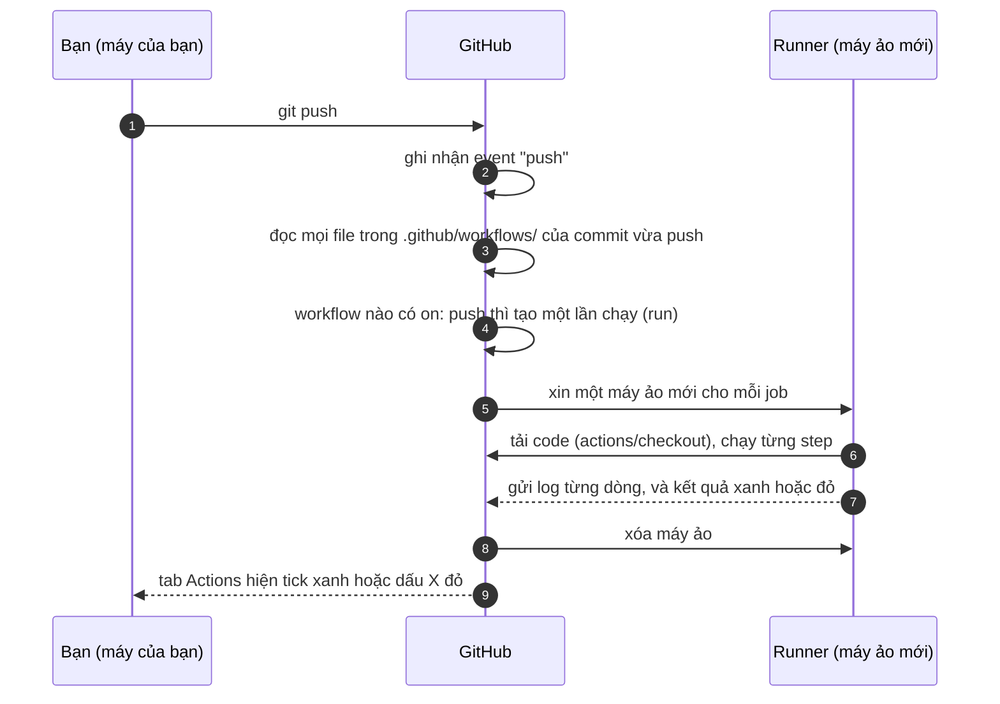
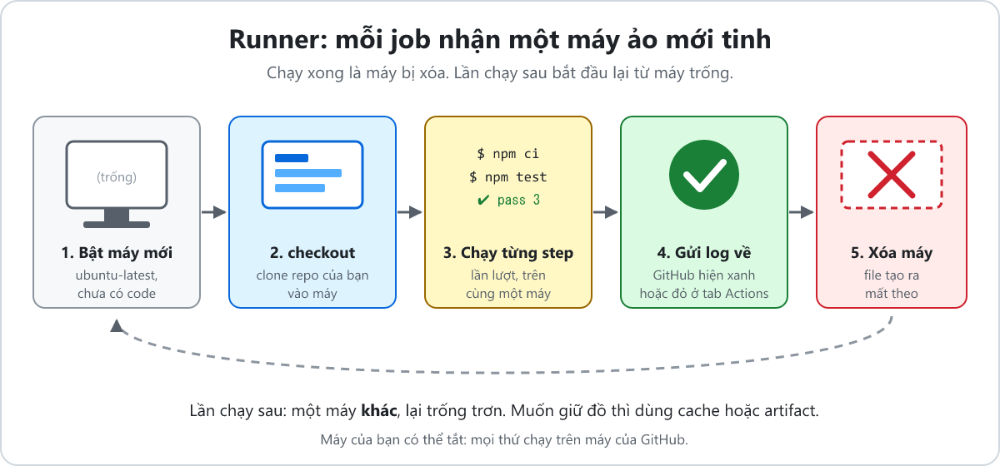
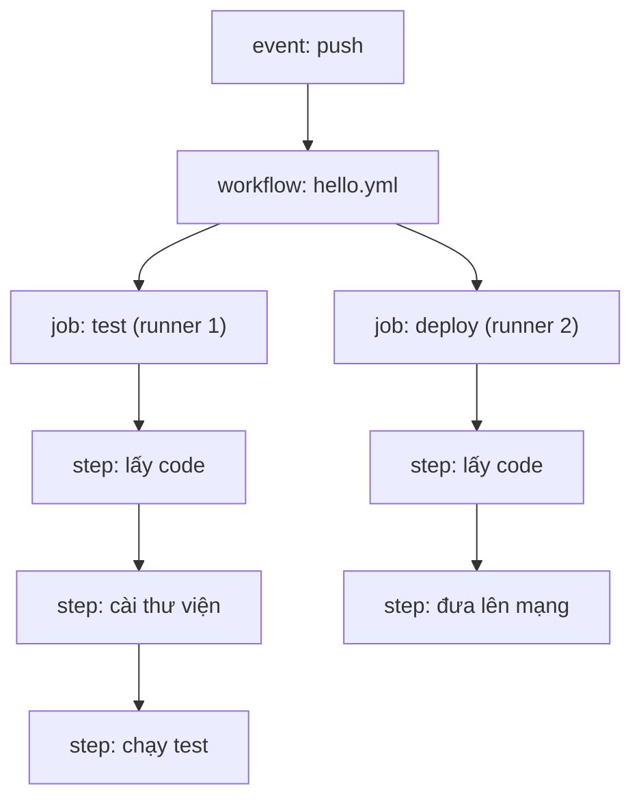

# GitHub Actions là gì, chuyện gì xảy ra khi bạn push

Bạn đã biết commit và push code lên GitHub. Mỗi lần push, có những việc lặp đi lặp lại mà ai cũng nên làm nhưng hay quên: chạy test, kiểm tra link hỏng, build rồi đưa trang web lên mạng. **GitHub Actions** cho GitHub tự làm các việc đó thay bạn, mỗi khi có chuyện xảy ra trong repo.

Bài này chưa viết dòng code nào. Mục tiêu là hiểu **bản chất**: ai làm, làm ở đâu, lúc nào. Hiểu chỗ này thì các chương sau chỉ còn là cú pháp.

## 1. Ví dụ đời thường: tiệm bánh có quy trình

Hình dung một tiệm bánh dán trên tường một tờ **quy trình**:

> "Mỗi khi **có đơn mới**: lấy một bàn bếp trống, lấy nguyên liệu, nhào bột, nướng, đóng hộp. Xong thì lau sạch bàn."

So với GitHub Actions:

| Tiệm bánh | GitHub Actions | Tên tiếng Anh |
| --- | --- | --- |
| Có đơn mới (chuông reo) | Có người push, mở pull request, tới giờ hẹn… | **event** (*sự kiện*) |
| Tờ quy trình dán trên tường | File YAML trong `.github/workflows/` | **workflow** (*quy trình làm việc*) |
| Một ca làm ở một bàn bếp | Một nhóm bước chạy trên cùng một máy | **job** (*công việc*) |
| Từng việc: nhào, nướng, đóng hộp | Từng lệnh hoặc từng action | **step** (*bước*) |
| Bàn bếp trống, lau sạch sau mỗi đơn | Máy ảo mới tinh, chạy xong bị xóa | **runner** (*người chạy*, máy chạy job) |
| Bột trộn sẵn mua ngoài tiệm | Bước đóng gói sẵn, người khác viết | **action** (*hành động*, gói bước dùng lại) |

Chữ "Actions" trong tên sản phẩm và chữ "action" (một gói bước dùng lại) là hai thứ khác nhau. Khi bài nói "một action" là nói gói bước, ví dụ `actions/checkout`.

## 2. Chuyện gì xảy ra khi bạn push

Đây là phần quan trọng nhất của chương. Đi qua từng bước:

**Đọc hiểu**

1. Bạn push. Với GitHub, đó là một **event** tên `push`.
2. GitHub mở thư mục `.github/workflows/` **ở đúng commit bạn vừa push** và đọc mọi file `.yml`. File nào không nằm trong thư mục đó thì GitHub không biết tới.
3. Workflow nào có `on: push` thì GitHub tạo một **lần chạy** (*workflow run*). Workflow có `on: pull_request` thì không chạy, vì event không khớp.
4. Mỗi **job** trong lần chạy được xếp hàng chờ một **runner**.
5. GitHub bật một máy ảo **mới tinh** (Ubuntu, Windows hoặc macOS, tuỳ bạn chọn). Máy có sẵn nhiều công cụ (Git, Node.js, Python, Docker…), nhưng **chưa có code của bạn**.
6. Chương trình runner trên máy đó chạy lần lượt từng **step**. Mỗi dòng in ra được gửi về GitHub, đó là **log** bạn đọc ở tab **Actions**.
7. Một step thất bại thì job dừng và đỏ. Mọi step xong thì job xanh.
8. Job xong, máy ảo bị **xóa hẳn**. Lần chạy sau nhận một máy mới khác.

## 3. Runner khác máy của bạn ở đâu

| | Máy của bạn | Runner do GitHub cấp |
| --- | --- | --- |
| Ở đâu | Trên bàn của bạn | Trong trung tâm dữ liệu của GitHub |
| Có code của repo không | Có, bạn đã clone | **Không**, phải lấy bằng `actions/checkout` |
| File tạo ra có còn ở lần sau không | Còn | **Không**, máy bị xóa sau mỗi job |
| Ai gõ lệnh | Bạn | Chương trình runner đọc file workflow rồi chạy |
| Hệ điều hành | Windows, macOS hay Linux tuỳ máy | Bạn chọn bằng `runs-on`, hay dùng `ubuntu-latest` |
| Tốn tiền không | Không | Repo **public**: miễn phí. Repo private: dùng số phút miễn phí mỗi tháng |

Vì runner luôn mới tinh nên kết quả **lặp lại được**: chạy trên máy bạn thì xanh nhưng runner đỏ, gần như chắc chắn là vì máy bạn có thứ gì đó (một file, một biến, một công cụ) mà repo không có. Đó chính là lỗi mà CI giúp bạn tìm ra.

## 4. Workflow, job, step lồng nhau thế nào

- Một repo có thể có **nhiều workflow** (nhiều file).
- Một workflow có **một hoặc nhiều job**. Mặc định các job chạy **song song**, mỗi job trên một runner **riêng**. Muốn job này chờ job kia, chương 2 sẽ dùng `needs`.
- Một job có **nhiều step**, chạy **lần lượt** trên **cùng một máy**. Step sau thấy được file mà step trước tạo ra.

## 5. Sai lầm thường gặp

| Nghĩ sai | Thật ra |
| --- | --- |
| "Runner có sẵn code của mình." | Runner trống trơn. Thiếu step `actions/checkout` thì lệnh nào đọc file cũng báo `No such file or directory`. |
| "Lần chạy trước đã cài thư viện rồi, lần này khỏi cài." | Máy cũ đã bị xóa. Mỗi lần chạy phải cài lại (chương 5 dùng cache để việc này nhanh hơn). |
| "Hai job trong một workflow dùng chung file." | Mỗi job một máy riêng. Muốn chuyển file giữa job thì dùng artifact (chương 5). |
| "GitHub Actions chạy trên máy mình." | Chạy trên máy của GitHub. Máy bạn tắt cũng không sao. |

## 6. Ngoài thực tế

Ở công ty, việc này có tên là **CI/CD**:

- **CI** = *Continuous Integration*, *tích hợp liên tục*: mỗi thay đổi đều được tự động build và test trước khi gộp vào nhánh chính.
- **CD** = *Continuous Delivery/Deployment*, *giao hàng/triển khai liên tục*: code đã qua kiểm tra được tự động đưa lên server hoặc lên mạng.

Quy trình thường ngày của một lập trình viên: tạo nhánh → commit → mở pull request → **CI chạy test** → bạn cùng nhóm review → merge vào `main` → **CD tự deploy**. Không ai phải nhớ "nhớ chạy test trước khi merge nhé", vì máy làm việc đó mọi lần. GitHub Actions là một công cụ CI/CD; các công ty khác có thể dùng GitLab CI, Jenkins, CircleCI, nhưng ý tưởng event → job → step → runner giống nhau.

## 7. Khi chưa hiểu

| Thắc mắc | Gợi ý |
| --- | --- |
| Không phân biệt được job và step | Job = một máy. Step = một lệnh trên máy đó. |
| Không hiểu vì sao cần runner | Đọc lại mục 3: runner là "máy sạch" để kết quả không phụ thuộc máy ai. |
| Vẫn chưa rõ, hay muốn hỏi thêm | Hỏi mentor của track, công khai hay **nhắn riêng** đều được (tab **Cài đặt** → "Hỏi ở đâu"). |

## Tóm tắt

- **Event** đánh thức **workflow**; workflow gồm các **job**; mỗi job chạy các **step** trên một **runner**.
- Runner là máy ảo mới tinh, chưa có code, chạy xong bị xóa.
- Bài sau viết workflow đầu tiên và xem nó chạy thật.
