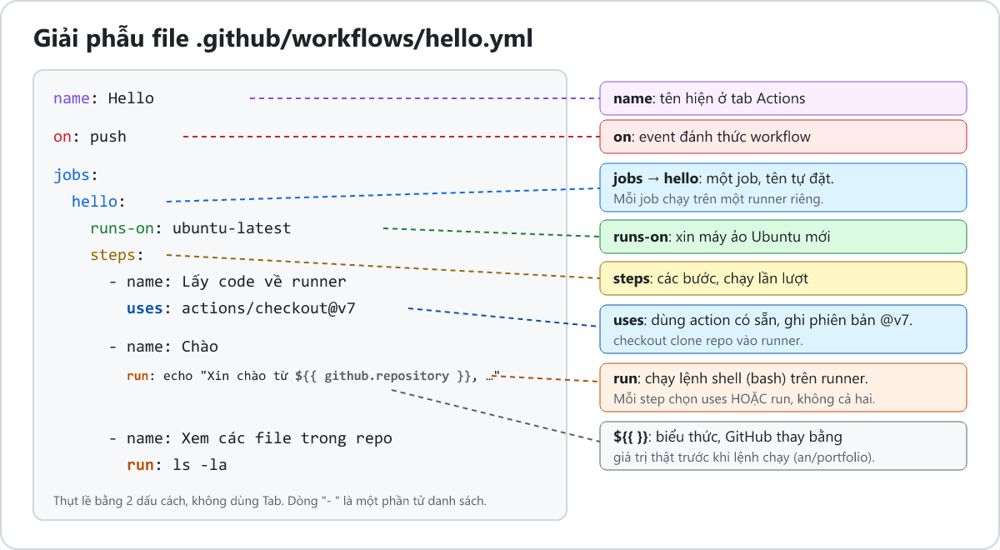

# Viết workflow đầu tiên

Bài trước đã nói: workflow là một file YAML trong `.github/workflows/`. Bài này viết file đó, push lên và xem GitHub chạy nó.

Bạn cần một repo trên GitHub để thử. Dùng repo **portfolio** (trang giới thiệu bản thân bằng HTML/CSS) nếu bạn có; chưa có thì tạo repo mới tên `portfolio`, thêm một file `index.html` bất kỳ. Chương 2 sẽ đưa chính repo này lên mạng.

## 1. YAML trong 2 phút

**YAML** (*YAML Ain't Markup Language*, đọc là "di-a-mồ") là một cách viết dữ liệu cho người đọc dễ. GitHub Actions dùng nó để mô tả workflow. Bạn chỉ cần ba thứ:

```yaml
name: Hello              # khóa: giá trị
on: push

jobs:                    # khóa chứa các khóa con, thụt vào 2 dấu cách
  hello:
    runs-on: ubuntu-latest
    steps:               # danh sách: mỗi phần tử bắt đầu bằng "- "
      - name: Bước một
      - name: Bước hai
```

**Đọc hiểu**

- `khóa: giá trị`: dấu hai chấm rồi **một dấu cách**. Thiếu dấu cách là lỗi.
- **Thụt lề** nói khóa nào nằm trong khóa nào. `runs-on` thụt vào sâu hơn `hello`, nên nó thuộc job `hello`. Dùng **2 dấu cách**, không dùng phím Tab (YAML cấm Tab).
- Dòng bắt đầu bằng `- ` là một phần tử của **danh sách**. `steps` là danh sách các bước.
- Chữ sau `#` là chú thích, GitHub bỏ qua.

Trong VS Code, cài extension **GitHub Actions** (xem tab **Cài đặt**) để được tô màu và báo lỗi ngay khi gõ sai.

## 2. Viết workflow

Trong repo, tạo file `.github/workflows/hello.yml`. Chú ý dấu chấm ở đầu `.github` và chữ `workflows` có `s`.

```yaml
name: Hello

on: push

jobs:
  hello:
    runs-on: ubuntu-latest
    steps:
      - name: Lấy code về runner
        uses: actions/checkout@v7

      - name: Chào
        run: echo "Xin chào từ ${{ github.repository }}, commit ${{ github.sha }}"

      - name: Xem các file trong repo
        run: ls -la
```



**Đọc hiểu**

- `name: Hello`: tên workflow, hiện trong tab **Actions**.
- `on: push`: event. Chạy mỗi lần có commit được push lên **bất kỳ nhánh nào**.
- `jobs:` mở danh sách job. `hello` là tên job do bạn đặt.
- `runs-on: ubuntu-latest`: xin một runner chạy Ubuntu, bản mới nhất GitHub hỗ trợ. `runs-on` = *chạy trên*.
- `steps:` danh sách bước. Mỗi bước có `name` (tên hiện trong log) và **một trong hai**:
  - `uses:` dùng một action có sẵn;
  - `run:` chạy lệnh shell (trên Ubuntu là `bash`).
- `uses: actions/checkout@v7`: action **checkout** (*lấy ra*, giống `git checkout`) clone repo của bạn vào runner. Nhớ lại bài trước: runner trống trơn, thiếu bước này thì `ls -la` chỉ thấy thư mục rỗng. Cách đọc: `actions` là chủ (tài khoản GitHub), `checkout` là tên repo của action, `@v7` là **phiên bản**. Luôn ghi phiên bản để workflow không tự đổi hành vi khi action ra bản mới.
- `run: echo "..."`: in một dòng chữ ra log.
- `run: ls -la`: liệt kê file (`ls` = *list*, `-l` = dạng dài, `-a` = *all*, kể cả file ẩn). Bạn sẽ thấy `.git`, `.github`, `index.html`… chứng tỏ checkout đã chạy.

## 3. Biểu thức `${{ }}` và context

`${{ github.repository }}` là một **expression** (*biểu thức*). GitHub thay nó bằng giá trị thật **trước khi** gửi lệnh tới runner. Ví dụ, với repo `an/portfolio`, lệnh thật chạy trên runner là:

```bash
echo "Xin chào từ an/portfolio, commit 3f2a9c1e..."
```

**Đọc hiểu**

- `github` là một **context** (*ngữ cảnh*): một "túi" thông tin về lần chạy mà GitHub chuẩn bị sẵn.
- `github.repository` là tên repo dạng `chủ/tên`; `github.sha` là mã commit đã kích hoạt lần chạy; `github.ref_name` là tên nhánh; `github.actor` là người đã push.
- Các chương sau gặp thêm context `secrets`, `vars`, `env`, `matrix`. Cú pháp luôn là `${{ <context>.<tên> }}`.

| Bạn viết | GitHub thay thành (ví dụ) |
| --- | --- |
| `${{ github.repository }}` | `an/portfolio` |
| `${{ github.ref_name }}` | `main` |
| `${{ github.actor }}` | `an` |

## 4. Chạy thử

```bash
git add .github/workflows/hello.yml
git commit -m "Thêm workflow Hello"
git push
```

**Đọc hiểu**

- `git add` đưa file workflow vào commit tiếp theo; `git commit` chốt; `git push` gửi lên GitHub.
- Chính lệnh `git push` là **event** `push` đánh thức workflow.

Mở repo trên GitHub, vào tab **Actions**. Bạn sẽ thấy một lần chạy mang tên commit message, chấm vàng (đang chạy) rồi dấu tick xanh. Bấm vào lần chạy, chọn job `hello`, mở từng step để xem output. Step **Chào** in tên repo và mã commit của bạn.

Repo **public** chạy Actions miễn phí. Repo private dùng vào số phút miễn phí hằng tháng của tài khoản.

## 5. Chọn event

`on:` nhận nhiều dạng. Hay gặp nhất:

```yaml
on:
  push:
    branches: [main]      # chỉ khi push lên nhánh main
  pull_request:           # khi mở hoặc cập nhật pull request
  workflow_dispatch:      # thêm nút "Run workflow" để chạy bằng tay
  schedule:
    - cron: "0 1 * * 1"   # 01:00 giờ UTC mỗi thứ Hai
```

**Đọc hiểu**

- `branches: [main]`: bộ lọc. Push lên nhánh khác thì không chạy. `[main]` là cách viết danh sách trên một dòng.
- `pull_request`: chạy khi có pull request vào repo, và mỗi lần push thêm commit lên nhánh của PR. Chương 3 dùng nó cho CI.
- `workflow_dispatch` (*dispatch* = *gửi đi, phát lệnh*): hiện nút **Run workflow** trong tab Actions để bạn tự bấm chạy. Rất tiện khi thử.
- `schedule` chạy theo giờ hẹn. Năm ô trong `cron` là phút, giờ, ngày, tháng, thứ, tính theo giờ **UTC** (giờ Việt Nam = UTC + 7).

| Event | Ai/cái gì kích hoạt | Dùng cho |
| --- | --- | --- |
| `push` | `git push` | build, deploy |
| `pull_request` | mở/cập nhật PR | chạy test trước khi merge |
| `workflow_dispatch` | bạn bấm nút | chạy thử, deploy bằng tay |
| `schedule` | đồng hồ | việc định kỳ, ví dụ kiểm tra link mỗi tuần |

## 6. Sai lầm thường gặp

- Đặt file ở `.github/workflow/` (thiếu `s`) hoặc `github/workflows/` (thiếu dấu chấm): GitHub không thấy, tab Actions trống.
- Dùng Tab để thụt lề: `Invalid workflow file`.
- Viết `uses` và `run` trong **cùng một** step: mỗi step chỉ chọn một.
- Quên `@v7`: GitHub báo lỗi vì không biết dùng phiên bản nào.
- Viết `run: echo "Kết quả: xong"` trên một dòng: chữ `: ` (dấu hai chấm rồi dấu cách) bên trong làm YAML tưởng có thêm một khóa, báo `mapping values are not allowed`. Cách chắc ăn: viết `run: |` rồi đặt lệnh ở dòng dưới, thụt vào thêm 2 dấu cách:

  ```yaml
        run: |
          echo "Kết quả: xong"
  ```

## 7. Ngoài thực tế

Trong nhóm, file workflow được review như code: nó nằm trong repo, đi qua pull request, ai cũng đọc được lịch sử sửa. Nhờ vậy "máy làm gì khi có push" không phải bí mật trong đầu một người, và khi workflow hỏng thì `git log` cho biết ai đổi gì, lúc nào.

## 8. Khi bị lỗi

| Lỗi | Vì sao | Cách sửa |
| --- | --- | --- |
| Tab Actions không có lần chạy nào | File sai thư mục hoặc sai đuôi | Đường dẫn phải là `.github/workflows/<tên>.yml` |
| `Invalid workflow file` | Lỗi YAML | Mở file trên GitHub, dòng lỗi được tô đỏ; thường là Tab hoặc thiếu dấu cách sau `:` |
| `ls -la` chỉ thấy `.` và `..` | Thiếu step checkout | Thêm `uses: actions/checkout@v7` làm step đầu |
| Lỗi khác, hoặc chưa hiểu vì sao | | Nhắn mentor của track, công khai hay **nhắn riêng** đều được (tab **Cài đặt** → "Hỏi ở đâu") |

## Tóm tắt

- Workflow là file YAML trong `.github/workflows/`, chạy khi có event ở `on:`.
- Mỗi step dùng `uses` (action có sẵn) hoặc `run` (lệnh shell); step đầu thường là `actions/checkout`.
- `${{ github.<tên> }}` được thay bằng giá trị thật trước khi lệnh chạy.
