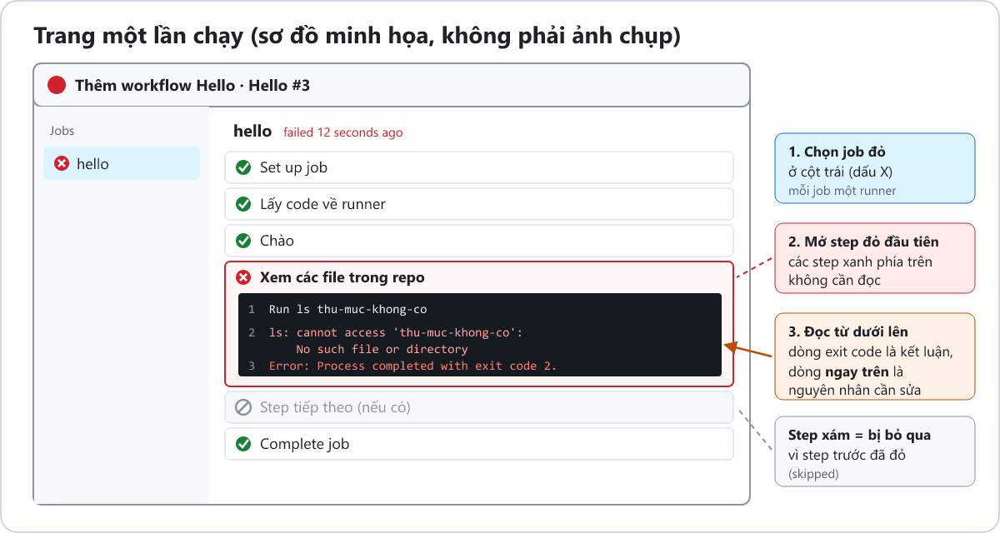
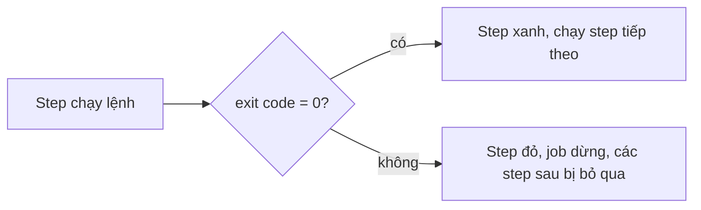

# Khi workflow bị đỏ: đọc log

Workflow sẽ có lúc đỏ, chuyện bình thường. Thật ra, CI tồn tại **để** đỏ khi có lỗi. Kỹ năng quan trọng nhất là đọc **log** (*nhật ký*: mọi dòng chữ các lệnh in ra trong lần chạy) để biết vì sao.

## 1. Trang của một lần chạy trông thế nào



- **Cột trái**: danh sách job. Dấu X đỏ là job thất bại.
- **Khung phải**: các step của job đang chọn. Bấm vào một step để mở log của nó.
- Step bị **bỏ qua** (*skipped*) hiện màu xám: chúng không chạy vì step trước đã lỗi.

## 2. Exit code: cách máy nói "xong" hay "hỏng"

Mỗi lệnh khi kết thúc trả về một con số gọi là **exit code** (*mã thoát*):

- `0` nghĩa là **thành công**;
- khác `0` (1, 2, 127…) nghĩa là **thất bại**.

Bạn không thấy con số này khi gõ lệnh trên máy, nhưng runner thì nhìn nó sau **mỗi** step:



Thử xem exit code trên máy bạn. Đứng trong thư mục một repo Git bất kỳ (ví dụ repo portfolio đã clone), rồi hỏi Git về một file không có:

```bash
git ls-files --error-unmatch khong-co-file-nay
echo $?
```

**Đọc hiểu**

- `git ls-files` liệt kê các file Git đang theo dõi. `--error-unmatch` bảo nó **báo lỗi** nếu không tìm thấy file được hỏi. File `khong-co-file-nay` không có, nên Git in `error: pathspec 'khong-co-file-nay' did not match any file(s) known to git`.
- `$?` là biến đặc biệt của bash, giữ exit code của lệnh **vừa chạy**. Bạn sẽ thấy `1`.
- Trong **PowerShell**, dùng `echo $LASTEXITCODE` thay cho `echo $?`, cũng ra `1`. `$LASTEXITCODE` chỉ có giá trị sau khi chạy một **chương trình ngoài** như `git`, `node`, `npm`; lệnh có sẵn của PowerShell như `ls` (thật ra là `Get-ChildItem`) không đặt nó. Còn `$?` của PowerShell chỉ in `True`/`False`.

Mọi lệnh trong `run` đều theo luật này: test không qua, `curl -f` gặp lỗi HTTP, `grep` không tìm thấy chữ… đều trả về khác 0 và làm job đỏ. Chính nhờ vậy mà CI chặn được lỗi trước khi nó tới tay người dùng.

## 3. Cố tình làm hỏng

Sửa step cuối trong `hello.yml` thành một lệnh sai:

```yaml
      - name: Xem các file trong repo
        run: ls thu-muc-khong-co
```

**Đọc hiểu**

- Vẫn là step cũ, chỉ đổi lệnh thành liệt kê một thư mục không có trong repo, để nó trả về exit code khác 0.

Commit và push. Trong tab **Actions**, lần chạy mới có dấu X đỏ.

## 4. Đọc log theo 3 bước

1. **Mở lần chạy đỏ**, chọn job có dấu X.
2. **Tìm step đỏ đầu tiên.** Các step sau nó màu xám, đừng đọc chúng.
3. **Đọc từ dưới lên** trong step đó. Dòng cuối thường là `Error: Process completed with exit code 2.`; dòng ngay trên mới là **nguyên nhân**:

```text
ls: cannot access 'thu-muc-khong-co': No such file or directory
Error: Process completed with exit code 2.
```

**Đọc hiểu**

- Dòng 1 do lệnh `ls` in ra: nó không truy cập được thư mục, vì không có.
- Dòng 2 do runner in ra: lệnh trả về exit code 2, nên runner đánh dấu step đỏ.
- Muốn sửa thì sửa theo dòng 1, không phải dòng 2.

## 5. Những lỗi hay gặp

| Bạn thấy | Nguyên nhân thường gặp |
| --- | --- |
| Không có lần chạy nào trong tab Actions | File không nằm đúng `.github/workflows/`, hoặc đuôi không phải `.yml`/`.yaml`, hoặc `on:` không khớp event |
| `Invalid workflow file` trên trang lần chạy | Lỗi YAML: thụt lề sai, dùng Tab, thiếu dấu `:` |
| `No such file or directory` | Quên step `actions/checkout`, hoặc sai đường dẫn (Linux phân biệt hoa thường: `Index.html` khác `index.html`) |
| `command not found` (exit code 127) | Lệnh không có trên runner, hoặc gõ sai tên |
| Exit code 1 mà không rõ lý do | Thêm `set -x` ở đầu `run` để in từng lệnh trước khi chạy (đừng làm vậy ở step có secret, chương 4) |

## 6. Sửa và chạy lại

Sửa lại thành `run: ls -la`, commit, push: một lần chạy mới bắt đầu.

Nếu lỗi **không do code** (mạng chập chờn khi tải thứ gì đó, GitHub bị chậm), không cần commit gì cả: mở lần chạy đỏ, bấm **Re-run jobs** → **Re-run failed jobs**. **Re-run** (*chạy lại*) dùng đúng commit cũ, trên một runner mới.

| Tình huống | Làm gì |
| --- | --- |
| Log chỉ ra lỗi trong code hoặc trong workflow | Sửa, commit, push |
| Log báo lỗi mạng, timeout, lỗi phía GitHub | Re-run failed jobs |
| Re-run lần hai vẫn đỏ y hệt | Không phải lỗi tạm thời. Đọc log lại từ đầu. |

## 7. Bắt lỗi trước khi push

- **VS Code** với extension **GitHub Actions** báo lỗi cú pháp ngay khi gõ.
- **actionlint** là công cụ kiểm tra file workflow (sai khóa, sai biểu thức, sai tên event). Nếu máy có Docker, chạy trong thư mục repo:

```bash
docker run --rm -v "$(pwd):/repo" -w /repo rhysd/actionlint:1.7.12 -color
```

**Đọc hiểu**

- `docker run --rm`: chạy công cụ trong một container rồi xóa container khi xong.
- `-v "$(pwd):/repo"`: cho container thấy thư mục hiện tại tại đường dẫn `/repo`. Trong PowerShell, đổi `$(pwd)` thành `${PWD}`.
- `-w /repo`: đứng ở `/repo` khi chạy. `rhysd/actionlint:1.7.12` là image của actionlint, ghi rõ phiên bản.
- Không in gì nghĩa là không thấy lỗi. Không có Docker thì bỏ qua bước này, extension VS Code là đủ cho track.

## 8. Ngoài thực tế

Trong nhóm, khi CI đỏ trên pull request của bạn, người review thường **không xem** PR cho tới khi nó xanh. Việc của bạn là đọc log, sửa, push lại. Khi nhờ người khác giúp, gửi **link lần chạy** (copy từ thanh địa chỉ), không chỉ chụp dòng cuối: người giúp cần thấy dòng nguyên nhân phía trên.

## 9. Khi bị lỗi

| Lỗi | Vì sao | Cách sửa |
| --- | --- | --- |
| Không tìm thấy dòng nguyên nhân | Đang đọc step xám hoặc đọc từ trên xuống | Mở step **đỏ đầu tiên**, đọc từ dưới lên |
| Re-run mãi vẫn đỏ | Lỗi thật, không phải lỗi tạm thời | Sửa theo dòng nguyên nhân |
| Lỗi khác, hoặc chưa hiểu vì sao | | Gửi link lần chạy cho mentor, công khai hay **nhắn riêng** đều được (tab **Cài đặt** → "Hỏi ở đâu") |

## Tóm tắt

- Exit code khác 0 làm step đỏ, job dừng, các step sau bị bỏ qua.
- Mở job đỏ, tìm step đỏ đầu tiên, đọc log từ dưới lên.
- Lỗi tạm thời thì **Re-run failed jobs**; lỗi trong code thì sửa rồi push.
