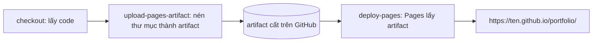

# Deploy portfolio bằng actions/deploy-pages

**GitHub Pages** (*trang của GitHub*) phục vụ trang web tĩnh (HTML, CSS, JS, ảnh) miễn phí cho repo public. Bài này cho GitHub Actions tự **deploy** (*triển khai*: đưa phiên bản mới lên chỗ người dùng truy cập được) portfolio mỗi khi bạn push lên `main`.

## 1. Bản chất: deploy một trang tĩnh là gì

Trang tĩnh chỉ là một thư mục file. "Deploy" nghĩa là **chép thư mục đó lên máy chủ của GitHub Pages**, để ai mở `https://<tên>.github.io/...` cũng nhận được đúng các file đó.

Nhưng runner làm việc đó thế nào, khi runner sẽ bị xóa ngay sau job? Câu trả lời là **artifact** (*sản phẩm, đồ tạo tác*): một file nén chứa kết quả của job, được GitHub **cất ở ngoài runner**, nên còn tồn tại sau khi máy ảo bị xóa.




## 2. Bật Pages

Trong repo portfolio: **Settings** → **Pages** → mục **Build and deployment**, chọn **Source: GitHub Actions**.

Địa chỉ trang:

- repo tên `<tên-github>.github.io` → `https://<tên-github>.github.io/`;
- repo tên khác, ví dụ `portfolio` → `https://<tên-github>.github.io/portfolio/`.

Với địa chỉ thứ hai, trang nằm trong thư mục con `/portfolio/`. Dùng link **tương đối** (`about.html`, `images/me.png`), đừng bắt đầu bằng `/`: link `/style.css` sẽ tìm ở `https://<tên>.github.io/style.css`, ngoài thư mục `/portfolio/`, nên CSS không tải được.

## 3. Workflow

Tạo `.github/workflows/pages.yml`. Bản này chỉ có job deploy; bài sau thêm job kiểm tra link.

```yaml
name: Deploy Pages

on:
  push:
    branches: [main]
  workflow_dispatch:

# Quyền tối thiểu cho mọi job. Job nào cần thêm thì tự xin.
permissions:
  contents: read

jobs:
  deploy:
    runs-on: ubuntu-latest
    permissions:
      contents: read
      pages: write
      id-token: write
    # Không cho hai lần deploy chạy chồng lên nhau
    concurrency:
      group: pages
      cancel-in-progress: false
    environment:
      name: github-pages
      url: ${{ steps.deployment.outputs.page_url }}
    steps:
      - uses: actions/checkout@v7

      - uses: actions/configure-pages@v6

      - name: Đóng gói trang web
        uses: actions/upload-pages-artifact@v5
        with:
          path: .

      - name: Deploy lên GitHub Pages
        id: deployment
        uses: actions/deploy-pages@v5
```

## 4. Đọc hiểu

Đi từ trên xuống:

- `on`: chạy khi push lên `main`, hoặc khi bấm **Run workflow**. Nhánh khác không deploy, vì `main` là bản "chính thức".
- `permissions` (*quyền*): mỗi job nhận một "chìa khóa" tạm thời tên `GITHUB_TOKEN` để làm việc với repo. `permissions` nói chìa khóa đó mở được những gì. Ở cấp workflow, ta chỉ cho đọc code (`contents: read`). Job `deploy` xin thêm:
  - `pages: write`: được ghi lên GitHub Pages;
  - `id-token: write`: được xin một "giấy tờ tùy thân" chứng minh lần deploy đến từ đúng workflow này, để Pages tin.
  Chương 7 nói kỹ vì sao nên xin ít quyền nhất có thể.
- `concurrency` (*đồng thời*): hai lần push liền nhau thì lần sau **chờ** lần trước deploy xong (`cancel-in-progress: false` = không hủy lần đang chạy). Mọi lần chạy cùng `group: pages` xếp hàng một.
- `environment` (*môi trường*): nơi code được deploy tới. GitHub tạo sẵn môi trường `github-pages` khi bật Pages, và mặc định chỉ cho nhánh `main` deploy vào đó. `url` hiện link trang ngay trên lần chạy. Chương 4 dạy cách thêm luật cho environment, ví dụ bắt người duyệt trước khi deploy.
- `uses: actions/configure-pages@v6`: đọc cấu hình Pages của repo (địa chỉ trang…). Báo lỗi ngay nếu bạn chưa bật Pages.
- `uses: actions/upload-pages-artifact@v5` với `with: path: .`: nén thư mục `.` (cả repo) thành artifact. `with:` là chỗ truyền **input** (*đầu vào*) cho action. File và thư mục bắt đầu bằng dấu chấm như `.github`, `.git` **không** bị đưa lên.
- `id: deployment`: đặt tên cho step để chỗ khác nhắc tới nó. `${{ steps.deployment.outputs.page_url }}` đọc **output** (*đầu ra*) `page_url` của step đó.
- `uses: actions/deploy-pages@v5`: bảo GitHub Pages lấy artifact vừa upload và đưa lên mạng.

Portfolio nằm trong thư mục con, ví dụ `site/`? Đổi `path: site`. Thư mục đó phải có `index.html`.

## 5. Chạy

Commit và push lên `main`. Trong tab **Actions**, lần chạy **Deploy Pages** có link trang ngay dưới tên job `deploy`. Lần đầu có thể mất 1–2 phút trang mới hiện.

## 6. Sai lầm thường gặp

| Nghĩ sai | Thật ra |
| --- | --- |
| "Push là trang tự đổi." | Trang chỉ đổi khi job `deploy` xanh. Job đỏ thì trang cũ giữ nguyên. |
| "Xóa file khỏi repo là trang vẫn còn file đó." | Mỗi lần deploy thay **toàn bộ** trang bằng artifact mới. File không có trong artifact thì biến mất khỏi trang. |
| "`path: .` đưa cả `.git` lên mạng." | Không. File và thư mục bắt đầu bằng dấu chấm bị bỏ qua. |

## 7. Khi lỗi

| Lỗi trong log | Cách sửa |
| --- | --- |
| `Get Pages site failed` hoặc `Not Found` ở `configure-pages` | Chưa bật Pages với **Source: GitHub Actions** (mục 2) |
| `Branch "feat/..." is not allowed to deploy to github-pages` | Chỉ `main` được deploy. Merge vào `main` trước. |
| `Resource not accessible by integration` | Thiếu `pages: write` hoặc `id-token: write` trong `permissions` |
| Trang hiện nhưng không có CSS/ảnh | Link bắt đầu bằng `/`, hoặc sai hoa thường (`Style.css` khác `style.css` trên máy chủ) |
| Lỗi khác, hoặc chưa hiểu vì sao | Gửi link lần chạy cho mentor, công khai hay **nhắn riêng** đều được (tab **Cài đặt** → "Hỏi ở đâu") |

## Tóm tắt

- Bật Pages với **Source: GitHub Actions**.
- Ba action: `configure-pages` → `upload-pages-artifact` (nén thành artifact) → `deploy-pages` (đưa artifact lên mạng).
- Job deploy xin đúng quyền nó cần: `pages: write`, `id-token: write`; `concurrency` giữ cho các lần deploy không chồng nhau.
