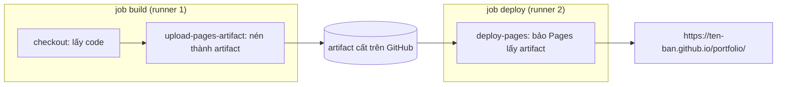

# Deploy portfolio bằng actions/deploy-pages

**GitHub Pages** (*trang của GitHub*) phục vụ trang web tĩnh (HTML, CSS, JS, ảnh) miễn phí cho repo public. Bài này cho GitHub Actions tự **deploy** (*triển khai*: đưa phiên bản mới lên chỗ người dùng truy cập được) portfolio mỗi khi bạn push lên `main`.

## 1. Bản chất: deploy một trang tĩnh là gì

Trang tĩnh chỉ là một thư mục file. "Deploy" nghĩa là **chép thư mục đó lên máy chủ của GitHub Pages**, để ai mở `https://<tên>.github.io/...` cũng nhận được đúng các file đó.

Nhưng runner làm việc đó thế nào, khi runner sẽ bị xóa ngay sau job? Câu trả lời là **artifact** (*sản phẩm, đồ tạo tác*): một file nén chứa kết quả của job, được GitHub **cất ở ngoài runner**, nên còn tồn tại sau khi máy ảo bị xóa.




Workflow có **hai job**: `build` đóng gói, `deploy` đưa lên mạng. Job `deploy` không cần code, chỉ cần artifact, nên nó không có bước checkout.

## 2. Bật Pages

Trong repo portfolio: **Settings** → **Pages** → mục **Build and deployment**, chọn **Source: GitHub Actions**.

Địa chỉ trang:

- repo tên `<tên-github>.github.io` → `https://<tên-github>.github.io/`;
- repo tên khác, ví dụ `portfolio` → `https://<tên-github>.github.io/portfolio/`.

Với địa chỉ thứ hai, trang nằm trong thư mục con `/portfolio/`. Dùng link **tương đối** (`about.html`, `images/me.png`), đừng bắt đầu bằng `/`: link `/style.css` sẽ tìm ở `https://<tên>.github.io/style.css`, ngoài thư mục `/portfolio/`, nên CSS không tải được.

## 3. Workflow

Tạo `.github/workflows/pages.yml`. Bản này chỉ có job deploy; bài sau thêm job kiểm tra link.

```yaml
name: Deploy Pages

on:
  push:
    branches: [main]
  workflow_dispatch:

# Quyền tối thiểu cho mọi job. Job nào cần thêm thì tự xin.
permissions:
  contents: read

jobs:
  build:
    runs-on: ubuntu-latest
    steps:
      - uses: actions/checkout@v7

      - uses: actions/configure-pages@v6

      - name: Đóng gói trang web
        uses: actions/upload-pages-artifact@v5
        with:
          path: .

  deploy:
    needs: build
    runs-on: ubuntu-latest
    permissions:
      pages: write
      id-token: write
    # Không cho hai lần deploy chạy chồng lên nhau
    concurrency:
      group: pages
      cancel-in-progress: false
    environment:
      name: github-pages
      url: ${{ steps.deployment.outputs.page_url }}
    steps:
      - name: Deploy lên GitHub Pages
        id: deployment
        uses: actions/deploy-pages@v5
```

## 4. Đọc hiểu

Đi từ trên xuống:

- `on`: chạy khi push lên `main`, hoặc khi bấm **Run workflow**. Nhánh khác không deploy, vì `main` là bản "chính thức".
- `permissions` (*quyền*): mỗi job nhận một "chìa khóa" tạm thời tên `GITHUB_TOKEN` để làm việc với repo. `permissions` nói chìa khóa đó mở được những gì. Ở cấp workflow, ta chỉ cho đọc code (`contents: read`); job `build` dùng mức này. Job `deploy` ghi `permissions` riêng, **thay hẳn** mức của workflow:
  - `pages: write`: được ghi lên GitHub Pages;
  - `id-token: write`: được xin một "giấy tờ tùy thân" chứng minh lần deploy đến từ đúng workflow này, để Pages tin.
  Job `deploy` không checkout nên không cần `contents: read`. Chương 7 nói kỹ vì sao nên xin ít quyền nhất có thể.
- Job `build` lấy code, đọc cấu hình Pages, rồi nén trang thành artifact.
- `needs: build` (*cần*): job `deploy` **chờ** job `build` xong và chỉ chạy khi `build` xanh. Không có dòng này, hai job chạy song song (chương 1) và `deploy` sẽ tìm artifact khi nó chưa có. Bài sau dùng `needs` kỹ hơn.
- `concurrency` (*đồng thời*): hai lần push liền nhau thì lần sau **chờ** lần trước deploy xong (`cancel-in-progress: false` = không hủy lần đang chạy). Mọi lần chạy cùng `group: pages` xếp hàng một.
- `environment` (*môi trường*): nơi code được deploy tới. GitHub tạo sẵn môi trường `github-pages` khi bật Pages, và mặc định chỉ cho nhánh `main` deploy vào đó. `url` hiện link trang ngay trên lần chạy. Chương 4 dạy cách thêm luật cho environment, ví dụ bắt người duyệt trước khi deploy.
- `uses: actions/configure-pages@v6`: đọc cấu hình Pages của repo (địa chỉ trang…). Báo lỗi ngay nếu bạn chưa bật Pages.
- `uses: actions/upload-pages-artifact@v5` với `with: path: .`: nén thư mục `.` (cả repo) thành artifact. `with:` là chỗ truyền **input** (*đầu vào*) cho action. File và thư mục bắt đầu bằng dấu chấm như `.github`, `.git` **không** bị đưa lên.
- `id: deployment`: đặt tên cho step để chỗ khác nhắc tới nó. `${{ steps.deployment.outputs.page_url }}` đọc **output** (*đầu ra*) `page_url` của step đó.
- `uses: actions/deploy-pages@v5`: bảo GitHub Pages lấy artifact mà job `build` đã upload và đưa lên mạng.

Vì sao tách hai job mà không làm hết trong một job? Khi chạy thử trên GitHub thật, bản một job (upload rồi deploy ngay trong cùng job) thỉnh thoảng đỏ với `No artifacts named "github-pages" were found for this workflow run`: artifact vừa upload chưa kịp "hiện ra" khi deploy-pages đi tìm (lỗi đã được báo ở [actions/deploy-pages#451](https://github.com/actions/deploy-pages/issues/451)). Tách job thì giữa upload và deploy có vài giây chuyển job, và mẫu workflow chính thức của GitHub cho Pages cũng làm như vậy.

Với `path: .`, **mọi** file không bắt đầu bằng dấu chấm đều lên mạng, kể cả `README.md`, `package.json` hay file nháp. Log của step **Đóng gói trang web** liệt kê đúng các file được nén, ví dụ `./index.html`, `./about.html`, `./README.md`, `./style.css`. Ai cũng mở được, ví dụ `https://<tên>.github.io/portfolio/README.md`. Với portfolio chỉ có HTML/CSS thì không sao. Repo có thêm thứ khác thì để trang web trong thư mục con, ví dụ `site/`, rồi đổi `path: site`. Thư mục đó phải có `index.html`.

## 5. Chạy

Commit và push lên `main`. Trong tab **Actions**, lần chạy **Deploy Pages** có hai job `build` → `deploy`, và link trang ngay dưới tên job `deploy`. Cuối log của step **Deploy lên GitHub Pages** có dòng `Reported success!`. Lần đầu có thể mất 1–2 phút trang mới hiện.

Nếu tài khoản GitHub của bạn đã gắn tên miền riêng cho Pages, địa chỉ trang sẽ là tên miền đó thay cho `<tên>.github.io`; link dưới job `deploy` luôn đúng.

## 6. Sai lầm thường gặp

| Nghĩ sai | Thật ra |
| --- | --- |
| "Push là trang tự đổi." | Trang chỉ đổi khi job `deploy` xanh. Job đỏ thì trang cũ giữ nguyên. |
| "Xóa file khỏi repo là trang vẫn còn file đó." | Mỗi lần deploy thay **toàn bộ** trang bằng artifact mới. File không có trong artifact thì biến mất khỏi trang. |
| "`path: .` đưa cả `.git` lên mạng." | Không. File và thư mục bắt đầu bằng dấu chấm bị bỏ qua. |

## 7. Khi lỗi

| Lỗi trong log | Cách sửa |
| --- | --- |
| `Get Pages site failed` hoặc `Not Found` ở `configure-pages` | Chưa bật Pages với **Source: GitHub Actions** (mục 2) |
| `Branch "feat/..." is not allowed to deploy to github-pages due to environment protection rules.` | Chỉ `main` được deploy. Merge vào `main` trước. |
| `No artifacts named "github-pages" were found for this workflow run` | Upload và deploy nằm trong cùng một job: tách thành hai job `build` và `deploy` như mục 3 |
| `Multiple artifacts named "github-pages" were unexpectedly found` | Đã bấm **Re-run** một lần chạy có upload và deploy cùng job, nên có thêm artifact trùng tên: tách hai job như mục 3, rồi push hoặc **Run workflow** để có lần chạy mới |
| `Resource not accessible by integration` | Thiếu `pages: write` hoặc `id-token: write` trong `permissions` |
| Trang hiện nhưng không có CSS/ảnh | Link bắt đầu bằng `/`, hoặc sai hoa thường (`Style.css` khác `style.css` trên máy chủ) |
| Lỗi khác, hoặc chưa hiểu vì sao | Gửi link lần chạy cho mentor, công khai hay **nhắn riêng** đều được (tab **Cài đặt** → "Hỏi ở đâu") |

## Tóm tắt

- Bật Pages với **Source: GitHub Actions**.
- Hai job nối bằng `needs`: `build` (`configure-pages` → `upload-pages-artifact`, nén thành artifact) rồi `deploy` (`deploy-pages`, đưa artifact lên mạng).
- Job deploy xin đúng quyền nó cần: `pages: write`, `id-token: write`; `concurrency` giữ cho các lần deploy không chồng nhau.
