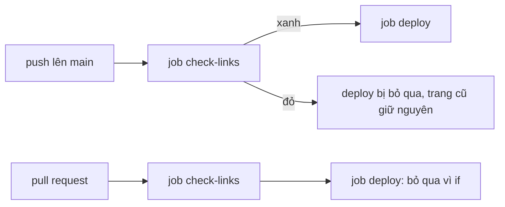

# Chặn link hỏng trước khi deploy

Đổi tên file `about.html` thành `gioi-thieu.html` mà quên sửa link trong `index.html` là người xem gặp trang 404. Đây chính là việc **CI** (*Continuous Integration*, *tích hợp liên tục*) làm tốt: kiểm tra tự động mỗi lần thay đổi, chặn lỗi trước khi nó lên site. Bài trước là phần **CD** (*Continuous Deployment*, *triển khai liên tục*): tự đưa lên mạng. Bài này đặt CI **trước** CD.

## 1. Công cụ: lychee

**lychee** (tên một loại quả, *quả vải*; đọc là "lai-chi") là chương trình đọc file HTML, tìm mọi link và kiểm tra từng link. Với tuỳ chọn `--offline`, nó chỉ kiểm tra link **trong repo** (file, ảnh, CSS), bỏ qua link ra ngoài. Nhờ vậy kết quả ổn định: không đỏ chỉ vì một trang bên ngoài tạm thời chậm.

Ta dùng nó qua action `lycheeverse/lychee-action`, nên không cần cài gì lên máy.

## 2. Hai job nối nhau bằng `needs`

Nhớ lại chương 1: các job **mặc định chạy song song**. Nếu `check-links` và `deploy` chạy cùng lúc, link hỏng vẫn được deploy trước khi kiểm tra kịp báo đỏ. **`needs`** (*cần*) bắt một job chờ job khác:



## 3. Workflow hoàn chỉnh

Sửa `.github/workflows/pages.yml` thành:

```yaml
name: Deploy Pages

on:
  push:
    branches: [main]
  pull_request:
  workflow_dispatch:

# Quyền tối thiểu cho mọi job. Job nào cần thêm thì tự xin.
permissions:
  contents: read

jobs:
  check-links:
    runs-on: ubuntu-latest
    steps:
      - uses: actions/checkout@v7

      - name: Kiểm tra link hỏng
        uses: lycheeverse/lychee-action@v2.9.0
        with:
          args: --offline --no-progress '**/*.html'
          fail: true

  deploy:
    needs: check-links
    # Chỉ deploy khi push lên main hoặc bấm Run workflow, không deploy từ pull request
    if: github.event_name != 'pull_request'
    runs-on: ubuntu-latest
    permissions:
      contents: read
      pages: write
      id-token: write
    # Không cho hai lần deploy chạy chồng lên nhau
    concurrency:
      group: pages
      cancel-in-progress: false
    environment:
      name: github-pages
      url: ${{ steps.deployment.outputs.page_url }}
    steps:
      - uses: actions/checkout@v7

      - uses: actions/configure-pages@v6

      - name: Đóng gói trang web
        uses: actions/upload-pages-artifact@v5
        with:
          path: .

      - name: Deploy lên GitHub Pages
        id: deployment
        uses: actions/deploy-pages@v5
```

**Đọc hiểu** (chỉ những gì mới so với bài trước)

- `pull_request` trong `on`: mở PR là có kiểm tra link, để bạn sửa **trước** khi merge.
- Job `check-links` có hai step: lấy code, rồi chạy lychee.
  - `lycheeverse/lychee-action@v2.9.0`: action này không có tag `v2` gọn như `actions/checkout`, nên ghi đủ phiên bản.
  - `args`: tham số truyền cho lychee. `--offline` chỉ kiểm tra link trong repo; `--no-progress` tắt thanh tiến trình cho log gọn; `'**/*.html'` là mọi file `.html` ở mọi thư mục (`**` = mọi thư mục con). Giữ dấu nháy đơn để lychee tự tìm file.
  - `fail: true`: có link hỏng thì step đỏ (exit code khác 0).
- `needs: check-links`: job `deploy` chờ `check-links` xong và **chỉ chạy khi nó xanh**.
- `if: github.event_name != 'pull_request'`: **`if`** (*nếu*) là điều kiện; sai thì job bị bỏ qua (màu xám, *skipped*). `github.event_name` là tên event đã kích hoạt lần chạy, `!=` là "khác". Đọc cả dòng: "chỉ chạy nếu event **không phải** pull request". Trên PR ta chỉ kiểm tra, không deploy bản chưa được duyệt.

## 4. Thử làm hỏng

Tạo nhánh, sửa một link thành tên file không có, ví dụ `href="abuot.html"`, rồi mở pull request:

```bash
git switch -c thu-link-hong
# sửa index.html: đổi một link thành abuot.html
git commit -am "Thử link hỏng"
git push -u origin thu-link-hong
```

**Đọc hiểu**

- `git switch -c thu-link-hong`: tạo nhánh mới và chuyển sang (`-c` = *create*).
- `git commit -am`: `-a` = *all*, tự `add` mọi file đã theo dõi có thay đổi; `-m` = *message*.
- `git push -u origin thu-link-hong`: đẩy nhánh lên GitHub; `-u` nhớ nhánh trên GitHub để lần sau chỉ cần `git push`.

Mở pull request từ nhánh đó trên GitHub. Job `check-links` đỏ, log có dạng:

```text
Issues found in 1 input. Find details below.

[index.html]:
[ERROR] file:///home/runner/work/portfolio/portfolio/abuot.html (at 12:15) | File not found. Check if file exists and path is correct

🔍 9 Total 🔗 9 Unique ✅ 8 OK 🚫 1 Error
```

**Đọc hiểu**

- `[index.html]:` là file **chứa** link hỏng.
- `file:///home/runner/work/portfolio/portfolio/` là thư mục repo **trên runner** (checkout đặt code ở đó). Đây là bằng chứng lychee chạy trên máy ảo, không phải máy bạn.
- `abuot.html` là file mà link trỏ tới nhưng không có. `(at 12:15)` là dòng 12, cột 15 trong `index.html`.
- Dòng cuối đếm: 9 link, 8 tốt, 1 lỗi. Số của bạn sẽ khác, tuỳ trang.

Sửa lại, commit, push lên nhánh: PR tự chạy lại và xanh. Job `deploy` trên PR luôn hiện **skipped**.

## 5. Kiểm tra cả link ra ngoài?

Bỏ `--offline` thì lychee kiểm tra cả link tới LinkedIn, GitHub… Có ích nhưng hay đỏ vì lý do ngoài tầm tay (trang chặn bot, mạng chậm). Nếu muốn, viết một workflow riêng chạy theo `schedule` mỗi tuần (chương 1, mục "Chọn event"); đừng để nó chặn việc deploy.

## 6. Sai lầm thường gặp

- Quên `needs`: hai job chạy song song, deploy xong rồi check mới báo đỏ.
- Đặt `if` sai chỗ: `if` của job nằm ngang hàng với `runs-on`, không nằm trong `steps`.
- Viết `if: github.event_name != pull_request` (thiếu nháy): chuỗi trong biểu thức phải để trong **nháy đơn**.

## 7. Ngoài thực tế

Đây là đúng quy trình của các nhóm làm web: **mọi PR đều phải qua kiểm tra tự động**, chỉ `main` mới được deploy, và deploy chỉ xảy ra khi kiểm tra xanh. Nếu bỏ bước kiểm tra, lỗi chỉ được phát hiện khi người dùng thật gặp trang 404, và người đó thường không báo cho bạn. Chương 3 làm điều tương tự với test của code.

## 8. Khi bị lỗi

| Lỗi | Vì sao | Cách sửa |
| --- | --- | --- |
| `check-links` đỏ dù trang mở được trên máy | Sai hoa thường tên file (Windows, macOS không phân biệt, runner Linux thì có) | Đổi link cho khớp đúng tên file |
| `deploy` chạy trên PR | Thiếu hoặc sai dòng `if` | Chép lại đúng dòng `if` ở mục 3 |
| Lỗi khác, hoặc chưa hiểu vì sao | | Gửi link lần chạy cho mentor, công khai hay **nhắn riêng** đều được (tab **Cài đặt** → "Hỏi ở đâu") |

## Tóm tắt

- CI kiểm tra tự động mỗi lần thay đổi; lychee `--offline` bắt link hỏng trong repo.
- `needs` nối job: deploy chỉ chạy khi kiểm tra xanh.
- `if: github.event_name != 'pull_request'`: trên PR chỉ kiểm tra, không deploy.
