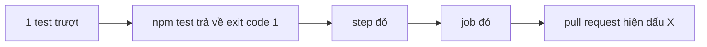

# Một project Node nhỏ có test

Chương 2 đã có một kiểu kiểm tra tự động: link hỏng. Với code, kiểm tra quan trọng nhất là **test**. Chương này dựng một project Node.js nhỏ có test, rồi để GitHub chạy test đó trên mỗi pull request.

Bạn không cần biết nhiều JavaScript. Code chỉ vài dòng, và mỗi dòng đều được giải thích. Cần cài **Node.js** trước (tab **Cài đặt**, mục 2).

## 1. Test là gì

**Test** (*kiểm thử*) là một đoạn code nhỏ gọi code thật với đầu vào đã biết, rồi **khẳng định** kết quả phải bằng một giá trị đã biết. Mỗi câu khẳng định gọi là một **assertion** (*sự khẳng định*).

Ví dụ đời thường: thầy cô ra đề có đáp án sẵn. "Điểm 8, 9, 10 thì trung bình là 9" là một assertion. Code tính ra 9 thì qua, ra số khác thì trượt.

| | Kiểm tra bằng tay | Test tự động |
| --- | --- | --- |
| Ai làm | Bạn, mở app ra thử | Máy, chạy một lệnh |
| Mất bao lâu | Vài phút mỗi lần | Vài giây |
| Có bị quên không | Hay quên khi vội | Không, CI chạy mọi lần |
| Kiểm tra lại toàn bộ sau mỗi lần sửa | Hiếm ai làm | Luôn luôn |

## 2. Tạo project

Tạo repo mới trên GitHub tên `diem-trung-binh` (public, có README), clone về rồi tạo 3 file dưới đây. Cấu trúc:

```text
diem-trung-binh/
├── package.json
├── src/
│   └── grade.js
└── test/
    └── grade.test.js
```

**`package.json`**: "lý lịch" của project Node.

```json
{
  "name": "diem-trung-binh",
  "version": "1.0.0",
  "private": true,
  "scripts": {
    "test": "node --test"
  }
}
```

**Đọc hiểu**

- **package.json** là file mô tả project: tên, phiên bản, các thư viện cần dùng, và các lệnh tắt.
- `"private": true`: không cho lỡ tay đăng project lên kho thư viện công khai npm.
- `"scripts"`: lệnh tắt. `"test": "node --test"` nghĩa là khi gõ `npm test`, npm chạy `node --test`. Node.js có sẵn bộ chạy test: `node --test` tự tìm file test và chạy chúng: các file tên kiểu `*.test.js`, và các file `.js` nằm trong thư mục `test/`.

**`src/grade.js`**: code thật.

```js
// Tính điểm trung bình, làm tròn 1 chữ số thập phân
function average(scores) {
  if (scores.length === 0) {
    throw new Error("Cần ít nhất một điểm");
  }
  const total = scores.reduce((sum, s) => sum + s, 0);
  return Math.round((total / scores.length) * 10) / 10;
}

// Xếp loại theo điểm trung bình
function classify(avg) {
  if (avg >= 8) return "Giỏi";
  if (avg >= 6.5) return "Khá";
  if (avg >= 5) return "Trung bình";
  return "Yếu";
}

module.exports = { average, classify };
```

**Đọc hiểu**

- `average(scores)` nhận một danh sách điểm. Danh sách rỗng thì `throw` (*ném*) một lỗi, vì không chia được cho 0.
- `scores.reduce(...)` cộng dồn mọi điểm thành `total`. `Math.round(x * 10) / 10` làm tròn 1 chữ số sau dấu phẩy.
- `classify(avg)` trả về xếp loại theo các mốc 8; 6,5; 5.
- `module.exports` cho file khác (file test) dùng được hai hàm này.

**`test/grade.test.js`**: test.

```js
const test = require("node:test");
const assert = require("node:assert/strict");
const { average, classify } = require("../src/grade.js");

test("average tính đúng điểm trung bình", () => {
  assert.equal(average([8, 9, 10]), 9);
  assert.equal(average([7, 8]), 7.5);
});

test("average báo lỗi khi không có điểm nào", () => {
  assert.throws(() => average([]));
});

test("classify xếp loại đúng", () => {
  assert.equal(classify(8.5), "Giỏi");
  assert.equal(classify(7), "Khá");
  assert.equal(classify(5), "Trung bình");
  assert.equal(classify(4.9), "Yếu");
});
```

**Đọc hiểu**

- `require("node:test")` lấy hàm `test` có sẵn trong Node. `require("node:assert/strict")` lấy bộ assertion.
- `require("../src/grade.js")` lấy hai hàm cần kiểm tra. `..` là "lên một thư mục", từ `test/` sang `src/`.
- Mỗi `test("tên", () => { ... })` là một ca test. Tên viết bằng câu dễ hiểu, vì khi đỏ bạn sẽ đọc nó trong log.
- `assert.equal(a, b)`: khẳng định `a` bằng `b`. Sai thì ca test trượt.
- `assert.throws(() => ...)`: khẳng định đoạn code bên trong **phải** báo lỗi.
- Ca `classify(5)` kiểm tra đúng **mốc biên**: 5 điểm phải là "Trung bình". Lỗi hay nằm ở mốc biên.

## 3. Chạy test trên máy

Trong thư mục project:

```bash
npm install
npm test
```

**Đọc hiểu**

- **npm** (*Node Package Manager*, *trình quản lý gói của Node*) có sẵn khi cài Node.js. Nó cài thư viện và chạy các lệnh tắt trong `scripts`.
- `npm install` đọc `package.json`, cài thư viện (project này chưa có thư viện nào) và tạo file `package-lock.json`.
- `npm test` chạy lệnh tắt `test`, tức `node --test`.

Kết quả (đã rút gọn vài dòng `ℹ`; số mili giây của bạn sẽ khác):

```text
✔ average tính đúng điểm trung bình (0.55ms)
✔ average báo lỗi khi không có điểm nào (0.16ms)
✔ classify xếp loại đúng (0.09ms)
ℹ tests 3
ℹ pass 3
ℹ fail 0
```

Ba dấu ✔, `fail 0`: mọi test qua.

**`package-lock.json` là gì?** Đây là **lockfile** (*file khóa*): nó ghi **chính xác** phiên bản của mọi thư viện đã cài. `package.json` có thể nói "thư viện X bản 2 trở lên"; lockfile chốt "đúng bản 2.3.1". Nhờ vậy máy bạn, máy bạn cùng nhóm và runner cài **y hệt nhau**. Luôn commit lockfile. Chương sau, runner dùng nó với `npm ci`.

## 4. Làm test đỏ, xem exit code

Cố tình gây lỗi ở mốc biên: trong `src/grade.js`, đổi `avg >= 5` thành `avg > 5`. Chạy lại:

```bash
npm test
echo $?
```

```text
✔ average tính đúng điểm trung bình (0.54ms)
✔ average báo lỗi khi không có điểm nào (0.16ms)
✖ classify xếp loại đúng (0.62ms)
ℹ tests 3
ℹ pass 2
ℹ fail 1

✖ failing tests:

test at test/grade.test.js:14:1
✖ classify xếp loại đúng (0.62ms)
  AssertionError [ERR_ASSERTION]: Expected values to be strictly equal:
  + actual - expected

  + 'Yếu'
  - 'Trung bình'

      at TestContext.<anonymous> (.../test/grade.test.js:17:10)
      ...
    actual: 'Yếu',
    expected: 'Trung bình',
1
```

**Đọc hiểu**

- Kết quả đã rút gọn: log thật còn vài dòng `ℹ` và vài dòng `at ...` chỉ chỗ lỗi trong Node, có thể bỏ qua.
- `✖ classify xếp loại đúng`: ca test nào trượt.
- `test at test/grade.test.js:14:1`: ca test đó bắt đầu ở dòng 14 của file test.
- `+ actual` là giá trị code **thật sự** trả về (`'Yếu'`); `- expected` là giá trị test **mong đợi** (`'Trung bình'`). Vậy `classify(5)` đang sai.
- `grade.test.js:17:10`: dòng 17 là đúng dòng `assert.equal(classify(5), ...)` bị trượt.
- Hai dòng `actual:` và `expected:` nói lại điều đó, và **luôn có** trong log. Phần so sánh phía trên thì đổi kiểu tùy phiên bản Node và độ dài chuỗi: có lúc là `+ actual - expected` như trên, có lúc gọn một dòng như `'Khá' !== 'Giỏi'`, trong terminal có màu thì chữ được tô màu từng ký tự. Không chắc thì tìm hai dòng `actual:` / `expected:`.
- Số `1` cuối cùng là exit code (in bởi `echo $?`; trong PowerShell dùng `echo $LASTEXITCODE`). **Test trượt thì `npm test` trả về khác 0.**

Đây là mảnh ghép nối chương 1 với chương này: runner thấy exit code khác 0 nên đánh step đỏ. Test trượt → `npm test` trả về 1 → step đỏ → job đỏ → pull request hiện dấu X.



Đổi lại `avg >= 5`, chạy `npm test` cho xanh, rồi commit cả 4 file (kể cả `package-lock.json`) và push lên `main`.

## 5. Sai lầm thường gặp

| Nghĩ sai | Thật ra |
| --- | --- |
| "Test xanh nghĩa là code không có lỗi." | Test chỉ chứng minh các ca **đã viết** chạy đúng. Ca chưa viết thì chưa ai biết. |
| "Không cần commit `package-lock.json`." | Thiếu nó, `npm ci` trên runner báo lỗi, và mỗi máy có thể cài bản thư viện khác nhau. |
| "Thêm `node_modules/` vào repo cho chắc." | Không. Thư mục đó được tạo lại từ lockfile. Thêm `node_modules/` vào `.gitignore`. |

## 6. Ngoài thực tế

Ở công ty, mỗi tính năng mới hoặc mỗi lần sửa lỗi thường đi kèm test. Sửa một bug thì viết thêm một test **tái hiện** bug đó trước, để nó không quay lại. Người review PR hay hỏi câu đầu tiên: "có test chưa?".

## 7. Khi bị lỗi

| Lỗi | Vì sao | Cách sửa |
| --- | --- | --- |
| `npm: command not found` / `'npm' is not recognized` | Chưa cài Node.js, hoặc chưa mở lại terminal sau khi cài | Làm mục 2 tab **Cài đặt**, mở terminal mới |
| `Cannot find module '../src/grade.js'` | Sai tên thư mục hoặc tên file | So lại với cây thư mục ở mục 2 |
| `tests 0` | Node không tìm thấy file test nào: sai tên, sai thư mục, hoặc chạy lệnh ở ngoài thư mục project | Đặt file đúng `test/grade.test.js` như cây ở mục 2, và chạy `npm test` trong thư mục `diem-trung-binh` |
| Lỗi khác, hoặc chưa hiểu vì sao | | Nhắn mentor của track, công khai hay **nhắn riêng** đều được (tab **Cài đặt** → "Hỏi ở đâu") |

## Tóm tắt

- Test gọi code với đầu vào đã biết và khẳng định kết quả (assertion).
- `npm test` chạy lệnh tắt trong `package.json`; test trượt thì exit code khác 0.
- Commit `package-lock.json` để mọi máy cài giống nhau.
