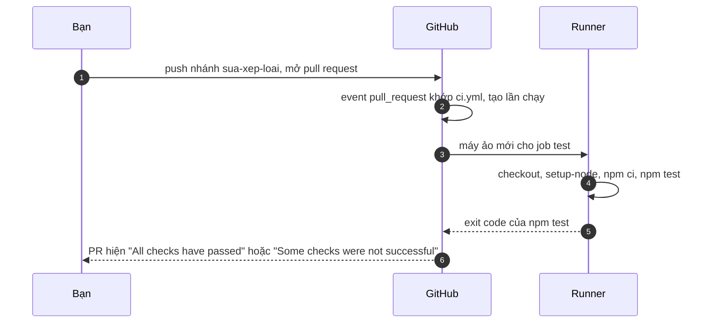

# Workflow CI: chạy test trên mỗi pull request

Bài trước, bạn tự chạy `npm test` trên máy. Bài này để runner chạy nó **mỗi khi có pull request**, để không ai merge được code làm hỏng test mà không biết.

**Pull request** (PR, *yêu cầu kéo/gộp*) là lời đề nghị: "hãy gộp các commit trên nhánh của tôi vào `main`". **Merge** (*gộp*) là hành động gộp đó. Bạn đã gặp PR ở track Git/GitHub và ở chương 2.

## 1. Workflow

Trong repo `diem-trung-binh`, tạo `.github/workflows/ci.yml`:

```yaml
name: CI

on:
  pull_request:
  push:
    branches: [main]

permissions:
  contents: read

jobs:
  test:
    runs-on: ubuntu-latest
    steps:
      - name: Lấy code
        uses: actions/checkout@v7

      - name: Cài Node.js
        uses: actions/setup-node@v7
        with:
          node-version: 24

      - name: Cài thư viện
        run: npm ci

      - name: Chạy test
        run: npm test
```

**Đọc hiểu**

- `on: pull_request` và `push` lên `main`: chạy test trên mọi PR, và chạy lại sau khi merge vào `main` (để biết `main` luôn xanh).
- `permissions: contents: read`: job chỉ cần đọc code (chương 2 đã giải thích; chương 7 nói kỹ).
- `actions/setup-node@v7`: action **setup-node** (*cài đặt Node*) cài đúng phiên bản Node.js lên runner. Runner Ubuntu có sẵn một bản Node, nhưng bản đó do GitHub chọn và có thể đổi bất cứ lúc nào. Tự ghi `node-version: 24` thì kết quả không phụ thuộc lựa chọn của GitHub.
- `run: npm ci`: cài thư viện **đúng theo lockfile** (giải thích ở mục 2).
- `run: npm test`: chạy test. Test trượt → exit code 1 → step đỏ (bài trước).

## 2. `npm ci` khác `npm install` ở đâu

**npm ci** (*ci* = *clean install*, *cài sạch*; cũng gợi tới CI) được làm riêng cho máy tự động.

| | `npm install` | `npm ci` |
| --- | --- | --- |
| Dùng khi | Bạn đang phát triển trên máy | Runner, CI |
| Đọc từ | `package.json`, có thể **sửa** lockfile | Chỉ lockfile, **không bao giờ** sửa nó |
| Lockfile không khớp `package.json` | Tự cập nhật lockfile | **Báo lỗi** và dừng |
| Thiếu lockfile | Tạo lockfile mới | **Báo lỗi** |
| `node_modules/` có sẵn | Giữ, cài thêm | Xóa sạch rồi cài lại |

Vì sao CI cần sự khắt khe đó? Vì mục đích của CI là kiểm tra **đúng thứ sẽ chạy thật**. Nếu CI tự đổi phiên bản thư viện, nó đang test một thứ khác với thứ bạn commit.

## 3. Chuyện gì xảy ra khi bạn mở PR



**Đọc hiểu**

- Với event `pull_request`, code được checkout là **kết quả gộp thử** nhánh của bạn vào `main`, chưa gộp thật. Nghĩa là CI kiểm tra "nếu merge PR này thì `main` có còn chạy không".
- Mỗi lần push thêm commit lên nhánh của PR, GitHub chạy lại từ đầu trên runner mới.

## 4. Thử một PR có test đỏ

```bash
git switch -c sua-xep-loai
```

**Đọc hiểu**

- Tạo nhánh `sua-xep-loai` và chuyển sang. Mọi thay đổi tiếp theo nằm trên nhánh này, không đụng `main`.

Trong `src/grade.js`, đổi mốc "Giỏi" từ `avg >= 8` thành `avg >= 9` (giả sử bạn hiểu nhầm quy chế). Commit, push, mở PR:

```bash
git commit -am "Đổi mốc xếp loại Giỏi"
git push -u origin sua-xep-loai
```

**Đọc hiểu**

- `git commit -am` commit mọi file đã theo dõi có thay đổi; `git push -u origin sua-xep-loai` đẩy nhánh lên GitHub.
- Trên trang repo, GitHub hiện nút **Compare & pull request**. Bấm, rồi **Create pull request**.

Ở cuối trang PR, mục kiểm tra hiện chấm vàng rồi dấu X đỏ: `CI / test (pull_request)` thất bại. Bấm **Details** để mở log, tìm step **Chạy test**, đọc từ dưới lên như chương 1. Bạn sẽ thấy `classify(8.5)` trả về `'Khá'` trong khi test mong `'Giỏi'`.

Có hai cách xử lý, và **chính bạn** phải quyết định cách nào đúng:

- quy chế không đổi → sửa code lại `avg >= 8`;
- quy chế đổi thật → sửa **test** cho khớp quy chế mới, và ghi rõ lý do trong PR.

Ở đây quy chế không đổi: sửa code lại, commit, push. PR tự chạy lại và xanh.

## 5. Sai lầm thường gặp

| Nghĩ sai | Thật ra |
| --- | --- |
| "Test đỏ thì sửa test cho xanh là xong." | Test đỏ là tín hiệu. Đọc kỹ nó báo gì trước. Sửa test chỉ khi yêu cầu thật sự đã đổi. |
| "Máy tôi xanh nên CI đỏ là lỗi của CI." | Runner là máy sạch. CI đỏ mà máy bạn xanh thường là do quên commit một file, hoặc lockfile cũ. |
| "Chỉ cần chạy CI trên `main`." | Lúc đó lỗi đã vào `main` rồi. Chạy trên PR để chặn **trước** khi merge. |

## 6. Ngoài thực tế

Quy trình hằng ngày ở công ty: tạo nhánh → commit → mở PR → **CI chạy test** → review → merge. Nhiều nhóm có quy tắc "không review PR đỏ": người viết PR tự đọc log và sửa trước. Khi bỏ CI, mỗi người phải tự nhớ chạy test, và chỉ cần một người quên là `main` hỏng cho cả nhóm.

## 7. Khi bị lỗi

| Lỗi trong log | Vì sao | Cách sửa |
| --- | --- | --- |
| `npm ci` báo ``The `npm ci` command can only install with an existing package-lock.json`` | Chưa commit lockfile | `npm install` trên máy, commit `package-lock.json` |
| `npm ci` báo ``can only install packages when your package.json and package-lock.json ... are in sync`` | Sửa `package.json` mà chưa cập nhật lockfile | `npm install` trên máy, commit lockfile mới |
| Không có check nào trên PR | `ci.yml` chưa nằm trên nhánh của PR, hoặc thiếu `pull_request` trong `on` | Thêm file vào nhánh, kiểm tra `on:` |
| Lỗi khác, hoặc chưa hiểu vì sao | | Gửi link lần chạy cho mentor, công khai hay **nhắn riêng** đều được (tab **Cài đặt** → "Hỏi ở đâu") |

## Tóm tắt

- `setup-node` ghim phiên bản Node; `npm ci` cài đúng lockfile; `npm test` chạy test.
- CI chạy trên PR để chặn lỗi trước khi merge; kết quả hiện ngay trên trang PR.
- Test đỏ: đọc log, quyết định sửa code hay sửa test, rồi push lại.
