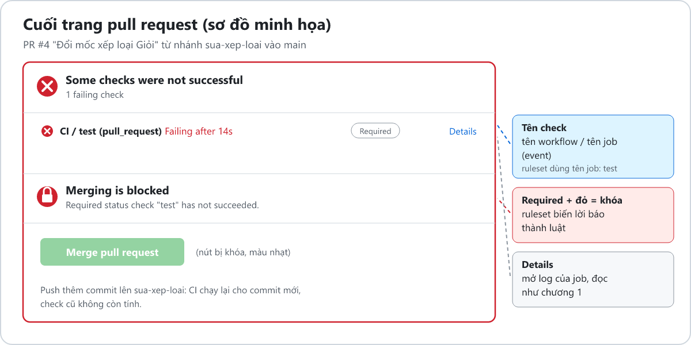
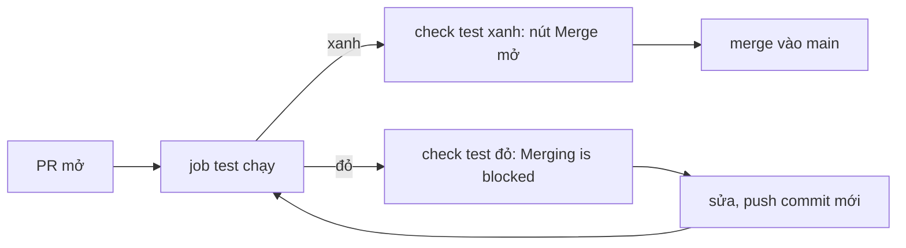

# Status check và required check: chặn merge khi CI đỏ

Bài trước, CI đỏ hiện trên PR. Nhưng nút **Merge pull request** vẫn bấm được! CI chỉ **báo**, chưa **chặn**. Bài này biến lời báo thành luật.

## 1. Status check là gì, gắn vào đâu

Mỗi job chạy xong, GitHub ghi một **status check** (*kết quả kiểm tra trạng thái*) và **gắn nó vào commit** đã được kiểm tra: xanh (thành công), đỏ (thất bại), vàng (đang chạy), xám (bị bỏ qua).

Vì gắn vào commit, nên:

- trang PR hiện check của **commit mới nhất** trên nhánh;
- push commit mới thì check cũ không còn tính, GitHub chạy lại;
- trong danh sách commit của repo, mỗi commit có dấu tick hoặc X nhỏ bên cạnh.

Tên của một check trên trang PR có dạng `<tên workflow> / <tên job> (<event>)`, ví dụ `CI / test (pull_request)`.



## 2. Required check: biến báo thành chặn

**Required check** (*check bắt buộc*) là check mà GitHub **không cho merge** khi nó chưa xanh. Bạn bật nó bằng luật cho nhánh `main`. GitHub có hai cách đặt luật cho nhánh:

| | **Branch protection** (*bảo vệ nhánh*) | **Ruleset** (*bộ luật*) |
| --- | --- | --- |
| Có từ | Lâu rồi, cách cũ | Mới hơn, GitHub khuyên dùng |
| Áp cho | Một mẫu tên nhánh | Nhiều nhánh, tag, bật/tắt được cả bộ |
| Ở đâu | **Settings** → **Branches** | **Settings** → **Rules** → **Rulesets** |

Bài này dùng **ruleset**. Repo public dùng miễn phí; repo private của tài khoản miễn phí thì luật không được áp dụng.



## 3. Bật ruleset từng bước

Làm trong repo `diem-trung-binh` (cần quyền admin, repo của bạn thì bạn có):

1. **Settings** → **Rules** → **Rulesets** → **New ruleset** → **New branch ruleset**.
2. **Ruleset Name**: `bao-ve-main`. **Enforcement status**: **Active** (*đang áp dụng*).
3. **Target branches** → **Add target** → **Include default branch** (nhánh mặc định, tức `main`).
4. Trong **Branch rules**, đánh dấu:
   - **Require a pull request before merging**: không ai push thẳng lên `main`, mọi thay đổi phải qua PR;
   - **Require status checks to pass**: bấm **Add checks**, gõ `test`, chọn check `test` (tên **job** trong `ci.yml`).
5. **Create**.

**Đọc hiểu**

- Check chỉ hiện trong ô tìm khi nó đã chạy ít nhất một lần gần đây. Vì thế phải làm bài trước xong rồi mới bật ruleset.
- Tên check là tên **job** (`test`), không phải tên file (`ci.yml`) hay tên workflow (`CI`). Đổi tên job sau này thì phải sửa ruleset.
- Mục **Bypass list** (*danh sách được vượt luật*) để trống: kể cả bạn, chủ repo, cũng phải theo luật (lần chạy thử xác nhận: push thẳng của chủ repo cũng bị từ chối). Đừng tự thêm mình vào đó: luật có ý nghĩa khi áp cho mọi người.
- Tên check là tên job ở **bất kỳ** workflow nào. Nếu hai workflow cùng có job tên `test`, check nào xanh cũng làm luật hài lòng. Đặt tên job khác nhau để luật kiểm tra đúng thứ bạn muốn (chương 5 có ví dụ).

## 4. Thử lại

Mở lại một PR làm test đỏ (như bài trước). Lần này nút merge bị khóa, kèm dòng **Merging is blocked** và check `test` có nhãn **Required**. Sửa cho xanh: nút mở lại.

Thử `git push` thẳng lên `main` từ máy:

```bash
git switch main
git commit --allow-empty -m "Thử push thẳng"
git push
```

**Đọc hiểu**

- `git switch main`: về nhánh `main`.
- `--allow-empty`: cho phép commit không có thay đổi, chỉ để thử.
- `git push` bị từ chối. Thông báo thật khi chạy thử:

  ```text
  remote: error: GH013: Repository rule violations found for refs/heads/main.
  remote: - Changes must be made through a pull request.
  remote: - Required status check "test" is expected.
   ! [remote rejected] main -> main (push declined due to repository rule violations)
  ```

  Mỗi dòng `-` là một luật bị vi phạm: chưa qua PR, và chưa có check `test` xanh. Ruleset đang hoạt động.
- Dọn dẹp commit thử: `git reset --hard origin/main` đưa `main` trên máy về đúng bản trên GitHub (xóa commit rỗng vừa tạo).

## 5. Badge trên README

**Badge** (*huy hiệu*) là ảnh nhỏ hiện "passing" (xanh) hoặc "failing" (đỏ) theo lần chạy gần nhất trên nhánh mặc định. Người khác mở repo là biết ngay `main` có khỏe không. Thêm vào đầu `README.md` (đổi `ten-ban/diem-trung-binh` thành repo của bạn):

```markdown
[](https://github.com/ten-ban/diem-trung-binh/actions/workflows/ci.yml)
```

**Đọc hiểu**

- `` là ảnh; bọc trong `[...](...)` để bấm vào ảnh thì mở trang workflow.
- `ci.yml` là **tên file** workflow (khác với tên check ở mục 3).
- Cũng lấy được từ tab **Actions** → chọn workflow **CI** → nút **…** → **Create status badge**.

## 6. Sai lầm thường gặp

| Tình huống | Vì sao | Cách sửa |
| --- | --- | --- |
| PR treo mãi ở `Expected — Waiting for status to be reported` | Check bắt buộc không bao giờ chạy: đổi tên job, workflow bị lọc `paths`/`branches`, hoặc job bị `if` bỏ qua | Sửa tên check trong ruleset cho khớp, hoặc cho job luôn chạy trên PR |
| Không tìm thấy check `test` khi Add checks | Workflow chưa chạy lần nào | Mở một PR để CI chạy, rồi quay lại |
| Ruleset không có tác dụng | **Enforcement status** đang **Disabled** hoặc **Evaluate**, hoặc repo private của tài khoản miễn phí | Chọn **Active**; dùng repo public |

## 7. Ngoài thực tế

Hầu hết các nhóm đặt cho `main`: bắt buộc qua PR, bắt buộc CI xanh, bắt buộc ít nhất một người review đồng ý (**Require approvals**). Ở dự án mã nguồn mở, required check là thứ giúp maintainer yên tâm: họ chỉ cần đọc PR đã xanh. Bỏ required check thì sớm muộn sẽ có người merge lúc vội, `main` đỏ, và cả nhóm phải dừng việc để sửa.

## 8. Khi bị lỗi

| Lỗi | Vì sao | Cách sửa |
| --- | --- | --- |
| Không thấy mục **Rules** trong Settings | Không có quyền admin | Làm trên repo của chính bạn |
| `GH013` khi push lên nhánh khác `main` | Target của ruleset rộng hơn ý muốn | Sửa **Target branches** chỉ còn nhánh mặc định |
| Lỗi khác, hoặc chưa hiểu vì sao | | Nhắn mentor của track, công khai hay **nhắn riêng** đều được (tab **Cài đặt** → "Hỏi ở đâu") |

## Tóm tắt

- Status check gắn vào commit; tên trên PR dạng `CI / test (pull_request)`.
- Ruleset với **Require status checks to pass** biến check thành **required check**: đỏ thì không merge được.
- Badge trong README cho mọi người thấy `main` đang xanh hay đỏ.
