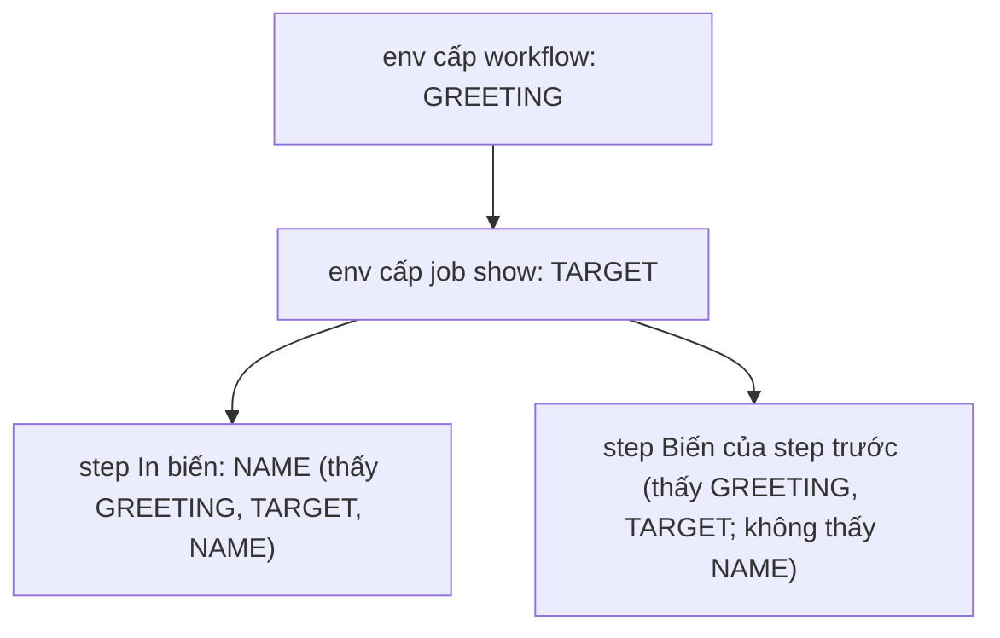

# Biến môi trường và biến cấu hình (env, vars)

Workflow hay cần những giá trị có thể đổi: tên site, phiên bản Node, địa chỉ server. Viết thẳng giá trị đó ở nhiều chỗ thì khi đổi phải sửa nhiều chỗ và dễ sót. Chương này dạy ba "ngăn kéo" để cất giá trị: `env`, `vars` và (bài sau) `secrets`.

## 1. Biến môi trường là gì

**Environment variable** (*biến môi trường*) là một cặp `TÊN=giá trị` mà hệ điều hành đưa cho mọi chương trình đang chạy. Chương trình đọc nó như đọc một tờ ghi chú dán sẵn trên bàn làm việc.

Bạn đã dùng nó mà không để ý: `PATH` cho terminal biết tìm lệnh ở đâu, `HOME` là thư mục nhà của bạn. Thử trên máy:

```bash
echo $HOME
```

**Đọc hiểu**

- `$HOME`: bash thay `$HOME` bằng giá trị của biến `HOME` rồi mới chạy `echo`. Bạn thấy kiểu `/home/ten-ban` hoặc `/Users/ten-ban`.
- Trong PowerShell trên Windows, biến môi trường đọc bằng `$env:TÊN`: chạy `echo $env:USERPROFILE`. Windows thường không có biến `HOME`, nên `$env:HOME` hay ra rỗng. PowerShell còn có biến riêng `$HOME`, cũng in thư mục nhà, ví dụ `C:\Users\ten-ban`.

Trên runner, GitHub đặt sẵn nhiều biến, tên bắt đầu bằng `GITHUB_` hoặc `RUNNER_`: `GITHUB_SHA` (mã commit), `GITHUB_REPOSITORY` (tên repo), `RUNNER_OS` (`Linux`, `Windows`, `macOS`).

## 2. Khai báo `env` ở ba cấp

Khóa **`env`** trong workflow tạo biến môi trường cho runner. Đặt ở đâu thì biến có **scope** (*phạm vi*) ở đó.

Tạo `.github/workflows/env-demo.yml` trong repo `diem-trung-binh`:

```yaml
name: Env demo

on: workflow_dispatch

permissions:
  contents: read

env:
  GREETING: Xin chào        # cấp workflow: mọi job thấy

jobs:
  show:
    runs-on: ubuntu-latest
    env:
      TARGET: runner        # cấp job: mọi step của job show thấy
    steps:
      - name: In biến
        env:
          NAME: An          # cấp step: chỉ step này thấy
        run: echo "$GREETING $NAME từ $TARGET, commit $GITHUB_SHA"

      - name: Biến của step trước
        run: echo "NAME bây giờ là '$NAME'"
```

**Đọc hiểu**

- `on: workflow_dispatch`: chỉ chạy khi bấm **Run workflow** (chương 1). Tiện để thử, không chạy mỗi lần push.
- `env:` ở cấp workflow tạo `GREETING`; ở cấp job tạo `TARGET`; ở cấp step tạo `NAME`.
- `run: echo "$GREETING $NAME ..."`: bash thay `$GREETING`, `$NAME`, `$TARGET`, `$GITHUB_SHA` bằng giá trị lúc chạy. Log in `Xin chào An từ runner, commit 3f2a9c…`.
- Step thứ hai in `NAME bây giờ là ''`: `NAME` chỉ sống trong step đầu. Mỗi step là một tiến trình shell riêng; khi step xong, biến của nó mất.



Cùng một tên khai báo ở nhiều cấp thì cấp **gần nhất** thắng: step đè job, job đè workflow.

## 3. Hai cách đọc biến: `$TEN` và `${{ env.TEN }}`

| | `$TEN` | `${{ env.TEN }}` |
| --- | --- | --- |
| Ai đọc | **Shell** (bash) trên runner | **GitHub**, trước khi gửi lệnh tới runner |
| Lúc nào | Lúc lệnh chạy | Lúc chuẩn bị step |
| Dùng được ở đâu | Chỉ trong `run` | Mọi chỗ nhận biểu thức: `with:`, `if:`, `name:`… |
| Ví dụ | `run: echo "$NAME"` | `with: node-version: ${{ env.NODE_VERSION }}` |

Quy tắc đơn giản cho track này: **trong `run`, đọc bằng `$TEN`**. Ngoài `run` (ví dụ input `with:` của action), dùng `${{ env.TEN }}`. Chương 7 giải thích vì sao thói quen này giúp tránh một lỗ hổng bảo mật.

## 4. Biến cấu hình `vars`: giá trị nằm ngoài file workflow

`env` nằm **trong** file YAML, nên muốn đổi giá trị phải commit. Có những giá trị bạn muốn đổi mà không sửa code, ví dụ tên site hiện trên trang. Đó là việc của **vars** (*variables*, *biến cấu hình*): giá trị cất trong **Settings** của repo, workflow đọc qua context `vars`.

Tạo biến:

1. Repo → **Settings** → **Secrets and variables** → **Actions**.
2. Tab **Variables** → **New repository variable**.
3. **Name**: `SITE_NAME`, **Value**: `Điểm trung bình của An`. **Add variable**.

Thêm step thứ ba vào job `show`:

```yaml
      - name: Đọc biến cấu hình
        env:
          SITE_NAME: ${{ vars.SITE_NAME }}
        run: |
          echo "Tên site: $SITE_NAME"
```

**Đọc hiểu**

- `${{ vars.SITE_NAME }}`: GitHub lấy giá trị từ Settings, đặt vào biến môi trường `SITE_NAME` của step.
- `run` đọc nó bằng `$SITE_NAME`, đúng quy tắc ở mục 3.
- `run: |` rồi viết lệnh ở dòng dưới: bắt buộc ở đây vì lệnh có `: ` (dấu hai chấm rồi dấu cách) trong chữ `Tên site: `. Viết trên một dòng thì YAML tưởng đó là một cặp `khóa: giá trị` mới và báo lỗi.
- Biến chưa tạo thì `${{ vars.SITE_NAME }}` thành chuỗi rỗng, **không báo lỗi**. Log in `Tên site: ` là dấu hiệu bạn gõ sai tên.

Bấm **Run workflow**, xem log. Rồi sửa giá trị trong Settings, chạy lại: log đổi theo mà không cần commit.

## 5. Chọn ngăn kéo nào

| | `env` trong YAML | `vars` | `secrets` (bài sau) |
| --- | --- | --- | --- |
| Nằm ở | File workflow, trong Git | Settings của repo | Settings, **mã hóa** |
| Ai đọc được giá trị | Ai đọc được repo | Người có quyền vào Settings, và **ai đọc được log** (repo public: mọi người) | Không ai đọc lại được, kể cả bạn |
| Hiện trong log | Có | Có | Bị che thành `***` |
| Đổi giá trị | Commit | Sửa trong Settings | Sửa trong Settings |
| Ví dụ | `NODE_VERSION: 24` | Tên site, URL trang staging | Token, mật khẩu, webhook URL |

Với repo **public**, ai cũng đọc được log, nên giá trị `vars` in ra log coi như công khai.

Câu hỏi để chọn: "**Lộ giá trị này ra có sao không?**" Có sao → `secrets`. Không sao, nhưng muốn đổi không cần commit → `vars`. Còn lại → `env`.

## 6. Sai lầm thường gặp

| Nghĩ sai | Thật ra |
| --- | --- |
| "Đặt biến trong step 1 thì step 2 dùng được." | Mỗi step là một tiến trình riêng. Muốn dùng chung thì đặt ở cấp job. |
| "Gõ sai tên `vars` sẽ báo lỗi." | Ra chuỗi rỗng, không báo. Luôn in thử hoặc kiểm tra giá trị. |
| "Để mật khẩu trong `vars` cũng được, đằng nào cũng ở Settings." | `vars` hiện rõ trong log và trong Settings. Mật khẩu phải là `secrets`. |

## 7. Ngoài thực tế

Ở công ty, cùng một workflow thường deploy lên nhiều nơi (staging để thử, production cho người dùng thật). Thay vì chép hai file workflow, người ta để địa chỉ server, tên miền… trong `vars` của từng môi trường (bài 3 của chương). Đổi server thì người vận hành sửa Settings, lập trình viên không cần mở PR.

## 8. Khi bị lỗi

| Lỗi | Vì sao | Cách sửa |
| --- | --- | --- |
| Biến in ra rỗng | Sai tên, sai scope, hoặc `vars` chưa tạo | So tên từng chữ (phân biệt hoa thường), xem biến khai báo ở cấp nào |
| Không thấy nút **Run workflow** | Workflow chưa nằm trên nhánh mặc định | Merge file workflow vào `main` |
| `git push` lên `main` bị từ chối với `GH013` | Ruleset ở chương 3 bắt buộc qua PR | Tạo nhánh, push nhánh, mở PR, merge khi CI xanh |
| Lỗi khác, hoặc chưa hiểu vì sao | | Nhắn mentor của track, công khai hay **nhắn riêng** đều được (tab **Cài đặt** → "Hỏi ở đâu") |

## Tóm tắt

- `env` tạo biến môi trường; cấp workflow, job, step quyết định ai thấy biến.
- Trong `run` đọc bằng `$TEN`; ngoài `run` dùng `${{ env.TEN }}`.
- `vars` cất giá trị không bí mật trong Settings, đổi được mà không cần commit.
