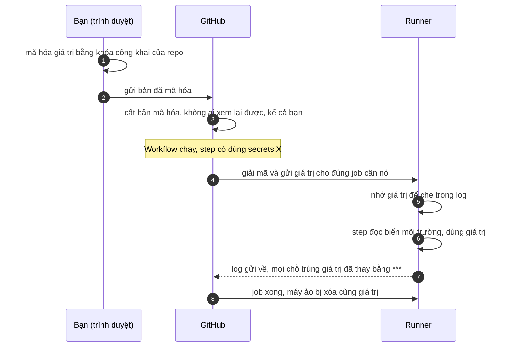
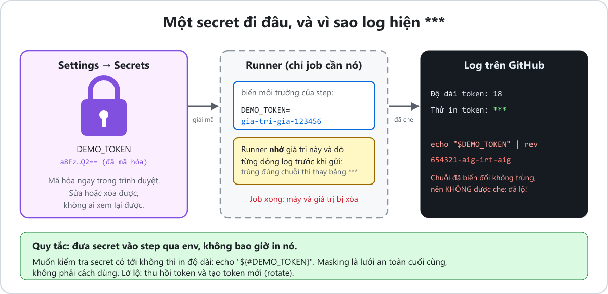

# Secrets: giữ bí mật trong workflow

Workflow thật thường cần những giá trị không được lộ: **token** (*thẻ, mã thông hành*: một chuỗi dài thay cho mật khẩu, ai cầm nó là làm được việc nó cho phép), mật khẩu, webhook URL. Bỏ chúng vào file YAML là ai đọc được repo cũng thấy, và Git giữ lịch sử mãi mãi. Nơi đúng cho chúng là **secret** (*bí mật*).

## 1. Đường đi của một secret

Hiểu đường đi này thì hiểu luôn vì sao secret an toàn, và khi nào nó **không** an toàn.





**Đọc hiểu**

1. Giá trị được **mã hóa ngay trong trình duyệt** trước khi rời máy bạn.
2. GitHub chỉ cất bản mã hóa. Trang Settings cho **sửa** hoặc **xóa**, không bao giờ cho **xem lại**.
3. Chỉ khi một job có dùng `secrets.X`, GitHub mới giải mã và gửi giá trị tới runner của job đó.
4. Runner nhớ giá trị đó. Mỗi dòng log, trước khi gửi về GitHub, được dò: chỗ nào **trùng đúng chuỗi** secret thì thay bằng `***`. Đây gọi là **masking** (*che mặt nạ*).
5. Job xong, máy ảo bị xóa, giá trị đi theo.

Điểm yếu nằm ở bước 4: runner chỉ che **đúng chuỗi đó**. Mục 4 sẽ cho thấy chuyện gì xảy ra khi chuỗi bị biến đổi.

## 2. Tạo secret

Dùng một giá trị **giả** để thử, đừng dùng token thật:

1. Repo `diem-trung-binh` → **Settings** → **Secrets and variables** → **Actions**.
2. Tab **Secrets** → **New repository secret**.
3. **Name**: `DEMO_TOKEN`. **Secret**: `gia-tri-gia-123456`. **Add secret**.

Tên secret chỉ gồm chữ, số và `_`, không bắt đầu bằng số hay bằng `GITHUB_`.

## 3. Dùng secret đúng cách: qua `env`

Tạo `.github/workflows/secret-demo.yml`:

```yaml
name: Secret demo

on: workflow_dispatch

permissions:
  contents: read

jobs:
  demo:
    runs-on: ubuntu-latest
    steps:
      - name: Dùng secret qua env
        env:
          DEMO_TOKEN: ${{ secrets.DEMO_TOKEN }}
        run: |
          echo "Độ dài token: ${#DEMO_TOKEN}"
          echo "Thử in token: $DEMO_TOKEN"
```

**Đọc hiểu**

- `${{ secrets.DEMO_TOKEN }}`: context `secrets`, đọc secret tên `DEMO_TOKEN`. GitHub đưa giá trị vào biến môi trường `DEMO_TOKEN` của **riêng step này**.
- `run: |`: dấu `|` cho phép viết **nhiều dòng lệnh**, mỗi dòng một lệnh, thụt lề đều nhau.
- `${#DEMO_TOKEN}`: cú pháp bash, ra **độ dài** của chuỗi. Cách kiểm tra "secret có tới không" mà không in giá trị.
- Dòng thứ hai cố tình in secret, để bạn thấy masking.

Bấm **Run workflow**. Log:

```text
Độ dài token: 18
Thử in token: ***
```

Runner đã che. Nhưng **đừng dựa vào masking**: nó là lưới an toàn cuối cùng, không phải cách dùng. Quy tắc là **không bao giờ in secret**, kể cả "để kiểm tra". Muốn kiểm tra thì in độ dài như dòng đầu.

## 4. Masking bị lọt thế nào

Thêm vào cuối `run` một dòng (chỉ làm với giá trị giả):

```bash
echo "$DEMO_TOKEN" | rev
```

**Đọc hiểu**

- `|` (*pipe*, *ống*) đưa output của lệnh trước làm input cho lệnh sau.
- `rev` (*reverse*) đảo ngược chuỗi. Log in `654321-aig-irt-aig`: chuỗi đảo ngược **không trùng** chuỗi gốc, nên runner không che.

Cùng lý do, những việc sau làm lộ secret dù có masking:

| Việc | Vì sao lọt |
| --- | --- |
| In secret qua `base64`, `rev`, cắt một nửa | Chuỗi đã đổi, không còn trùng |
| Bật `set -x` trong step có secret | Bash in **từng lệnh** kèm giá trị biến trước khi chạy; thường bị che, nhưng không chắc với mọi dạng biến đổi |
| Gửi secret tới một trang web lạ bằng `curl` | Không qua log; masking không liên quan |
| Ghi secret ra file rồi upload thành artifact (chương 5) | Artifact không được che |

Giá trị **tính ra từ** secret mà cũng cần giấu thì báo runner che thêm:

```bash
echo "::add-mask::$GIA_TRI_MOI"
```

**Đọc hiểu**

- Dòng bắt đầu bằng `::add-mask::` là một **lệnh cho runner** (không phải lệnh bash): từ đây, mọi chỗ trùng `$GIA_TRI_MOI` trong log đều thành `***`.

## 5. Ai **không** nhận được secret

| Tình huống | Có secret không | Vì sao |
| --- | --- | --- |
| Push lên repo của bạn | Có | Người push có quyền ghi repo |
| PR từ nhánh trong **cùng** repo | Có | Người tạo nhánh có quyền ghi repo |
| PR từ **fork** (repo người khác chép từ repo của bạn) | **Không** | Người lạ có thể sửa workflow để in secret; GitHub chặn trước |
| PR do Dependabot mở | Không (dùng bộ secret riêng của Dependabot) | Cùng lý do an toàn |

Chương 7 nói kỹ về fork. Ở đây chỉ cần nhớ: workflow chạy trên PR từ fork thì `secrets.X` là chuỗi rỗng.

## 6. Lỡ lộ secret thì sao

Coi như đã mất. Xóa log hay xóa commit **không** đủ: người khác có thể đã đọc, và bản sao có thể nằm ở fork hay máy ai đó. Làm ngay:

1. **Rotate** (*xoay vòng*): vào nơi cấp token (Discord, nhà cung cấp…) **thu hồi** token cũ, tạo token mới.
2. Cập nhật secret trong Settings bằng giá trị mới.
3. Tìm nguyên nhân (dòng `echo`, `set -x`…) và sửa workflow.

## 7. Hỏi bài mà không lộ secret

Bạn **nên** hỏi khi bị kẹt, và hoàn toàn hỏi được mà không lộ gì:

- gửi **link lần chạy** (log đã che `***`) thay vì copy log ra chỗ khác;
- chụp màn hình thì **tô đen** mọi chuỗi giống token, kể cả một phần;
- dán đoạn YAML thì thay giá trị bằng `<đã che>`; tên secret (`DEMO_TOKEN`) không phải bí mật, giữ nguyên được.

## 8. Ngoài thực tế

Ở công ty, secret thường do người phụ trách hạ tầng tạo, lập trình viên chỉ biết **tên** secret để dùng trong workflow. Token được cấp với quyền **hẹp nhất** có thể và có hạn dùng, để lỡ lộ thì thiệt hại nhỏ. Mỗi lần có người rời nhóm, các secret họ từng biết được rotate. Bỏ qua những việc này là lý do của rất nhiều vụ lộ dữ liệu: token bị đẩy lên GitHub công khai, bị bot quét được trong vài phút.

## 9. Khi bị lỗi

| Lỗi | Vì sao | Cách sửa |
| --- | --- | --- |
| `Độ dài token: 0` | Sai tên secret, hoặc chạy từ PR của fork | So tên từng chữ; chạy bằng **Run workflow** trên repo của bạn |
| Không xem lại được giá trị secret đã nhập | Thiết kế của GitHub | Nhập lại giá trị mới bằng **Update** |
| Lỡ in secret thật ra log | | Làm ngay mục 6, rồi nhắn mentor nếu cần giúp |
| Lỗi khác, hoặc chưa hiểu vì sao | | Nhắn mentor của track, công khai hay **nhắn riêng** đều được (nhớ che secret như mục 7) |

## Tóm tắt

- Secret được mã hóa từ trình duyệt, chỉ giải mã cho job cần nó, và bị che thành `***` trong log khi **trùng đúng chuỗi**.
- Đưa secret vào step qua `env:`; không in, không biến đổi rồi in, không `set -x`.
- PR từ fork không nhận secret. Lỡ lộ thì rotate ngay.
