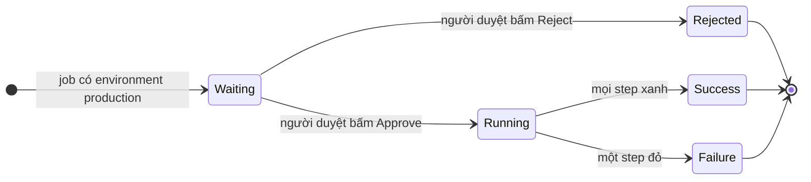
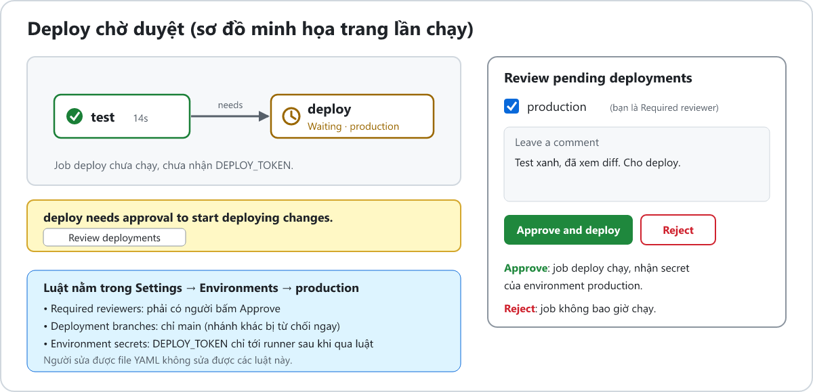

# Environments: deploy có người duyệt

Ở chương 2, job deploy có dòng `environment: github-pages`. Bài này giải thích environment là gì, và dùng nó để **bắt người duyệt** trước khi deploy.

## 1. Environment là gì

Environment (*môi trường*) là **một nơi code được deploy tới**, có tên. Các công ty thường có ít nhất hai:

- **staging** (*sân khấu chuẩn bị*, *khu chạy thử*): bản giống thật để nhóm thử trước;
- **production** (*sản xuất*, hay gọi "prod"): bản người dùng thật đang dùng.

Trong GitHub, mỗi environment là một "phòng có khóa" chứa:

| Thứ trong environment | Tác dụng |
| --- | --- |
| Secrets riêng | Token deploy prod chỉ nằm ở đây, job khác không lấy được |
| Variables riêng | Ví dụ `SITE_URL` khác nhau cho staging và production |
| **Protection rules** (*luật bảo vệ*) | Điều kiện phải thỏa **trước khi** job được chạy |

Protection rule hay dùng:

| Luật | Nghĩa |
| --- | --- |
| **Required reviewers** (*người duyệt bắt buộc*) | Job dừng chờ, một trong những người được chỉ định bấm **Approve** thì mới chạy |
| **Wait timer** (*hẹn giờ chờ*) | Chờ N phút rồi mới chạy (để kịp hủy nếu thấy sai) |
| **Deployment branches and tags** | Chỉ nhánh/tag được chọn (thường là `main`) mới deploy được vào đây |

Điều quan trọng: secret của environment chỉ được gửi tới runner **sau khi** mọi luật đã qua. Một job chưa được duyệt thì không bao giờ cầm được token prod.



## 2. Tạo environment `production`

Trong repo `diem-trung-binh`:

1. **Settings** → **Environments** → **New environment**, tên `production`, **Configure environment**.
2. Đánh dấu **Required reviewers**, thêm chính bạn (tài khoản GitHub của bạn).
3. Bỏ đánh dấu **Prevent self-review** nếu có (bạn làm một mình nên phải tự duyệt được).
4. **Deployment branches and tags** → **Selected branches and tags** → **Add deployment branch or tag rule** → gõ `main`.
5. Mục **Environment secrets** → **Add environment secret**: tên `DEPLOY_TOKEN`, giá trị giả `token-gia-cho-prod`.
6. **Save protection rules**.

**Đọc hiểu**

- Bước 2–3: job vào `production` sẽ dừng chờ bạn duyệt.
- Bước 4: job chạy từ nhánh khác `main` bị từ chối ngay, không cần ai duyệt.
- Bước 5: `DEPLOY_TOKEN` chỉ tồn tại trong environment `production`. Job không có `environment: production` đọc `secrets.DEPLOY_TOKEN` thì nhận chuỗi rỗng.
- Required reviewers dùng được với mọi repo **public**, kể cả tài khoản miễn phí. Với repo **private**, luật bảo vệ của environment (người duyệt, hẹn giờ) cần gói GitHub Enterprise; gói Pro hay Team cũng không đủ. Vì vậy track dùng repo public.

## 3. Workflow deploy có duyệt

Track này không có server thật, nên "deploy" là một lệnh `echo`. Cấu trúc thì giống hệt thật. Tạo `.github/workflows/deploy-demo.yml`:

```yaml
name: Deploy demo

on: workflow_dispatch

permissions:
  contents: read

jobs:
  test:
    runs-on: ubuntu-latest
    steps:
      - uses: actions/checkout@v7
      - uses: actions/setup-node@v7
        with:
          node-version: 24
      - run: npm ci
      - run: npm test

  deploy:
    needs: test
    runs-on: ubuntu-latest
    environment: production
    steps:
      - name: Deploy (giả lập)
        env:
          DEPLOY_TOKEN: ${{ secrets.DEPLOY_TOKEN }}
        run: |
          echo "Deploy commit $GITHUB_SHA lên production"
          echo "Có token deploy: ${#DEPLOY_TOKEN} ký tự"
```

**Đọc hiểu**

- Job `test` giống CI chương 3. Job `deploy` có `needs: test`: test đỏ thì không deploy (chương 2).
- `environment: production`: job này vào environment `production`, nên phải qua protection rules, và mới đọc được secret của environment đó.
- `secrets.DEPLOY_TOKEN`: lấy từ environment, đưa vào step qua `env:` như bài trước. In độ dài, không in giá trị.

## 4. Chạy và duyệt

Merge workflow vào `main` (qua PR, vì ruleset chương 3), rồi tab **Actions** → **Deploy demo** → **Run workflow**:

1. Job `test` chạy, xanh.
2. Job `deploy` hiện **Waiting**, trang lần chạy có khung vàng **Review deployments**.
3. Bấm **Review deployments**, đánh dấu `production`, viết lời nhắn, **Approve and deploy**.
4. Job `deploy` chạy, log in `Có token deploy: 18 ký tự`.

Chạy lần nữa và bấm **Reject**: job `deploy` dừng, không bao giờ chạy, và không bao giờ nhận token.

Thử chọn một nhánh khác `main` trong ô **Use workflow from** khi bấm **Run workflow**: job `test` vẫn chạy, còn job `deploy` đỏ sau 1–2 giây, không chờ ai duyệt. Lần chạy thử thật báo:

```text
Branch "thu-nhanh" is not allowed to deploy to production due to environment protection rules.
The deployment was rejected or didn't satisfy other protection rules.
```

**Đọc hiểu**

- Dòng 1: nhánh `thu-nhanh` không nằm trong **Deployment branches** của `production`, nên GitHub từ chối ngay.
- Dòng 2: lời kết chung khi một luật bảo vệ không qua. Job không bao giờ bắt đầu, nên cũng không bao giờ nhận `DEPLOY_TOKEN`.



## 5. Sai lầm thường gặp

| Nghĩ sai | Thật ra |
| --- | --- |
| "Secret của environment giống secret của repo, chỉ khác chỗ để." | Secret của environment chỉ tới runner **sau khi** qua luật. Đó là khác biệt chính. |
| "Đặt `if: github.ref == 'refs/heads/main'` là đủ an toàn." | `if` nằm trong file YAML, ai sửa được workflow là bỏ được. Luật nhánh của environment nằm trong Settings, người sửa YAML không đụng tới. |
| "Tên environment gõ sai thì báo lỗi." | GitHub **tự tạo** environment mới không có luật nào. Kiểm tra tên trong Settings sau lần chạy đầu. |

## 6. Ngoài thực tế

Quy trình hay gặp: merge vào `main` → tự deploy lên **staging** → nhóm kiểm tra → trưởng nhóm bấm **Approve** cho **production**. Lịch sử duyệt được GitHub lưu lại (ai duyệt, lúc nào, kèm lời nhắn), nên khi có sự cố có thể tra ngược. Bỏ bước duyệt thì một lần merge vội là đi thẳng tới người dùng thật.

## 7. Khi bị lỗi

| Lỗi | Vì sao | Cách sửa |
| --- | --- | --- |
| Không có nút Approve | Bạn chưa có trong Required reviewers, hoặc **Prevent self-review** đang bật | Sửa trong Settings → Environments → `production` |
| `Branch "..." is not allowed to deploy to production due to environment protection rules.` | Luật nhánh chỉ cho `main` | Chạy từ `main` |
| `Có token deploy: 0 ký tự` | Secret tạo ở repo thay vì environment, hoặc sai tên | Tạo lại trong **Environment secrets** |
| Lỗi khác, hoặc chưa hiểu vì sao | | Nhắn mentor của track, công khai hay **nhắn riêng** đều được (tab **Cài đặt** → "Hỏi ở đâu") |

## Tóm tắt

- Environment là một đích deploy có secrets, variables và protection rules riêng.
- Required reviewers bắt job dừng chờ duyệt; secret của environment chỉ tới runner sau khi được duyệt.
- Luật trong Settings an toàn hơn `if` trong YAML, vì người sửa workflow không sửa được nó.
