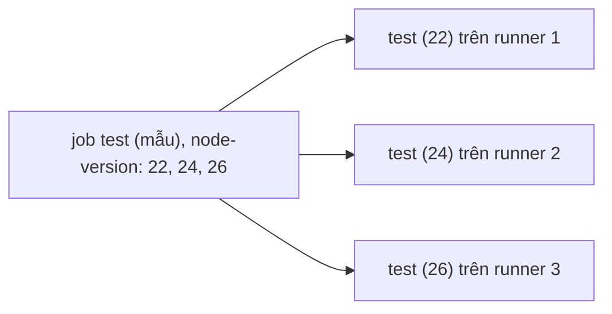
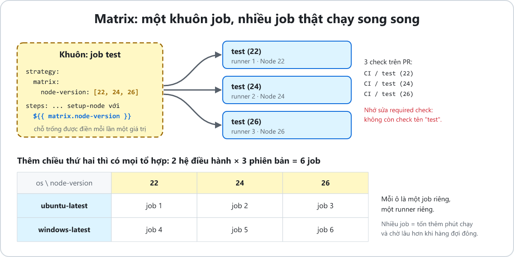
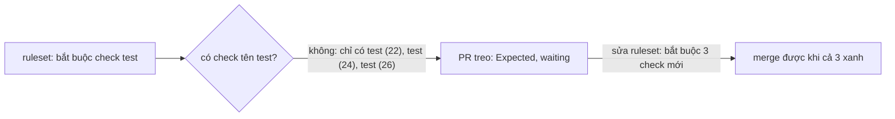

# Matrix: một job, nhiều phiên bản

Code của bạn chạy trên Node 24. Bạn cùng nhóm dùng Node 22, server dùng Node 26. Test có qua trên cả ba không? Chép job `test` ba lần, mỗi lần đổi một số, thì chạy được nhưng sửa một chỗ phải sửa ba chỗ. **Matrix** (*ma trận*: bảng các tổ hợp) làm việc đó bằng vài dòng.

## 1. Bản chất: matrix là một cái khuôn

Hình dung bạn in thiệp mời: một mẫu thiệp, một danh sách tên. Máy in tạo ra mỗi tên một tấm thiệp. Matrix cũng vậy:

- **mẫu**: job `test` của bạn, trong đó có chỗ trống `${{ matrix.node-version }}`;
- **danh sách**: `node-version: [22, 24, 26]`;
- **kết quả**: GitHub tạo **3 job thật**, mỗi job điền một giá trị vào chỗ trống, chạy **song song** trên **3 runner riêng**.





## 2. Viết matrix

Sửa job `test` trong `ci.yml` của repo `diem-trung-binh`:

```yaml
jobs:
  test:
    runs-on: ubuntu-latest
    strategy:
      matrix:
        node-version: [22, 24, 26]
    steps:
      - uses: actions/checkout@v7

      - name: Cài Node.js ${{ matrix.node-version }}
        uses: actions/setup-node@v7
        with:
          node-version: ${{ matrix.node-version }}

      - run: npm ci
      - run: npm test
```

**Đọc hiểu**

- `strategy` (*chiến lược*): cách GitHub tạo các bản của job. `matrix` nằm trong nó.
- `node-version: [22, 24, 26]`: một **chiều** của matrix, tên do bạn đặt, có 3 giá trị.
- `${{ matrix.node-version }}`: context `matrix`, đọc giá trị của **bản đang chạy**. Ở job thứ nhất nó là `22`, thứ hai `24`, thứ ba `26`.
- Dùng nó ở cả `name` của step (để log dễ đọc) và input `node-version` của `setup-node`.

Vì sao 22, 24, 26? Node.js ra bản số chẵn làm **LTS** (*Long-Term Support*, *hỗ trợ dài hạn*): được sửa lỗi bảo mật trong nhiều năm, nên các công ty dùng bản LTS. Xem bản nào còn được hỗ trợ ở [nodejs.org/en/about/previous-releases](https://nodejs.org/en/about/previous-releases).

Push lên một nhánh, mở PR: mục kiểm tra có **3 check** `CI / test (22) (pull_request)`, `CI / test (24) ...`, `CI / test (26) ...`. Log của Node 22 trông hơi khác (dòng bắt đầu bằng `#` thay vì `ℹ`): bản Node cũ in kết quả kiểu khác khi không chạy trong terminal thật. Không sao, chỉ cần nhìn `pass` và `fail`.

## 3. Hai chiều: bảng tổ hợp

Thêm chiều thứ hai thì GitHub tạo **mọi tổ hợp**:

```yaml
    runs-on: ${{ matrix.os }}
    strategy:
      matrix:
        os: [ubuntu-latest, windows-latest]
        node-version: [22, 24, 26]
```

**Đọc hiểu**

- `runs-on: ${{ matrix.os }}`: hệ điều hành của runner cũng lấy từ matrix.
- 2 hệ điều hành × 3 phiên bản = **6 job**.

| | Node 22 | Node 24 | Node 26 |
| --- | --- | --- | --- |
| ubuntu-latest | job 1 | job 2 | job 3 |
| windows-latest | job 4 | job 5 | job 6 |

Nhiều job thì tốn nhiều phút chạy (với repo private) và lâu xong hơn khi hàng đợi đông. Chỉ thêm chiều khi người dùng của bạn thật sự dùng tổ hợp đó. Bài tập của chương chỉ dùng một chiều.

## 4. `fail-fast`: một job đỏ thì sao

Mặc định, **fail-fast** (*hỏng thì dừng sớm*) đang bật: một job trong matrix đỏ thì GitHub **hủy** các job còn đang chạy, để tiết kiệm thời gian. Job bị hủy hiện là **cancelled**, không phải đỏ, nên bạn không biết phiên bản khác có qua không.

Khi muốn thấy đủ kết quả của mọi phiên bản:

```yaml
    strategy:
      fail-fast: false
      matrix:
        node-version: [22, 24, 26]
```

**Đọc hiểu**

- `fail-fast: false`: job nào đỏ thì đỏ, các job khác vẫn chạy tới cùng. Bạn thấy rõ "hỏng ở 22, qua ở 24 và 26".

## 5. Sai lầm thường gặp: required check biến mất

Ruleset ở chương 3 bắt buộc check tên `test`. Sau khi thêm matrix, **không còn check nào tên đúng `test`**: chỉ có `test (22)`, `test (24)`, `test (26)`. PR sẽ treo ở **Expected — Waiting for status to be reported**.



Cách sửa: **Settings** → **Rules** → **Rulesets** → `bao-ve-main` → trong **Require status checks to pass**, xóa `test`, thêm `test (22)`, `test (24)`, `test (26)` (chúng hiện trong ô tìm sau khi đã chạy một lần).

Bẫy ngược lại, gặp khi chạy thử thật: nếu repo còn **một workflow khác có job tên `test`** (ví dụ `report.yml` ở bài 3 của chương này), check `test` của workflow đó vẫn xuất hiện, ruleset thấy "đã có check `test` xanh" và PR **không** treo. Trông như không sao, nhưng luật đang kiểm tra nhầm workflow. Vì vậy sửa ruleset theo tên mới ngay khi đổi tên job, đừng đợi PR treo mới sửa.

## 6. Ngoài thực tế

Thư viện mã nguồn mở thường test trên mọi phiên bản Node còn hỗ trợ và cả ba hệ điều hành, vì người dùng của họ dùng đủ loại máy. Ứng dụng của một công ty thì thường chỉ test đúng phiên bản chạy trên server, cộng phiên bản sắp nâng cấp lên, để biết trước có gì hỏng. Khi một bản Node hết hỗ trợ, nhóm xóa nó khỏi matrix trong cùng PR nâng cấp.

## 7. Khi bị lỗi

| Lỗi | Vì sao | Cách sửa |
| --- | --- | --- |
| Chỉ có 1 job thay vì 3 | `matrix` không nằm trong `strategy`, hoặc giá trị không phải danh sách | So thụt lề với mục 2 |
| `setup-node` cài sai bản | Quên đổi `node-version: 24` thành `${{ matrix.node-version }}` | Sửa input |
| PR treo ở **Expected** | Required check vẫn là `test` | Làm mục 5 |
| Lỗi khác, hoặc chưa hiểu vì sao | | Nhắn mentor của track, công khai hay **nhắn riêng** đều được (tab **Cài đặt** → "Hỏi ở đâu") |

## Tóm tắt

- Matrix là khuôn: mỗi giá trị (hoặc mỗi tổ hợp) thành một job riêng, chạy song song.
- Đọc giá trị của bản đang chạy bằng `${{ matrix.<tên> }}`.
- `fail-fast: false` để thấy đủ kết quả; đổi tên job thì nhớ sửa required check.
