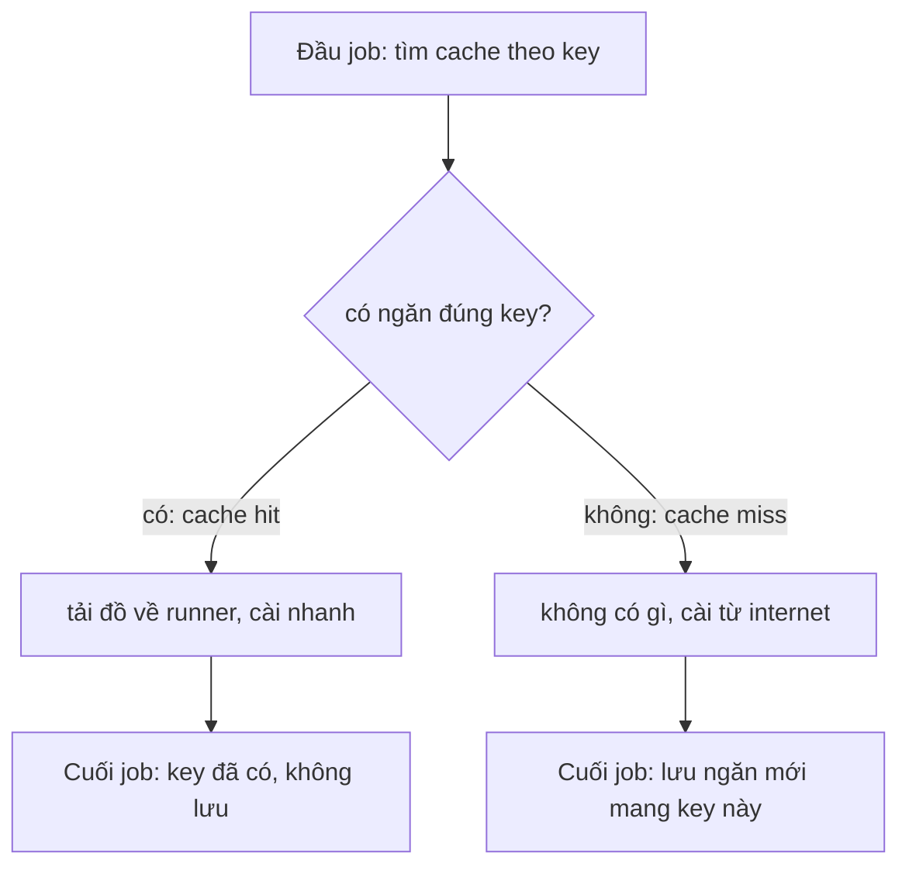
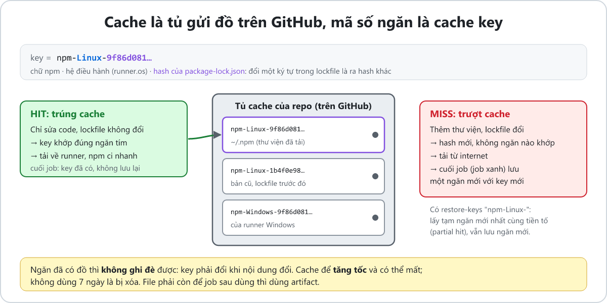

# Cache: đừng tải lại thứ đã tải

Chương 1: runner bị xóa sau mỗi job. Vì vậy mỗi lần chạy, `npm ci` lại tải toàn bộ thư viện từ internet. Project thật có vài trăm thư viện, mỗi lần tải mất cả phút. **Cache** (*bộ nhớ đệm*: chỗ cất tạm thứ hay dùng để lần sau lấy nhanh) giải quyết việc này.

## 1. Bản chất: cache là tủ gửi đồ có số

Hình dung tủ gửi đồ ở siêu thị. Mỗi ngăn có một **mã số**. Lần đầu bạn cất đồ vào ngăn mang mã `npm-Linux-a1b2c3`. Lần sau đến, bạn đọc đúng mã đó, mở ngăn, lấy đồ ra, khỏi đi mua lại.

- **Tủ** nằm trên máy chủ của GitHub, **không** nằm trên runner (runner bị xóa mà).
- **Mã số** gọi là **cache key** (*khóa cache*): một chuỗi do bạn tự đặt.
- Đầu job: tìm ngăn có key khớp, tải đồ về runner (**restore**, *khôi phục*).
- Cuối job (job xanh): nếu chưa có ngăn mang đúng key này, cất đồ vào ngăn mới (**save**, *lưu*).
- Ngăn đã có đồ thì **không ghi đè** được. Muốn đồ mới thì phải dùng key mới.



Hai từ bạn sẽ đọc trong log: **cache hit** (*trúng cache*: tìm thấy) và **cache miss** (*trượt cache*: không thấy).

## 2. Key phải đổi khi đồ đổi: hash

Câu hỏi then chốt: key nên là gì? Nếu key luôn là `npm-cache`, lần đầu lưu xong thì key đó **không bao giờ** được lưu lại, kể cả khi bạn thêm thư viện mới. Cache sẽ cũ mãi.

Cái quyết định "thư viện nào được cài" là **lockfile** (chương 3). Vậy key nên **đổi khi lockfile đổi**. Cách làm: lấy **hash** (*mã băm*, *dấu vân tay* của file) của lockfile.

- Hash là một chuỗi tính ra từ nội dung file, ví dụ `a1b2c3…`.
- Cùng nội dung → cùng hash. Đổi **một ký tự** → hash khác hẳn.
- Trong workflow: `${{ hashFiles('**/package-lock.json') }}`.

| Bạn làm gì | Lockfile | Hash | Cache |
| --- | --- | --- | --- |
| Sửa code trong `src/` | không đổi | không đổi | **hit** |
| Sửa test | không đổi | không đổi | **hit** |
| `npm install` thêm thư viện | **đổi** | **đổi** | **miss**, cuối job lưu ngăn mới |



## 3. Cách dễ: `cache: npm` của setup-node

`actions/setup-node` tự làm hết phần key cho bạn:

```yaml
      - name: Cài Node.js ${{ matrix.node-version }}
        uses: actions/setup-node@v7
        with:
          node-version: ${{ matrix.node-version }}
          cache: npm

      - run: npm ci
```

**Đọc hiểu**

- `cache: npm`: setup-node cache thư mục tải về của npm (`~/.npm`, `~` là thư mục nhà của người dùng trên runner), dùng key ghép từ hệ điều hành và hash của `package-lock.json`.
- Nó **không** cache `node_modules/`. `npm ci` vẫn chạy và vẫn xóa `node_modules/`, nhưng lấy file từ `~/.npm` trên máy thay vì tải từ internet.
- Cần có `package-lock.json` trong repo, nếu không step báo lỗi không tìm thấy file để tính key.

Log thật của lần chạy thử (mã hash rút gọn):

```text
# Lần đầu, step "Cài Node.js 24":
npm cache is not found
# ...cuối job, step "Post Cài Node.js 24":
Cache saved with the key: node-cache-Linux-x64-npm-eb8dace7…

# Lần sau, lockfile không đổi, step "Cài Node.js 26":
Cache hit for: node-cache-Linux-x64-npm-eb8dace7…
Cache restored successfully
Cache restored from key: node-cache-Linux-x64-npm-eb8dace7…
# ...cuối job:
Cache hit occurred on the primary key node-cache-Linux-x64-npm-eb8dace7…, not saving cache.
```

**Đọc hiểu**

- `npm cache is not found`: **miss**, chưa có ngăn nào mang key này.
- `Cache saved with the key: …`: step **Post** (chạy ở cuối job) cất ngăn mới.
- `Cache restored from key: …`: **hit**, đã lấy đồ ra.
- `not saving cache`: key đã có ngăn, không ghi đè (mục 1).
- Key **không** chứa phiên bản Node, nên ba job của matrix dùng **chung một ngăn**. Trong lần chạy thử, job Node 24 xong trước và lưu cache; job 22 và 26 chạy sau một chút đã trúng luôn ngăn đó ngay trong lần chạy đầu. Với `~/.npm` thì không sao, vì thư viện tải về không phụ thuộc phiên bản Node.

Project `diem-trung-binh` chưa có thư viện nào nên cache rất nhỏ và bạn khó thấy nhanh hơn. Với project thật, thời gian `npm ci` có thể giảm từ cả phút xuống vài giây.

## 4. Tự viết: `actions/cache`

Với công cụ không có sẵn tùy chọn cache, dùng `actions/cache`. Viết lại đúng việc ở mục 3 để thấy từng phần:

```yaml
      - uses: actions/setup-node@v7
        with:
          node-version: 24

      - name: Cache thư mục tải về của npm
        uses: actions/cache@v6
        with:
          path: ~/.npm
          key: npm-${{ runner.os }}-${{ hashFiles('**/package-lock.json') }}
          restore-keys: |
            npm-${{ runner.os }}-

      - run: npm ci
```

**Đọc hiểu**

- `path: ~/.npm`: thư mục cần cất và khôi phục.
- `key: npm-${{ runner.os }}-${{ hashFiles(...) }}`: key có 3 phần: chữ `npm`, hệ điều hành (`Linux`), hash của lockfile. Ví dụ thật: `npm-Linux-9f86d08188…`.
  - Có `runner.os` vì thư viện tải trên Linux có thể không dùng được trên Windows (matrix nhiều hệ điều hành ở bài trước).
  - `hashFiles('**/package-lock.json')`: hàm của GitHub, tính hash của mọi file `package-lock.json` trong repo.
- **restore-keys** (*các khóa khôi phục dự phòng*): khi key chính miss, GitHub tìm ngăn có key **bắt đầu bằng** `npm-Linux-` (ngăn mới nhất). Lấy đồ cũ còn hơn không có gì: `npm ci` chỉ phải tải phần thư viện mới. Trường hợp này gọi là **partial hit** (*trúng một phần*); output `cache-hit` vẫn là `false`, nên cuối job vẫn lưu ngăn mới với key chính.

| Tình huống | Key chính | restore-keys | Kết quả |
| --- | --- | --- | --- |
| Lockfile không đổi | khớp | | **hit**: khôi phục, không lưu lại |
| Lockfile đổi, đã từng có cache Linux | không khớp | khớp tiền tố `npm-Linux-` | **partial hit**: khôi phục bản cũ, cuối job lưu key mới |
| Lần đầu tiên, hoặc cache đã bị xóa | không khớp | không khớp | **miss**: tải hết, cuối job lưu key mới |

## 5. Cache sống bao lâu, ai đọc được

- Cache không được dùng trong **7 ngày** thì bị xóa. Tổng dung lượng cache mỗi repo có giới hạn (mặc định 10 GB); vượt thì cache cũ nhất bị xóa trước.
- Cache tạo trên `main` thì mọi nhánh và PR đọc được. Cache tạo trên một nhánh PR thì chỉ nhánh đó dùng, nhánh khác không thấy. Nhờ vậy một PR lạ không "đầu độc" được cache của `main`.
- Xem và xóa cache: tab **Actions** → mục **Caches** ở cột trái.

## 6. Sai lầm thường gặp

| Nghĩ sai | Thật ra |
| --- | --- |
| "Cache là để giữ kết quả cho job sau dùng." | Cache để **tăng tốc**, có thể mất bất cứ lúc nào. Muốn chuyển file chắc chắn giữa các job thì dùng **artifact** (bài sau). |
| "Key cố định cho đơn giản." | Key cố định thì cache không bao giờ cập nhật. Luôn đưa hash của lockfile vào key. |
| "Cache cả `node_modules/` cho nhanh nhất." | `npm ci` xóa `node_modules/` trước khi cài, nên cache nó vô ích; hơn nữa nó phụ thuộc phiên bản Node. Cache `~/.npm`. |
| "Cache bí mật cũng được, đằng nào cũng ở GitHub." | Đừng cất secret hay token vào cache. |

## 7. Ngoài thực tế

Ở các nhóm lớn, thời gian CI là thời gian chờ của lập trình viên: PR chờ 10 phút thay vì 2 phút, nhân với hàng chục PR mỗi ngày. Cache là cách rẻ nhất để rút ngắn nó. Khi CI tự nhiên chậm hẳn, việc đầu tiên người ta xem là log có `Cache restored` hay không.

## 8. Khi bị lỗi

| Lỗi | Vì sao | Cách sửa |
| --- | --- | --- |
| setup-node báo không tìm thấy lockfile (`Dependencies lock file is not found`) | Thiếu `package-lock.json` hoặc nằm ở thư mục con | Commit lockfile; nếu ở thư mục con, thêm input `cache-dependency-path` trỏ tới nó |
| Lần nào cũng miss | Key có thứ thay đổi mỗi lần (ví dụ `github.sha`), hoặc job đỏ nên không lưu | Chỉ để trong key những thứ quyết định nội dung cache; cho job xanh một lần |
| Lỗi khác, hoặc chưa hiểu vì sao | | Nhắn mentor của track, công khai hay **nhắn riêng** đều được (tab **Cài đặt** → "Hỏi ở đâu") |

## Tóm tắt

- Cache là tủ gửi đồ trên GitHub: đầu job restore theo key, cuối job save nếu key chưa có.
- Key nên chứa hash của lockfile; lockfile đổi thì miss và lưu ngăn mới.
- `setup-node` với `cache: npm` là cách dễ nhất; `actions/cache` cho mọi trường hợp khác.
