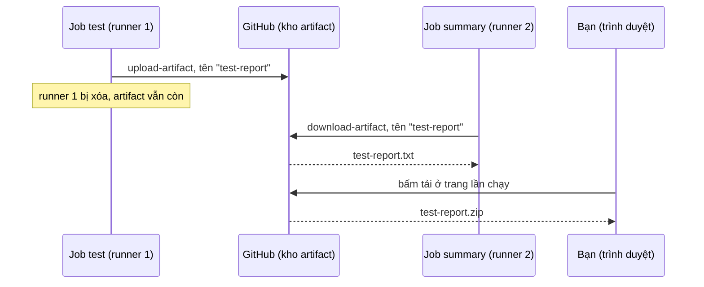

# Artifact: chuyển file giữa các job

Chương 2 đã gặp artifact: `upload-pages-artifact` nén trang web để Pages lấy. Bài này dùng artifact cho mọi loại file: báo cáo test, bản build, ảnh chụp màn hình lỗi.

## 1. Bản chất: artifact là bưu kiện gửi qua GitHub

Hai job chạy trên hai runner khác nhau, không chung ổ đĩa (chương 1). Muốn job A đưa một file cho job B, A phải **gửi file lên GitHub**, B **tải về**. Giống gửi bưu kiện: người gửi dán nhãn tên, bưu cục giữ hộ, người nhận đọc đúng tên để lấy.



## 2. Workflow

Tạo `.github/workflows/report.yml` trong repo `diem-trung-binh`:

```yaml
name: Test report

on:
  pull_request:
  workflow_dispatch:

permissions:
  contents: read

jobs:
  test:
    runs-on: ubuntu-latest
    steps:
      - uses: actions/checkout@v7

      - uses: actions/setup-node@v7
        with:
          node-version: 24
          cache: npm

      - run: npm ci

      - name: Chạy test, lưu kết quả ra file
        run: npm test 2>&1 | tee test-report.txt

      - name: Upload báo cáo test
        if: always()
        uses: actions/upload-artifact@v7
        with:
          name: test-report
          path: test-report.txt
          retention-days: 7

  summary:
    needs: test
    runs-on: ubuntu-latest
    steps:
      - name: Tải báo cáo test
        uses: actions/download-artifact@v8
        with:
          name: test-report

      - name: In số test qua và trượt
        run: grep -E "^ℹ (pass|fail)" test-report.txt
```

**Đọc hiểu**

- `npm test 2>&1 | tee test-report.txt`:
  - `2>&1`: gộp luồng báo lỗi (2) vào luồng output thường (1), để file có cả thông báo lỗi.
  - `| tee test-report.txt`: `tee` (đặt theo ống nước chữ T) vừa in ra log, vừa ghi vào file.
  - Có ống `|` thì exit code của cả dòng thường là của lệnh **cuối** (`tee`, luôn thành công). Nhưng GitHub chạy bash với tùy chọn **pipefail** (*ống hỏng thì báo hỏng*): lệnh nào trong ống đỏ thì cả dòng đỏ. Nhờ vậy test trượt vẫn làm step đỏ.
- `if: always()`: hàm **always** (*luôn luôn*): chạy step này **kể cả khi step trước đỏ**. Bình thường step sau bị bỏ qua khi có step đỏ (chương 1). Báo cáo test hữu ích nhất đúng lúc test đỏ, nên phải upload cả khi đỏ.
- `actions/upload-artifact@v7` với:
  - `name: test-report`: nhãn của bưu kiện, job khác dùng tên này để lấy;
  - `path: test-report.txt`: file (hoặc thư mục, hoặc mẫu như `reports/*.txt`) cần gửi;
  - `retention-days: 7`: **retention** (*thời gian lưu giữ*): GitHub giữ artifact 7 ngày rồi xóa. Không ghi thì theo mặc định của repo (thường 90 ngày). Đặt ngắn cho đỡ tốn dung lượng.
- Job `summary` có `needs: test`, chạy trên **runner mới**, nên chưa có file nào; nó không cần checkout vì chỉ đọc báo cáo.
- `actions/download-artifact@v8` với `name: test-report`: tải artifact đó về thư mục hiện tại, giải nén sẵn.
- `grep -E "^ℹ (pass|fail)"`: in các dòng bắt đầu bằng `ℹ pass` hoặc `ℹ fail`. Log: `ℹ pass 3` và `ℹ fail 0`.

Khi `test` đỏ, job `summary` bị bỏ qua (vì `needs`), nhưng artifact **vẫn được upload** nhờ `if: always()`. Mở trang lần chạy, kéo xuống mục **Artifacts**, bấm `test-report` để tải file `.zip` về đọc.

## 3. Artifact khác cache ở đâu

Hai thứ đều "cất file trên GitHub", nên rất hay bị nhầm:

| | Cache (bài trước) | Artifact |
| --- | --- | --- |
| Mục đích | **Tăng tốc**: khỏi tải lại thư viện | **Giữ kết quả**: chuyển file giữa job, cho người tải |
| Mất đi thì sao | Không sao, chỉ chậm hơn | Job sau hỏng, người dùng không có file |
| Tìm bằng | Key (khớp chính xác hoặc tiền tố) | Tên, trong **cùng lần chạy** |
| Dùng lại giữa các lần chạy | Có, đó là mục đích | Không (mặc định chỉ trong lần chạy tạo ra nó) |
| Người tải từ trang lần chạy | Không | Có |
| Sống bao lâu | Bị xóa sau 7 ngày không dùng | Theo `retention-days` |
| Ví dụ | `~/.npm` | Báo cáo test, file build, trang web để deploy |

Câu hỏi để chọn: "**Nếu file này biến mất, có gì hỏng không?**" Không hỏng, chỉ chậm → cache. Có hỏng → artifact.

## 4. Artifact trong matrix

Mỗi job của matrix upload một artifact thì **tên phải khác nhau**, nếu không job sau báo lỗi vì tên đã có. Đưa giá trị matrix vào tên:

```yaml
      - uses: actions/upload-artifact@v7
        if: always()
        with:
          name: test-report-node-${{ matrix.node-version }}
          path: test-report.txt
```

**Đọc hiểu**

- Ba job tạo ba artifact `test-report-node-22`, `test-report-node-24`, `test-report-node-26`.

## 5. Sai lầm thường gặp

| Nghĩ sai | Thật ra |
| --- | --- |
| "Job sau tự thấy file job trước tạo." | Không. Runner khác nhau. Phải upload rồi download. |
| "Upload `.` cho chắc." | Upload cả repo vừa chậm vừa dễ đưa nhầm file nhạy cảm (`.env`). Chỉ upload đúng file cần. |
| "Artifact công khai thì cứ để log có token." | Ai đọc được repo public là tải được artifact. Không bao giờ đưa secret vào file sẽ upload. |

## 6. Ngoài thực tế

Nhóm làm ứng dụng thường có job `build` upload bản build, rồi các job `test-e2e` và `deploy` tải **đúng bản build đó** về. Nhờ vậy thứ được deploy chính là thứ đã được test, không phải một bản build lại có thể khác. Khi test giao diện đỏ, ảnh chụp màn hình lúc lỗi được upload thành artifact để lập trình viên xem mà không cần chạy lại.

## 7. Khi bị lỗi

| Lỗi | Vì sao | Cách sửa |
| --- | --- | --- |
| `No files were found with the provided path` (cảnh báo) | Sai `path`, hoặc file chưa được tạo vì step trước đỏ sớm | Kiểm tra tên file; xem step tạo file có chạy không |
| `Artifact not found` ở download | Sai tên, hoặc job upload chưa chạy (thiếu `needs`) | Tên phải giống hệt; thêm `needs` |
| `Conflict: an artifact with this name already exists` | Hai job trong matrix dùng cùng tên | Đưa `${{ matrix.<tên> }}` vào `name` |
| Lỗi khác, hoặc chưa hiểu vì sao | | Nhắn mentor của track, công khai hay **nhắn riêng** đều được (tab **Cài đặt** → "Hỏi ở đâu") |

## Tóm tắt

- Artifact là bưu kiện: `upload-artifact` gửi lên GitHub, `download-artifact` (hoặc bạn) lấy về theo tên.
- `if: always()` để vẫn upload báo cáo khi test đỏ.
- Cache để tăng tốc, có thể mất; artifact để giữ kết quả, phải còn.
