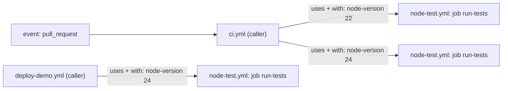
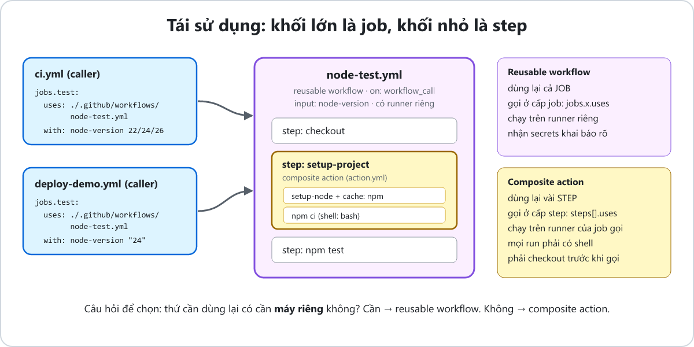

# Reusable workflow: gọi cả một workflow như gọi hàm

Repo của bạn giờ có `ci.yml`, `report.yml`, `deploy-demo.yml`, và cả ba đều lặp lại cùng một đoạn: checkout → setup-node → `npm ci` → `npm test`. Muốn đổi cách cài (ví dụ thêm cache) là phải sửa ba chỗ, sót một chỗ là ba workflow chạy ba kiểu. Lập trình viên gọi nguyên tắc tránh điều này là **DRY** (*Don't Repeat Yourself*, *đừng lặp lại chính mình*).

Chương này có hai công cụ để không lặp lại: **reusable workflow** (bài này) và **composite action** (bài sau).

## 1. Bản chất: workflow cũng là một hàm

Bạn đã quen với hàm: viết một lần, gọi nhiều lần, truyền tham số vào. **Reusable workflow** (*workflow dùng lại được*) là một workflow mà workflow khác **gọi** được, giống gọi hàm:

| Hàm trong code | Reusable workflow |
| --- | --- |
| Khai báo `function test(nodeVersion)` | File workflow có `on: workflow_call` và `inputs:` |
| Gọi `test(24)` | Job có `uses: ./.github/workflows/node-test.yml` và `with: node-version: 24` |
| Tham số | **input** (*đầu vào*) |
| Giá trị trả về | **output** (*đầu ra*) |
| Chỗ gọi hàm | **caller** (*bên gọi*): workflow chứa job có `uses` |





## 2. Viết workflow được gọi

Tạo `.github/workflows/node-test.yml`:

```yaml
name: Node test (reusable)

on:
  workflow_call:
    inputs:
      node-version:
        description: "Phiên bản Node.js"
        type: string
        required: true

permissions:
  contents: read

jobs:
  run-tests:
    runs-on: ubuntu-latest
    steps:
      - uses: actions/checkout@v7

      - uses: actions/setup-node@v7
        with:
          node-version: ${{ inputs.node-version }}
          cache: npm

      - run: npm ci
      - run: npm test
```

**Đọc hiểu**

- `on: workflow_call`: **workflow_call** (*được gọi bởi workflow*) là event đặc biệt: workflow này **không** tự chạy khi push hay PR, chỉ chạy khi có workflow khác gọi.
- `inputs.node-version`: khai báo một input.
  - `type: string`: kiểu dữ liệu (`string` là chuỗi, ngoài ra có `number`, `boolean`).
  - `required: true`: bên gọi bắt buộc truyền vào; thiếu là lỗi ngay khi bắt đầu.
- `${{ inputs.node-version }}`: context `inputs`, đọc giá trị bên gọi truyền vào.
- Phần `jobs:` viết y như workflow bình thường. Ghi `22` vào input kiểu `string` vẫn được: GitHub đổi số thành chuỗi `"22"`.

## 3. Gọi nó

Sửa `ci.yml` thành:

```yaml
name: CI

on:
  pull_request:
  push:
    branches: [main]

permissions:
  contents: read

jobs:
  test:
    strategy:
      fail-fast: false
      matrix:
        node-version: [22, 24, 26]
    uses: ./.github/workflows/node-test.yml
    with:
      node-version: ${{ matrix.node-version }}
```

**Đọc hiểu**

- `uses:` đặt ở **cấp job** (ngang hàng `strategy`), không nằm trong `steps`. Đây là điểm khác với `uses:` của action ở các chương trước.
- Job gọi workflow **không có** `runs-on` hay `steps`: những thứ đó nằm trong workflow được gọi.
- `./.github/workflows/node-test.yml`: đường dẫn trong **cùng repo**, bắt đầu bằng `./`.
- `with: node-version: ...`: truyền input. Kết hợp với matrix: mỗi giá trị matrix gọi workflow một lần.

Mở PR: check bây giờ có tên dạng `CI / test (22) / run-tests (pull_request)`: tên job gọi, rồi tên job bên trong. Required check trong ruleset cũng phải đổi theo: `test (22) / run-tests` và hai check tương tự cho 24, 26.

## 4. Secret không tự đi theo

Workflow được gọi **không tự thấy** secret của caller. Phải truyền rõ ràng, như truyền tham số. Ví dụ một secret **của repo** tên `NOTIFY_TOKEN` (token gửi thông báo, tạo ở **Repository secrets** như chương 4):

```yaml
# Trong workflow được gọi (notify.yml)
on:
  workflow_call:
    secrets:
      NOTIFY_TOKEN:
        required: true

# Trong caller
jobs:
  notify:
    uses: ./.github/workflows/notify.yml
    secrets:
      NOTIFY_TOKEN: ${{ secrets.NOTIFY_TOKEN }}
```

**Đọc hiểu**

- Bên được gọi khai báo nó cần secret `NOTIFY_TOKEN` (giống khai báo tham số).
- Bên gọi truyền `secrets.NOTIFY_TOKEN` của mình vào.
- Có cách tắt `secrets: inherit` (*thừa kế*: đưa **mọi** secret của caller sang). Tiện nhưng đưa nhiều hơn cần; track này truyền từng secret để luôn biết secret nào đi đâu (chương 7).

**Còn secret của environment** (như `DEPLOY_TOKEN` của `production` ở chương 4) thì **không** truyền theo cách này được: job gọi workflow không có khóa `environment`, nên không mở được "phòng" `production`. Cách đúng là để **job bên trong** workflow được gọi tự ghi `environment: production`; job đó phải qua luật bảo vệ (người duyệt, luật nhánh) rồi mới đọc được `secrets.DEPLOY_TOKEN`, y như chương 4:

```yaml
# deploy.yml, workflow được gọi
on:
  workflow_call:

jobs:
  deploy:
    runs-on: ubuntu-latest
    environment: production
    steps:
      - env:
          DEPLOY_TOKEN: ${{ secrets.DEPLOY_TOKEN }}
        run: |
          echo "Có token deploy: ${#DEPLOY_TOKEN} ký tự"
```

**Đọc hiểu**

- `environment: production` nằm ở job **bên trong** `deploy.yml`, không nằm ở caller.
- `secrets.DEPLOY_TOKEN` ở đây là secret của environment, chỉ tới runner sau khi được duyệt. Caller chỉ cần `uses: ./.github/workflows/deploy.yml`, không truyền secret nào.

## 5. Gọi workflow từ repo khác

Workflow được gọi có thể nằm ở repo khác, ví dụ một repo chung của cả nhóm:

```yaml
jobs:
  test:
    uses: ten-ban/shared-workflows/.github/workflows/node-test.yml@v1
    with:
      node-version: "24"
```

**Đọc hiểu**

- Dạng `<chủ>/<repo>/.github/workflows/<file>@<phiên bản>`. Repo đó phải public, hoặc cho phép truy cập từ repo của bạn.
- `@v1` là tag; như action, nên ghim phiên bản (bài 3 của chương nói cách ghim an toàn nhất).

## 6. Sai lầm thường gặp

| Nghĩ sai | Thật ra |
| --- | --- |
| "Đặt `uses: ./.github/workflows/x.yml` trong `steps`." | Reusable workflow gọi ở **cấp job**. Trong `steps` chỉ gọi action. |
| "Thêm `runs-on` cho job gọi." | Job gọi workflow không có `runs-on`, `steps`; GitHub báo lỗi nếu có. |
| "Workflow được gọi tự có secret của repo." | Phải truyền từng secret (hoặc `inherit`). |
| "Đổi tên job bên trong không ảnh hưởng gì." | Tên check đổi theo, required check phải sửa lại. |

## 7. Ngoài thực tế

Công ty có hàng chục repo thường giữ một repo `workflows` chung: "cách test một service Node", "cách deploy lên server", do nhóm hạ tầng viết và review kỹ. Mỗi repo chỉ cần vài dòng gọi. Khi cần sửa cách deploy (ví dụ vá lỗi bảo mật), nhóm hạ tầng sửa một chỗ và tăng tag, mọi repo hưởng theo thay vì phải mở hàng chục PR.

## 8. Khi bị lỗi

| Lỗi | Vì sao | Cách sửa |
| --- | --- | --- |
| `Invalid workflow file`, thông báo nhắc tới `runs-on` hoặc `steps` | Job gọi workflow có thêm `runs-on`/`steps` | Xóa chúng khỏi job gọi |
| `Invalid workflow file`, thông báo nhắc input `node-version` là bắt buộc | Bên gọi quên `with:` | Thêm `with: node-version: ...` |
| `Invalid workflow file`, thông báo nói workflow không gọi lại được (*not reusable*) | Workflow được gọi thiếu `workflow_call` | Thêm `workflow_call` vào `on:` |
| Lỗi khác, hoặc chưa hiểu vì sao | | Nhắn mentor của track, công khai hay **nhắn riêng** đều được (tab **Cài đặt** → "Hỏi ở đâu") |

## Tóm tắt

- Reusable workflow có `on: workflow_call`, nhận `inputs` (và `secrets` khai báo rõ).
- Gọi ở cấp job bằng `uses: ./.github/workflows/<file>.yml` + `with:`; job gọi không có `runs-on`, `steps`.
- Tên check đổi thành `<job gọi> / <job bên trong>`.
