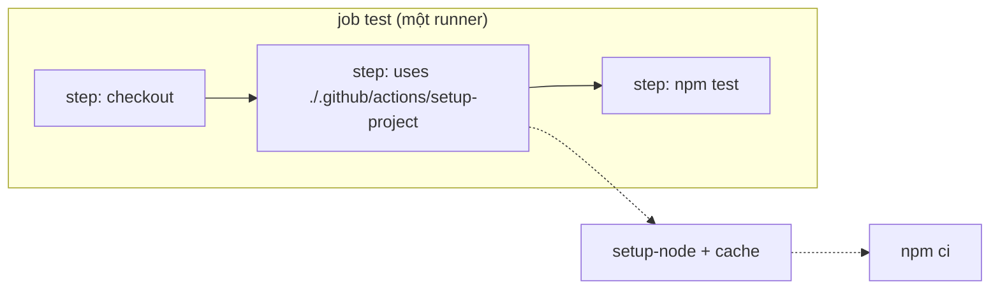

# Composite action: gom vài step thành một

Reusable workflow (bài trước) dùng lại **cả một job**. Nhưng nhiều khi bạn chỉ muốn dùng lại **vài step** ở giữa một job: "cài Node, bật cache, chạy `npm ci`" xuất hiện trong job test, job build, job deploy. Đó là việc của **composite action** (*action ghép*: một action được ghép từ nhiều step).

## 1. Bản chất: tự viết một action như `actions/checkout`

Từ chương 1 bạn đã dùng action của người khác bằng `uses:`. Composite action là **action của chính bạn**, viết bằng YAML, đặt ngay trong repo. Bên ngoài nhìn vào, nó chỉ là **một step**; bên trong nó chạy nhiều step.



**Đọc hiểu**

- Mọi step của composite action chạy **trên cùng runner** với job gọi nó. Nó không tạo job mới, không tạo máy mới.
- Đường nét đứt: những step "ẩn" bên trong action.

## 2. Viết action

Một action là một **thư mục** có file **action.yml** (*file mô tả action*). Tạo `.github/actions/setup-project/action.yml`:

```yaml
name: Cài project Node
description: Cài Node.js có cache npm, rồi cài thư viện bằng npm ci

inputs:
  node-version:
    description: "Phiên bản Node.js"
    required: false
    default: "24"

runs:
  using: composite
  steps:
    - name: Cài Node.js
      uses: actions/setup-node@v7
      with:
        node-version: ${{ inputs.node-version }}
        cache: npm

    - name: Cài thư viện
      run: npm ci
      shell: bash
```

**Đọc hiểu**

- `name`, `description`: tên và mô tả, bắt buộc với mọi action.
- `inputs.node-version` có `default: "24"`: không truyền thì dùng 24. `required: false` vì đã có giá trị mặc định.
- `runs.using: composite`: báo cho GitHub đây là composite action (loại khác là action viết bằng JavaScript hoặc chạy trong Docker, nằm ngoài track này).
- `runs.steps`: các step, viết như step của job, với một khác biệt:
- `shell: bash`: trong composite action, mỗi step `run` **bắt buộc** ghi **shell** (*vỏ*: chương trình đọc và chạy lệnh, ở đây là bash). Trong workflow thường thì GitHub tự chọn bash trên Linux; trong action thì không, vì action có thể được gọi từ runner Windows.
- `${{ inputs.node-version }}`: đọc input, y như reusable workflow.

## 3. Dùng action

Trong `node-test.yml` (bài trước), thay hai step setup-node và `npm ci` bằng một step:

```yaml
jobs:
  run-tests:
    runs-on: ubuntu-latest
    steps:
      - uses: actions/checkout@v7

      - name: Cài project
        uses: ./.github/actions/setup-project
        with:
          node-version: ${{ inputs.node-version }}

      - run: npm test
```

**Đọc hiểu**

- `uses: ./.github/actions/setup-project`: đường dẫn tới **thư mục** chứa `action.yml`, không phải tới file, và không có `@phiên bản` (vì nằm ngay trong repo, cùng commit).
- **Checkout phải chạy trước**: action nằm trong repo, mà runner chưa có repo cho tới khi checkout. Đặt `uses: ./...` trước checkout là lỗi `Can't find 'action.yml'`.
- `with:` truyền input như mọi action.

Log của step **Cài project** có thể mở ra để xem từng step bên trong (lần chạy thử thấy đủ hai step `Cài Node.js` và `Cài thư viện` của action, kèm dòng `Cache restored from key: …` của setup-node). Bên ngoài, danh sách step của job chỉ có: Set up job, checkout, **Cài project**, npm test, rồi các step Post và Complete job.

## 4. Chọn reusable workflow hay composite action

| | Reusable workflow | Composite action |
| --- | --- | --- |
| Dùng lại | Cả **job** (hoặc nhiều job) | Vài **step** trong một job |
| Gọi ở | Cấp **job**: `jobs.<tên>.uses` | Cấp **step**: `steps[*].uses` |
| Chạy trên | Runner **riêng** của nó (tự có `runs-on`) | Runner **của job gọi** |
| File | `.github/workflows/<tên>.yml` với `on: workflow_call` | `<thư mục>/action.yml` với `runs.using: composite` |
| Dùng `environment`, `secrets` riêng | Có | Không; nhận giá trị qua input |
| Log | Một job riêng trong lần chạy | Một step, mở ra thấy các step con |
| Ví dụ | "Test project Node", "Deploy lên production" | "Cài project Node", "Đăng nhập registry" |

Câu hỏi để chọn: "**Thứ tôi muốn dùng lại có cần máy riêng không?**" Cần (là cả một việc trọn vẹn) → reusable workflow. Không (chỉ là vài bước chuẩn bị) → composite action.

## 5. Sai lầm thường gặp

| Nghĩ sai | Thật ra |
| --- | --- |
| "`run` trong action không cần `shell`." | Composite action bắt buộc `shell` cho mọi `run`. |
| "Action đọc được `secrets.X` như workflow." | Context `secrets` không có trong composite action. Truyền giá trị qua input từ workflow. |
| "Đặt action ở `.github/workflows/` cho gọn." | Thư mục đó chỉ dành cho workflow; GitHub sẽ cố chạy `action.yml` như workflow và báo lỗi. Dùng `.github/actions/`. |

## 6. Ngoài thực tế

Các nhóm hay có một vài composite action nội bộ cho việc lặp lại nhiều nhất: cài môi trường, đăng nhập registry, gửi thông báo. Khi đổi phiên bản Node cho cả repo, chỉ sửa giá trị `default` ở một chỗ. Action dùng chung cho nhiều repo thì được tách ra repo riêng, gắn tag phiên bản, và gọi như action của người khác: `uses: ten-to-chuc/setup-project@v1`.

## 7. Khi bị lỗi

| Lỗi | Vì sao | Cách sửa |
| --- | --- | --- |
| `Can't find 'action.yml', 'action.yaml' or 'Dockerfile'` | Chưa checkout, hoặc sai đường dẫn thư mục | Đặt checkout trước; đường dẫn tới thư mục chứa `action.yml` |
| Lỗi nhắc tới `shell` | Step `run` trong action thiếu `shell` | Thêm `shell: bash` |
| Lỗi khác, hoặc chưa hiểu vì sao | | Nhắn mentor của track, công khai hay **nhắn riêng** đều được (tab **Cài đặt** → "Hỏi ở đâu") |

## Tóm tắt

- Composite action là thư mục có `action.yml` với `runs.using: composite`; nó là một step chứa nhiều step.
- Mọi `run` trong action phải có `shell`; phải checkout trước khi dùng action trong repo.
- Dùng lại cả job → reusable workflow; dùng lại vài step → composite action.
