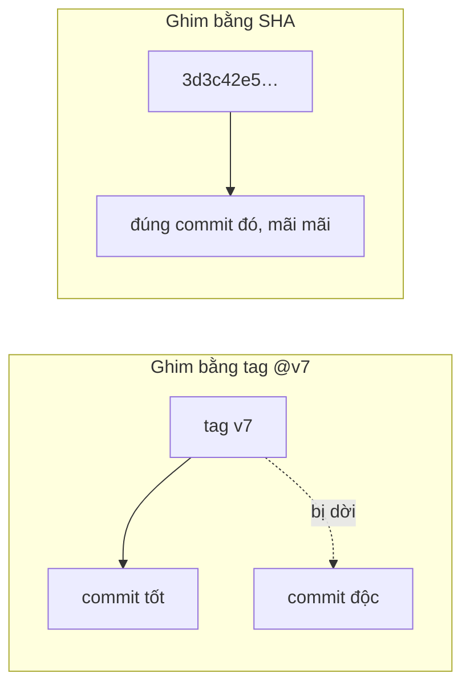

# Dùng action trên Marketplace an toàn: ghim commit SHA

Hai bài trước bạn tự viết thứ để dùng lại. Nhưng phần lớn action bạn dùng là của **người khác**: `actions/checkout`, `lycheeverse/lychee-action`… GitHub **Marketplace** (*chợ*: [github.com/marketplace?type=actions](https://github.com/marketplace?type=actions)) có hàng chục nghìn action như vậy. Bài này dạy chọn và dùng chúng mà không mở cửa cho kẻ xấu.

## 1. Bản chất: `uses:` là chạy code của người lạ, kèm chìa khóa của bạn

Khi bạn viết `uses: ai-do/mot-action@v1`, runner **tải code của repo `ai-do/mot-action`** về và chạy nó **trong job của bạn**: cùng máy, cùng biến môi trường, cùng secret mà step đó được đưa, cùng token `GITHUB_TOKEN`. Một action xấu có thể đọc secret và gửi đi đâu đó.

Đây gọi là rủi ro **supply chain** (*chuỗi cung ứng*): bạn an toàn bằng đúng mức an toàn của mọi thứ bạn dùng, giống một nhà hàng sạch vẫn ngộ độc nếu nhà cung cấp rau bẩn.

## 2. Chọn action: 5 câu hỏi

| Câu hỏi | Dấu hiệu tốt |
| --- | --- |
| Ai viết? | Của chính nhà làm công cụ (`actions/`, `docker/`, `aws-actions/`…), hoặc có dấu **Verified creator** trên Marketplace |
| Còn được chăm sóc không? | Có bản phát hành gần đây, issue được trả lời |
| Bao nhiêu người dùng? | Nhiều sao, nhiều repo dùng (không phải bảo đảm, nhưng lỗi sẽ bị phát hiện nhanh hơn) |
| Đọc được code không? | Repo công khai, code ngắn, hiểu được nó làm gì |
| Có cần nó không? | Việc chỉ là một hai lệnh shell thì tự viết `run:` còn an toàn hơn |

## 3. Tag có thể bị dời

Bạn đã ghi phiên bản cho mọi action: `@v7`, `@v2.9.0`. Đó là **tag** (*nhãn*): một cái tên trỏ tới một commit. Vấn đề: **chủ repo có thể dời tag sang commit khác** bất cứ lúc nào. Thường là để cập nhật (`v7` luôn trỏ tới bản `v7.x` mới nhất), nhưng nếu tài khoản của họ bị chiếm thì kẻ xấu cũng dời được.

Chuyện này đã xảy ra thật. Tháng 3/2025, action phổ biến `tj-actions/changed-files` bị chiếm, và kẻ tấn công dời **hầu hết các tag** của nó sang một commit độc hại in secret ra log. Hàng nghìn repo dùng `@v45`, `@v44`… chạy code độc mà không đổi một dòng YAML nào ([GitHub Advisory GHSA-mrrh-fwg8-r2c3](https://github.com/advisories/GHSA-mrrh-fwg8-r2c3)).

Một **commit SHA** (*mã băm của commit*: chuỗi 40 ký tự như `3d3c42e5…`) thì **không dời được**: nó tính ra từ chính nội dung commit, đổi nội dung là ra SHA khác.



| | Tag `@v7` | Commit SHA `@3d3c42e5…` |
| --- | --- | --- |
| Dễ đọc | Có | Không, cần chú thích |
| Có thể bị dời sang code khác | **Có** | **Không** |
| Tự nhận bản vá | Có (khi tác giả dời tag) | Không, cần cập nhật (Dependabot làm giúp) |

## 4. Ghim bằng SHA

**Pin** (*ghim*) action nghĩa là ghi SHA thay cho tag, kèm chú thích phiên bản để người đọc biết đó là bản nào:

```yaml
      - uses: actions/checkout@3d3c42e5aac5ba805825da76410c181273ba90b1 # v7.0.1
```

**Đọc hiểu**

- `@3d3c42e5…`: đủ **40 ký tự**. SHA rút gọn (7 ký tự) không được chấp nhận.
- `# v7.0.1`: chú thích, GitHub bỏ qua. Nó giúp người đọc và giúp Dependabot (mục 5) biết đang dùng bản nào.

Tìm SHA của một tag:

```bash
git ls-remote https://github.com/actions/checkout "refs/tags/v7.0.1" "refs/tags/v7.0.1^{}"
```

```text
3d3c42e5aac5ba805825da76410c181273ba90b1	refs/tags/v7.0.1
```

**Đọc hiểu**

- `git ls-remote` hỏi một repo từ xa xem nó có những nhánh, tag nào, **không cần clone**.
- Hai mẫu trong dấu nháy: tag `v7.0.1`, và `v7.0.1^{}` là "commit mà tag này trỏ tới". Kết quả mỗi dòng: SHA, dấu Tab, tên.
- Vì sao hỏi cả `^{}`? Có hai loại tag. Tag "nhẹ" (*lightweight*) trỏ thẳng vào commit: chỉ in **một dòng**, như `actions/checkout` ở trên, dùng SHA đó. Tag "có chú thích" (*annotated*) là một đối tượng riêng: in **hai dòng**, và SHA ở dòng đầu là của **đối tượng tag**, không phải commit. Khi đó dùng SHA của dòng kết thúc bằng `^{}`.
- Hỏi riêng `refs/tags/v7.0.1` (không có dòng `^{}`) thì không bao giờ thấy dòng thứ hai, nên dễ chép nhầm SHA của tag annotated.
- Cách khác: trang **Releases** của repo action → bấm vào bản phát hành → mã commit hiện cạnh tag.

Nên ghim SHA với action nào? Ít nhất là mọi action **bên thứ ba** (không phải `actions/` hay của chính bạn). Nhiều tổ chức ghim **tất cả**, và GitHub cho phép organization bật luật bắt buộc ghim SHA. Từ chương 7, track này ghim SHA cho action bên thứ ba trong ví dụ.

## 5. Dependabot: tự cập nhật các SHA đã ghim

Ghim SHA thì action không tự lên bản mới, kể cả bản vá lỗi bảo mật. **Dependabot** (robot của GitHub lo các thư viện phụ thuộc) giải quyết việc này: mỗi tuần nó kiểm tra, có bản mới thì **mở PR** đổi SHA và chú thích. CI của bạn chạy trên PR đó, bạn đọc rồi merge.

Tạo `.github/dependabot.yml`:

```yaml
version: 2
updates:
  - package-ecosystem: github-actions
    directories:
      - "/"
      - "/.github/actions/*"
    schedule:
      interval: weekly
  - package-ecosystem: npm
    directory: /
    schedule:
      interval: weekly
```

**Đọc hiểu**

- `version: 2`: phiên bản định dạng file, luôn là 2.
- Mục thứ nhất: theo dõi action. Với `github-actions`, thư mục `"/"` (gốc repo) nghĩa là các file trong `.github/workflows/`. Action dùng **bên trong** composite action của bạn (bài 2) nằm ở chỗ khác, nên thêm `"/.github/actions/*"`: dấu `*` là "mọi thư mục con", tức mọi action trong `.github/actions/`. Có nhiều thư mục thì dùng khóa `directories` (số nhiều) với một danh sách.
- Mục thứ hai: theo dõi thư viện npm trong `package.json` ở gốc repo. Chỉ một thư mục thì dùng `directory` (số ít).
- `interval: weekly`: kiểm tra mỗi tuần.
- File này không phải workflow, không nằm trong `workflows/`.

Sau khi file vào `main`, Dependabot tự chạy. Trong tab **Actions** xuất hiện mục **Dependabot Updates**; lần chạy thử thật có tên `github_actions in /., /.github/actions/*` (đúng hai thư mục đã khai báo) và `npm_and_yarn in /.`. Log ghi từng action được kiểm tra, ví dụ `Checking if actions/upload-artifact 7 needs updating` rồi `No update needed for actions/upload-artifact 7`. Mọi thứ đã mới nhất thì không có PR nào: đó là kết quả tốt, không phải lỗi.

## 6. Sai lầm thường gặp

| Nghĩ sai | Thật ra |
| --- | --- |
| "Action nhiều sao thì an toàn." | `tj-actions/changed-files` có hàng chục nghìn repo dùng. Sao không thay được việc ghim SHA. |
| "Ghim SHA rồi thì khỏi quan tâm." | Code ở SHA đó vẫn có thể có lỗi. Bật Dependabot để nhận bản vá. |
| "Dùng `@main` cho luôn mới nhất." | `@main` là nhánh, đổi mỗi lần tác giả push: còn rủi ro hơn tag. |
| "SHA rút gọn 7 ký tự cũng được." | Phải đủ 40 ký tự. |

## 7. Ngoài thực tế

Sau vụ `tj-actions` năm 2025, nhiều công ty bắt buộc ghim SHA cho mọi action và chạy Dependabot hoặc Renovate để cập nhật. Khi review một PR thêm action mới, người review hỏi: "action này của ai, có cần không, đã ghim SHA chưa?". Bỏ qua bước này là đặt toàn bộ secret của repo vào tay một người lạ.

## 8. Khi bị lỗi

| Lỗi | Vì sao | Cách sửa |
| --- | --- | --- |
| `Unable to resolve action ..., unable to find version ...` | SHA gõ sai, thiếu ký tự, hoặc không thuộc repo đó | Chạy lại `git ls-remote`, chép đủ 40 ký tự |
| Dependabot không mở PR nào | File sai chỗ/sai tên, hoặc mọi thứ đã mới nhất | File phải là `.github/dependabot.yml`; xem tab **Actions** → **Dependabot Updates**: log có `No update needed` là mọi thứ đã mới nhất |
| Lỗi khác, hoặc chưa hiểu vì sao | | Nhắn mentor của track, công khai hay **nhắn riêng** đều được (tab **Cài đặt** → "Hỏi ở đâu") |

## Tóm tắt

- `uses:` chạy code của người khác với quyền của job bạn: chọn action kỹ.
- Tag có thể bị dời; commit SHA 40 ký tự thì không. Ghim SHA kèm chú thích phiên bản.
- Dependabot tự mở PR cập nhật SHA; CI và bạn kiểm tra trước khi merge.
