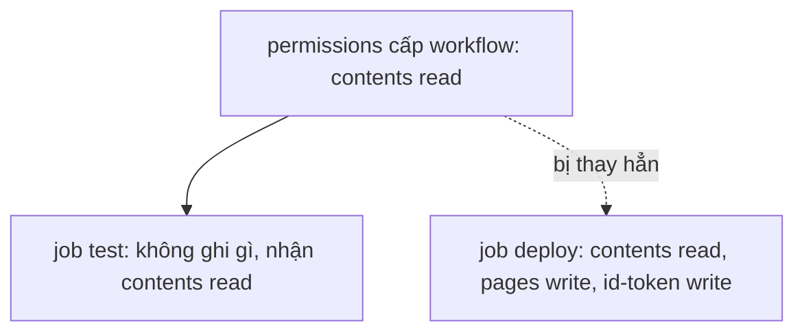

# GITHUB_TOKEN và permissions tối thiểu

Workflow của bạn chạy code với quyền ghi lên repo, lên GitHub Pages, lên PR. Kẻ xấu chiếm được workflow là chiếm được những quyền đó. Chương này gom các quy tắc an toàn bạn đã dùng rải rác từ chương 2, giải thích **vì sao**, và thêm những lỗ hổng hay gặp nhất.

## 1. GITHUB_TOKEN là chìa khóa tạm của mỗi job

Mỗi khi một job bắt đầu, GitHub tự tạo một **token** (chương 4) tên **GITHUB_TOKEN** và đưa cho job đó. Job dùng nó để làm việc với chính repo: checkout code, deploy Pages, viết bình luận lên PR.

Hình dung thẻ từ khách sạn:

| Thẻ từ khách sạn | GITHUB_TOKEN |
| --- | --- |
| Lễ tân cấp lúc nhận phòng | GitHub tạo lúc job bắt đầu |
| Chỉ mở phòng của bạn, hồ bơi, phòng gym nếu bạn đăng ký | Chỉ mở những **scope** (*phạm vi quyền*) ghi trong `permissions` |
| Chỉ dùng cho khách sạn này | Chỉ dùng cho repo đang chạy workflow |
| Hết hạn khi trả phòng | Hết hạn khi job xong (tối đa 24 giờ) |

Bạn không cần tạo nó. `actions/checkout` tự dùng nó. Khi tự gọi GitHub (mục 4), lấy nó bằng `${{ secrets.GITHUB_TOKEN }}` hoặc `${{ github.token }}`.

## 2. Các scope hay gặp

| Scope | `read` cho phép | `write` cho phép thêm | Gặp ở chương |
| --- | --- | --- | --- |
| `contents` | đọc code (checkout) | push commit, tạo release | mọi chương |
| `pages` | | deploy lên GitHub Pages | 2 |
| `id-token` | | xin "giấy tờ tùy thân" của workflow theo chuẩn OIDC (xem dưới bảng) | 2 |
| `pull-requests` | đọc PR | bình luận, gắn nhãn PR | 7 |
| `issues` | đọc issue | tạo, bình luận issue | |
| `packages` | tải package | đẩy package/image lên GitHub Packages | |
| `actions` | đọc các lần chạy | hủy, chạy lại workflow | |

Scope nào **không ghi** trong `permissions` thì là `none` (không có quyền).

**OIDC** (*OpenID Connect*, một chuẩn chung để chứng minh danh tính trên mạng): với `id-token: write`, job xin GitHub cấp một tờ giấy có chữ ký, ghi "tôi là workflow `pages.yml` của repo này, chạy trên nhánh `main`". Bên nhận (GitHub Pages ở chương 2, hoặc một dịch vụ cloud) kiểm tra chữ ký rồi tin, nên không cần cất mật khẩu hay token lâu dài nào trong secrets.

## 3. Least privilege: xin đúng thứ cần

**Least privilege** (*đặc quyền tối thiểu*) là nguyên tắc: mỗi người, mỗi chương trình chỉ có **đúng** quyền cần cho việc của nó. Thẻ từ chỉ mở phòng của bạn, nên rơi thẻ thì kẻ nhặt được cũng không vào được phòng người khác.

Áp vào workflow: **cấp workflow chỉ đọc, job nào cần gì thì tự xin**.

```yaml
permissions:
  contents: read          # mọi job: chỉ đọc code

jobs:
  test:                   # không ghi permissions: dùng của cấp workflow
    runs-on: ubuntu-latest
    steps:
      - uses: actions/checkout@v7
      - run: echo "chỉ cần đọc code"

  deploy:
    runs-on: ubuntu-latest
    permissions:          # THAY HẲN quyền cấp workflow cho job này
      contents: read
      pages: write
      id-token: write
    steps:
      - run: echo "được ghi lên Pages"
```

**Đọc hiểu**

- `permissions` cấp workflow: mọi job nhận `contents: read`, các scope khác là `none`.
- Job `test` không ghi gì nên dùng quyền cấp workflow.
- Job `deploy` ghi `permissions`: danh sách này **thay hẳn** danh sách cấp workflow, **không cộng thêm**. Vì vậy phải ghi lại `contents: read` nếu job còn cần checkout.



**Không ghi `permissions` ở đâu cả** thì token nhận **quyền mặc định** trong Settings của repo hoặc organization (**Settings** → **Actions** → **General** → **Workflow permissions**). Repo cũ có thể vẫn để mặc định là đọc **và ghi** mọi thứ. Đừng phụ thuộc vào cài đặt bạn không nhìn thấy trong file: luôn ghi rõ. Muốn tắt hết quyền, ghi `permissions: {}`.

## 4. Thử: một job cần quyền ghi

Job dưới đây viết bình luận cảm ơn lên PR. Thêm vào `ci.yml` của repo `diem-trung-binh`:

```yaml
  thank-you:
    if: github.event_name == 'pull_request'
    runs-on: ubuntu-latest
    permissions:
      pull-requests: write
    steps:
      - name: Cảm ơn người mở PR
        env:
          GH_TOKEN: ${{ secrets.GITHUB_TOKEN }}
          PR_NUMBER: ${{ github.event.pull_request.number }}
        run: gh pr comment "$PR_NUMBER" --repo "$GITHUB_REPOSITORY" --body "Cảm ơn bạn! CI đang chạy."
```

**Đọc hiểu**

- `if: github.event_name == 'pull_request'`: chỉ chạy trên PR (`==` là "bằng").
- `permissions: pull-requests: write`: xin đúng một quyền: viết lên PR. Không cần `contents` vì job không checkout.
- **gh** là GitHub CLI (*Command Line Interface*, *giao diện dòng lệnh* của GitHub), có sẵn trên runner. `gh` đọc token từ biến môi trường `GH_TOKEN`.
- `PR_NUMBER`: số thứ tự của PR, lấy từ context `github.event` (thông tin chi tiết của event). Đưa qua `env` rồi đọc `$PR_NUMBER`, như quy tắc ở chương 4.
- `gh pr comment ... --body "..."`: viết một bình luận lên PR đó.

Mở một PR: bình luận xuất hiện, tác giả là `github-actions[bot]`.

Bây giờ **xóa** dòng `pull-requests: write` (để `permissions:` chỉ còn `contents: read` chẳng hạn) và push lại. Step đỏ với:

```text
GraphQL: Resource not accessible by integration (addComment)
```

**Đọc hiểu**

- `Resource not accessible by integration`: token không có quyền làm việc vừa yêu cầu. "Integration" ở đây là chính workflow của bạn.
- `(addComment)`: việc bị từ chối là thêm bình luận, nên thiếu quyền ghi lên PR. Thêm lại `pull-requests: write`.

Đây là lý do nguyên tắc quyền tối thiểu **dễ áp dụng**: thiếu quyền thì GitHub báo rõ ràng, bạn thêm đúng quyền đó. Thừa quyền thì không ai báo gì cả, cho tới ngày bị lợi dụng.

## 5. Khi nào không dùng GITHUB_TOKEN

GITHUB_TOKEN chỉ làm việc với **repo đang chạy**. Cần làm việc với repo khác hoặc dịch vụ ngoài thì phải dùng token riêng, cất trong secrets (chương 4), cấp quyền **hẹp nhất** có thể và có hạn dùng. Đừng dùng token cá nhân có toàn quyền tài khoản của bạn cho việc mà GITHUB_TOKEN làm được.

## 6. Sai lầm thường gặp

| Nghĩ sai | Thật ra |
| --- | --- |
| "Job ghi `permissions: pages: write` là có thêm quyền ghi Pages, vẫn giữ quyền đọc code." | Danh sách cấp job **thay hẳn** cấp workflow. Thiếu `contents: read` thì checkout lỗi (với repo private). |
| "Cho `write-all` cho khỏi lỗi." | Một step bị lợi dụng sẽ có toàn quyền ghi repo. |
| "PR từ fork cũng bình luận được nếu xin `pull-requests: write`." | Token của PR từ fork luôn chỉ đọc (bài sau). |

## 7. Ngoài thực tế

Nhiều organization đặt mặc định **Read repository contents and packages permissions** cho mọi repo, và dùng công cụ quét workflow để cảnh báo job nào xin quyền ghi mà không cần. Khi review PR có thay đổi workflow, người review luôn xem phần `permissions` trước tiên: một dòng `contents: write` mới thêm cần có lý do rõ ràng.

## 8. Khi bị lỗi

| Lỗi | Vì sao | Cách sửa |
| --- | --- | --- |
| `Resource not accessible by integration` | Thiếu scope cho việc đó | Đọc việc bị từ chối, thêm đúng scope ở cấp job |
| Checkout lỗi sau khi thêm `permissions` cho job | Danh sách cấp job thay hẳn cấp workflow, mất `contents: read` | Thêm `contents: read` vào job |
| Lỗi khác, hoặc chưa hiểu vì sao | | Nhắn mentor của track, công khai hay **nhắn riêng** đều được (tab **Cài đặt** → "Hỏi ở đâu") |

## Tóm tắt

- GITHUB_TOKEN là chìa khóa tạm của mỗi job, chỉ cho repo hiện tại, mở đúng những scope trong `permissions`.
- Cấp workflow `contents: read`; job cần gì thì tự xin; danh sách cấp job thay hẳn, không cộng thêm.
- Thiếu quyền thì GitHub báo `Resource not accessible by integration`; thừa quyền thì không ai báo.
