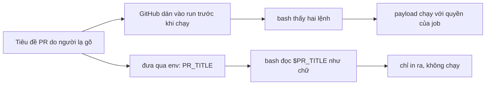

# Script injection và danh sách tự kiểm tra

Bài trước: code của người lạ nguy hiểm khi được chạy. Bài này: ngay cả **chữ** của người lạ (tiêu đề PR, tên nhánh, nội dung issue) cũng có thể thành lệnh, nếu bạn đặt nó sai chỗ.

## 1. Nhắc lại: ai thay `${{ }}`, lúc nào

Chương 1: GitHub thay `${{ ... }}` bằng giá trị thật **trước khi** gửi lệnh tới runner. Runner nhận một đoạn script đã thay xong, và bash chạy nó **như thể bạn tự gõ**. Bash không biết phần nào bạn viết, phần nào là giá trị được dán vào.

Với `${{ github.sha }}`, giá trị do GitHub tạo, không ai chọn được. Nhưng `${{ github.event.pull_request.title }}` là tiêu đề PR, do **người mở PR** gõ. Họ gõ gì, chữ đó được dán vào script của bạn.

## 2. Tấn công từng bước

Một workflow chào PR, trông vô hại:

```yaml
name: Chào PR

on: pull_request

permissions:
  contents: read

jobs:
  greet:
    runs-on: ubuntu-latest
    steps:
      - name: In tiêu đề PR
        run: |
          echo "Tiêu đề PR: ${{ github.event.pull_request.title }}"
```

**Đọc hiểu**

- Ý định: in tiêu đề PR ra log.
- Dòng `echo` chứa biểu thức lấy tiêu đề PR, đặt **bên trong** dấu nháy kép của bash.

Người mở PR đặt tiêu đề là: `Sửa lỗi"; echo "ĐÃ CHẠY LỆNH CỦA NGƯỜI LẠ`

GitHub thay biểu thức, runner nhận script:

```bash
echo "Tiêu đề PR: Sửa lỗi"; echo "ĐÃ CHẠY LỆNH CỦA NGƯỜI LẠ"
```

**Đọc hiểu**

- Dấu `"` trong tiêu đề **đóng** chuỗi của bạn sớm.
- `;` kết thúc lệnh `echo` thứ nhất. Mọi thứ sau đó là **lệnh mới** do người lạ viết.
- Log in hai dòng: `Tiêu đề PR: Sửa lỗi` và `ĐÃ CHẠY LỆNH CỦA NGƯỜI LẠ`.

Ở đây lệnh chen vào chỉ là `echo`. Kẻ xấu sẽ thay nó bằng lệnh gửi token đi, gọi là **payload** (*phần tải*: đoạn lệnh độc được chở theo). Kiểu tấn công này gọi là **script injection** (*tiêm lệnh vào script*).




Với event `pull_request` từ fork, token chỉ đọc và không có secret (bài trước), nên thiệt hại có giới hạn. Nhưng cùng lỗi đó trong workflow chạy bằng `pull_request_target`, `issues` hay `issue_comment` (những event có token ghi và secret, kích hoạt được bởi người lạ) là mất repo.

## 3. Sửa: đưa dữ liệu qua `env`

```yaml
      - name: In tiêu đề PR
        env:
          PR_TITLE: ${{ github.event.pull_request.title }}
        run: |
          echo "Tiêu đề PR: $PR_TITLE"
```

**Đọc hiểu**

- GitHub đặt tiêu đề vào **biến môi trường** `PR_TITLE`. Bước này không dán gì vào script.
- Script runner nhận là `echo "Tiêu đề PR: $PR_TITLE"`, **cố định**, không phụ thuộc tiêu đề.
- Bash thay `$PR_TITLE` **lúc chạy**, và coi giá trị là **chữ**, không phải lệnh. Log in nguyên văn: `Tiêu đề PR: Sửa lỗi"; echo "ĐÃ CHẠY LỆNH CỦA NGƯỜI LẠ`.

Đây chính là quy tắc bạn đã dùng từ chương 4: **trong `run`, đọc biến bằng `$TEN`**, không dán `${{ }}` vào. Giờ bạn biết vì sao.

## 4. Dữ liệu nào là của người lạ

| Không tin được (người ngoài gõ) | Tin được (GitHub hoặc bạn đặt) |
| --- | --- |
| `github.event.pull_request.title`, `.body` | `github.sha`, `github.repository`, `github.run_id` |
| `github.head_ref` (tên nhánh của PR) | `github.event.pull_request.number` (một con số) |
| `github.event.issue.title`, `.body` | `secrets.*`, `vars.*` (bạn đặt; vẫn đừng in secret) |
| `github.event.comment.body` | `matrix.*`, `inputs.*` do chính workflow của bạn khai báo giá trị |
| Tên, email tác giả commit; nội dung commit message | |

Khi không chắc: cứ đưa qua `env`. Không bao giờ thừa.

## 5. Để máy bắt giúp: actionlint

actionlint (chương 1) nhận ra mẫu này. Chạy nó trên workflow ở mục 2:

```bash
docker run --rm -v "$(pwd):/repo" -w /repo rhysd/actionlint:1.7.12 -color
```

```text
.github/workflows/greet.yml:13:40: "github.event.pull_request.title" is potentially untrusted. avoid using it directly in inline scripts. instead, pass it through an environment variable. see https://docs.github.com/en/actions/reference/security/secure-use#good-practices-for-mitigating-script-injection-attacks for more details [expression]
```

**Đọc hiểu**

- `greet.yml:13:40`: file, dòng, cột nơi phát hiện.
- `is potentially untrusted`: giá trị **có thể** do người ngoài đặt.
- `pass it through an environment variable`: đúng cách sửa ở mục 3.
- Không có Docker: extension GitHub Actions của VS Code không bắt lỗi này; hãy tự dò theo bảng ở mục 4, hoặc nhờ mentor chạy giúp.

Muốn chạy actionlint tự động trên mỗi PR, có thể thêm một job dùng image đó; một ý hay cho dự án cuối.

## 6. Danh sách tự kiểm tra của track

Đi qua danh sách này với **mọi** workflow trước khi merge, và trong dự án cuối:

- [ ] `permissions: contents: read` ở cấp workflow; job nào cần ghi thì tự xin đúng scope (bài 1).
- [ ] Không dùng `pull_request_target` (bài 2).
- [ ] Dữ liệu từ PR, issue, comment, tên nhánh đi qua `env:`, không chèn `${{ }}` thẳng vào `run` (bài này).
- [ ] Secret chỉ đi qua `env:` hoặc input của action; không `echo`, không biến đổi rồi in, không `set -x` ở step có secret (chương 4).
- [ ] Job deploy hoặc job cần secret quan trọng có `environment` với luật bảo vệ, và không chạy trên pull request (chương 2, 4).
- [ ] Mọi action ghi phiên bản; action bên thứ ba ghim commit SHA 40 ký tự kèm chú thích; có Dependabot (chương 6).
- [ ] Reusable workflow nhận secret được truyền từng cái, không `secrets: inherit` khi không cần (chương 6).
- [ ] actionlint không báo lỗi.

## 7. Ngoài thực tế

Script injection nằm trong nhóm lỗi hay gặp nhất của GitHub Actions, và từng ảnh hưởng tới cả những dự án lớn có hàng nghìn người đóng góp. Các nhóm có kinh nghiệm chạy công cụ quét workflow (actionlint, [zizmor](https://github.com/zizmorcore/zizmor)) trong CI, và coi file trong `.github/workflows/` là code nhạy cảm: thay đổi ở đó cần người review am hiểu bảo mật (thường đặt trong `CODEOWNERS`).

## 8. Khi bị lỗi

| Lỗi | Vì sao | Cách sửa |
| --- | --- | --- |
| actionlint báo `potentially untrusted` | Dữ liệu người ngoài được chèn thẳng vào `run` | Đưa qua `env:` như mục 3 |
| `could not parse as YAML: mapping values are not allowed` ở một dòng `run:` | Dòng `run:` một dòng có `: ` (dấu hai chấm + dấu cách) trong chữ, YAML hiểu nhầm | Dùng `run: |` và viết lệnh ở dòng dưới |
| Lỗi khác, hoặc chưa hiểu vì sao | | Nhắn mentor của track, công khai hay **nhắn riêng** đều được (tab **Cài đặt** → "Hỏi ở đâu") |

## Tóm tắt

- `${{ }}` được dán vào script trước khi bash chạy; chữ của người lạ có thể thành lệnh.
- Đưa dữ liệu không tin được qua `env:` rồi đọc `$TEN`; bash coi nó là chữ.
- Đi qua danh sách tự kiểm tra ở mục 6 với mọi workflow.
