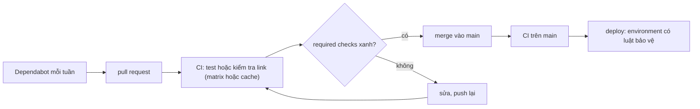

# Hướng dẫn dự án cuối: pipeline CI/CD cho repo của bạn

Bạn đã có đủ mảnh ghép. Dự án cuối ráp chúng thành một **pipeline** (*đường ống*: chuỗi các bước tự động nối nhau, từ lúc có thay đổi tới lúc thay đổi đến tay người dùng) cho **một repo của chính bạn**.

## 1. Chọn repo

Chọn **một** trong ba, theo sức:

| Lựa chọn | Hợp với | Phần "test" | Phần "deploy" |
| --- | --- | --- | --- |
| Repo `portfolio` (chương 2) | Ai mới học HTML/CSS | Kiểm tra link bằng lychee | GitHub Pages |
| Repo `diem-trung-binh` (chương 3–7) | Ai muốn làm theo đúng track | `npm test` | Pages cho một trang HTML nhỏ hiện kết quả, hoặc deploy giả lập có duyệt |
| Một project của bạn (bài tập lớn, project cá nhân) | Ai đã có code thật | Test hoặc lệnh kiểm tra có sẵn của project | Pages nếu là trang tĩnh, nếu không thì deploy giả lập có duyệt |

Repo phải **public** (để ruleset và required reviewers chạy miễn phí, và để mentor xem được). Không có secret thật, không có thông tin cá nhân ai khác trong repo.

## 2. Pipeline cần có




| Phần | Lấy từ | Bắt buộc |
| --- | --- | --- |
| CI chạy trên `pull_request` và `push` lên `main` | Chương 2, 3 | Có |
| Ruleset: bắt buộc PR và required checks cho `main` | Chương 3 | Có |
| Deploy chỉ từ `main`, qua `environment` có luật bảo vệ (Pages: luật nhánh mặc định là đủ; deploy giả lập: required reviewers) | Chương 2, 4 | Có |
| Ít nhất một trong: matrix, cache, artifact | Chương 5 | Có |
| Ít nhất một trong: reusable workflow, composite action | Chương 6 | Có |
| Ghim SHA cho action bên thứ ba, Dependabot | Chương 6 | Có |
| Đạt danh sách tự kiểm tra bảo mật | Chương 7 | Có |
| Job chạy actionlint trên PR, workflow theo lịch, bình luận lên PR… | | Không, làm thêm nếu còn sức |

## 3. Repo hoàn chỉnh trông thế nào

Ví dụ với `diem-trung-binh`:

```text
diem-trung-binh/
├── .github/
│   ├── actions/
│   │   └── setup-project/
│   │       └── action.yml      # chương 6: cài Node + cache + npm ci
│   ├── workflows/
│   │   ├── ci.yml              # chương 3, 5: gọi node-test.yml trong matrix
│   │   ├── node-test.yml       # chương 6: reusable workflow
│   │   └── deploy.yml          # chương 2, 4: deploy có environment
│   └── dependabot.yml          # chương 6
├── src/  test/                 # chương 3
├── package.json  package-lock.json
├── .gitignore                  # có node_modules/
└── README.md
```

**Đọc hiểu**

- Mỗi file một việc, và mỗi file ghi chương học nó. Khi bạn đọc lại sau vài tháng, hoặc người khác nhận repo, họ biết tìm gì ở đâu.
- Các workflow thử nghiệm (`env-demo.yml`, `secret-demo.yml`…) nên **xóa** trước khi nộp: repo sạch dễ review hơn.

## 4. README

README là trang đầu tiên mentor đọc. Cần có:

1. **Tên và một câu mô tả**; link trang Pages nếu có.
2. **Badge** của workflow CI (chương 3).
3. **Pipeline**: mỗi workflow chạy khi nào, làm gì (vài dòng hoặc sơ đồ). Mẫu:

   ```markdown
   ## Pipeline

   | Workflow | Chạy khi | Làm gì |
   | --- | --- | --- |
   | `ci.yml` | pull request, push lên main | test trên Node 22, 24, 26 (có cache) |
   | `deploy.yml` | push lên main | chờ duyệt ở environment production, rồi deploy |
   ```

4. **Bảo mật**: một đoạn ngắn nói repo đã làm gì theo danh sách tự kiểm tra của chương 7.
5. **Bằng chứng** (xem mục Nộp bài của bài tập).

## 5. Tự kiểm tra trước khi nộp

- [ ] Clone repo vào một thư mục **mới**, chạy lệnh kiểm tra của repo (`npm ci && npm test`, hoặc mở `index.html`): chạy được mà không cần file nào chỉ có trên máy bạn.
- [ ] Mở một PR thử: CI chạy, nút merge bị khóa khi CI đỏ, mở khi xanh.
- [ ] Merge vào `main`: deploy chạy (và chờ duyệt, nếu có required reviewers).
- [ ] Lần chạy thứ hai có cache hit (nếu dùng cache).
- [ ] actionlint không báo lỗi (nếu máy có Docker; không có thì nhờ mentor chạy giúp).
- [ ] Đi qua danh sách tự kiểm tra ở bài "Script injection".
- [ ] `git log --all --oneline -- .env` không in gì (chưa từng commit file bí mật). Project không có `.env` thì bỏ qua.

## 6. Nộp bài bằng pull request (như ở công ty)

Làm toàn bộ thay đổi trên một nhánh, ví dụ `pipeline`, và mở **một pull request** vào `main` của chính repo đó. Nộp **link PR**. Vì sao nộp bằng PR:

- mentor review được từng dòng thay đổi, và để lại bình luận ngay trên dòng đó;
- bạn thấy chính pipeline của mình chạy trên PR của mình;
- đó là đúng cách bạn sẽ làm việc khi vào nhóm thật.

Sau khi mentor nhận xét: sửa trên cùng nhánh, push, trả lời từng bình luận. Khi mentor đồng ý, bạn tự merge.

**Review chéo (khuyến khích):** đọc PR dự án cuối của một bạn khác trong track, để lại ít nhất một bình luận có ích (một điểm tốt, một câu hỏi, hoặc một mục trong danh sách tự kiểm tra họ chưa đạt). Ở công ty, đọc code người khác là việc hằng ngày.

## 7. Ngoài thực tế

Pipeline của bạn bây giờ có hình dạng giống pipeline của nhiều nhóm phần mềm thật: mọi thay đổi qua PR, máy kiểm tra trước, người duyệt sau, deploy có kiểm soát, phụ thuộc được cập nhật tự động. Khác biệt chủ yếu là quy mô: nhiều loại test hơn, nhiều môi trường hơn (staging, production), và nhiều người duyệt hơn. Các ý tưởng thì bạn đã có đủ.

## 8. Khi bị lỗi

| Lỗi | Cách xử lý |
| --- | --- |
| Không biết bắt đầu từ đâu | Chọn `diem-trung-binh`, làm lần lượt các dòng trong bảng ở mục 2 |
| Một phần chạy, phần khác đỏ | Đọc log như chương 1; quay lại bài của chương tương ứng ở bảng mục 2 |
| Lỗi khác, hoặc chưa hiểu vì sao | Nhắn mentor, công khai hay **nhắn riêng** đều được (tab **Cài đặt** → "Hỏi ở đâu"). Gửi link PR và link lần chạy |

## Tóm tắt

- Một repo public của bạn, một PR, một pipeline: CI trên PR, required checks, deploy có environment, matrix/cache/artifact, tái sử dụng, an toàn.
- README mô tả pipeline và có bằng chứng.
- Nộp link PR; sửa theo nhận xét trên cùng nhánh.
